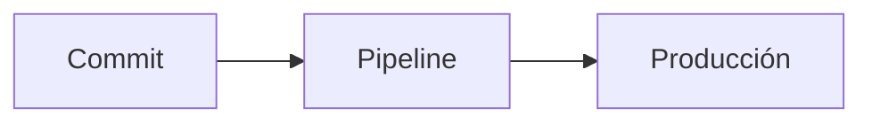

# Guía de Markdown desde cero

Oct 28, 2026 · @Jesús Guzmán

## Qué es Markdown

Markdown es una forma de dar formato a texto plano usando símbolos simples (`#`, `*`, `-`) en lugar de botones. Lo escribes en cualquier editor y una herramienta lo convierte en HTML con títulos, listas, tablas y enlaces.

Piénsalo como las "señas" que harías en un mensaje de WhatsApp para poner algo en *negritas*: el texto se sigue leyendo bien aunque no se procese, y cuando se procesa queda bonito. Lo creó John Gruber en 2004; hoy el estándar más usado es **CommonMark** y su extensión **GitHub Flavored Markdown (GFM)**.

Dónde lo vas a encontrar:

- **README.md** de repositorios en GitHub, GitLab y Azure DevOps
- Notas en **Obsidian**, **Notion**, **Joplin** o **Bear**
- Documentación técnica (MkDocs, Docusaurus, wikis)
- Mensajes en **Slack**, **Discord** y **Teams** (versión reducida)
- Prompts y respuestas de modelos de IA como Claude o ChatGPT
- Blogs estáticos con Hugo, Jekyll o Astro

## Paso 0: prepara tu entorno

Solo necesitas un editor de texto y una vista previa para ver el resultado mientras escribes.

1. Instala **Visual Studio Code** (gratis, Windows/macOS/Linux).
2. Crea una carpeta de práctica y dentro un archivo llamado `practica.md`. La extensión `.md` es lo que le dice al editor que es Markdown.
3. Abre la vista previa con `Ctrl + Shift + V` (macOS: `Cmd + Shift + V`), o en paralelo con `Ctrl + K` y luego `V`.
4. Opcional: instala la extensión **markdownlint** para que te marque errores de estilo.

Alternativas sin instalar nada: [StackEdit](https://stackedit.io), [Dillinger](https://dillinger.io) o crear un archivo `.md` directo en un repo de GitHub y usar la pestaña *Preview*.

Regla de oro: escribe en el panel izquierdo, mira el panel derecho. Cada paso de esta guía trae un bloque "Escribes" que puedes copiar a tu `practica.md`.

## Paso 1: párrafos, saltos de línea y encabezados

Un **párrafo** es texto separado por una línea en blanco. Si solo das Enter una vez, Markdown une ambas líneas en el mismo párrafo.

```markdown
Este es el primer párrafo.
Esta línea se pega al párrafo anterior.

Este ya es un segundo párrafo (hubo una línea en blanco).

Para forzar un salto de línea sin cambiar de párrafo,
termina la línea con dos espacios o con una barra invertida\
y listo.
```

Los **encabezados** se hacen con `#` al inicio de la línea: uno para el título principal, hasta seis para el nivel más pequeño. Siempre deja un espacio después del `#`.

```markdown
# Título principal (h1)
## Sección (h2)
### Subsección (h3)
#### Nivel 4
##### Nivel 5
###### Nivel 6
```

Analogía: los encabezados son el índice de un libro. Usa un solo `#` por documento y no te saltes niveles (de `##` a `####`), así el índice automático de GitHub y los lectores de pantalla lo entienden bien.

## Paso 2: énfasis — negritas, cursivas y tachado

El énfasis "envuelve" palabras entre símbolos, como poner algo entre comillas.

```markdown
*cursiva* o _cursiva_
**negrita** o __negrita__
***negrita y cursiva***
~~tachado~~ (GFM)
**Puedes _combinar_ estilos**
```

| Escribes | Resultado |
| --- | --- |
| `*cursiva*` | *cursiva* |
| `**negrita**` | **negrita** |
| `***ambas***` | ***ambas*** |
| `~~tachado~~` | ~~tachado~~ |

Recomendación: usa `*` para cursiva y `**` para negrita. El guion bajo `_` falla a mitad de palabra (`sin_formato_aqui` no se convierte), y mezclar estilos hace el archivo más difícil de leer.

## Paso 3: listas

Hay cuatro tipos y todas necesitan un espacio después del símbolo.

**Con viñetas** — usa `-`, `*` o `+` (elige uno y sé consistente):

```markdown
- Leche
- Huevos
- Café
```

**Numeradas** — el número real no importa; Markdown renumera solo. Por eso muchos escriben `1.` en todas las líneas y así reordenar no rompe nada:

```markdown
1. Clonar el repo
1. Instalar dependencias
1. Ejecutar las pruebas
```

**Anidadas** — sangra el elemento hijo para que quede debajo del texto del padre (2 espacios en viñetas, 3–4 en numeradas):

```markdown
1. Backend
   - API REST
   - Base de datos
2. Frontend
   - Componentes
       - Botones
```

**De tareas** (GFM) — en GitHub se convierten en casillas que puedes marcar:

```markdown
- [x] Crear el repositorio
- [ ] Escribir el README
- [ ] Configurar el pipeline
```

Si un párrafo o bloque de código va dentro de un elemento de lista, sangra con la misma cantidad de espacios que el texto del elemento; si no, la lista se "corta".

## Paso 4: enlaces e imágenes

Un enlace son dos piezas: el texto visible entre corchetes `[ ]` y la dirección entre paréntesis `( )`. Una imagen es igual, pero con `!` adelante: el "signo de admiración" le dice "muéstrame esto, no me mandes ahí".

```markdown
[Visita mi blog](https://maletadeviajes.com)
[Con tooltip](https://github.com "Texto al pasar el mouse")
<https://enlace-automatico.com>

[Ir a la sección de tablas](#paso-7-tablas-y-alineación)
[Ver el archivo de licencia](./LICENSE)


```

**Enlaces de referencia** — útiles cuando repites la misma URL o quieres que el texto se lea limpio:

```markdown
Consulta la [documentación oficial][docs] y la [guía de GitHub][gfm].

[docs]: https://commonmark.org
[gfm]: https://github.github.com/gfm/
```

**Imagen que es enlace** — mete la imagen dentro del texto de un enlace:

```markdown
[](https://ejemplo.com/pipeline)
```

Tips: el texto alternativo de la imagen (`Logo del proyecto`) es lo que leen los lectores de pantalla, no lo dejes vacío. Para los anclas internas, GitHub pasa el encabezado a minúsculas y cambia espacios por guiones. Markdown no controla el tamaño de las imágenes; si lo necesitas, usa HTML: ``.

## Paso 5: citas, separadores y escape de caracteres

**Citas** — empieza la línea con `>`, como cuando respondes un correo citando al otro. Se pueden anidar y llevar otros formatos dentro:

```markdown
> La mejor forma de predecir el futuro es inventarlo.
> — Alan Kay
>
>> Cita dentro de otra cita
>
> - También admite **listas** y `código`
```

**Líneas horizontales** — tres o más guiones, asteriscos o guiones bajos solos en una línea. Deja una línea en blanco arriba, porque `---` justo debajo de un texto lo convierte en encabezado:

```markdown
Texto de arriba

---

Texto de abajo
```

**Escapar caracteres** — si quieres mostrar un símbolo tal cual y no que se interprete como formato, ponle una barra invertida `\` antes:

```markdown
\*Esto no sale en cursiva\*
\# Esto no es un encabezado
1986\. Un año increíble (sin \ se volvería lista numerada)
```

Caracteres que puedes escapar: ` \  ` `` ` `` `*` `_` `{ }` `[ ]` `( )` `#` `+` `-` `.` `!` `|`

## Paso 6: código en línea y bloques de código

Esta es la función estrella para documentación técnica. Todo lo que va dentro de código se muestra literal, en fuente monoespaciada y sin interpretar formato.

**Código en línea** — envuelve con una comilla invertida (backtick) `` ` ``, la tecla junto al 1 o con `AltGr + }` en teclado latinoamericano:

```markdown
Ejecuta `terraform plan` antes de aplicar cambios.
Si el código contiene un backtick, usa dos: `` echo `date` ``
```

**Bloques de código** — tres backticks en una línea, el código, y tres backticks para cerrar. Después de los primeros tres indica el lenguaje para activar el resaltado de colores:

````markdown
```bash
az login
terraform init
```

```python
def saludar(nombre):
    return f"Hola, {nombre}"
```

```json
{ "nombre": "Brujería Tech", "activo": true }
```
````

Lenguajes comunes: `bash`, `powershell`, `python`, `javascript`, `typescript`, `json`, `yaml`, `hcl` (Terraform), `sql`, `html`, `css`, `dockerfile` y `diff`.

Truco con `diff` para mostrar cambios:

```diff
- replicas: 1
+ replicas: 3
```

Y si necesitas mostrar un bloque que a su vez contiene triple backtick (como el ejemplo de arriba), envuélvelo con cuatro backticks o con `~~~`.

## Paso 7: tablas y alineación

Las tablas (GFM) se dibujan con barras verticales `|` para separar columnas y una fila de guiones `---` debajo del encabezado. No necesitas alinear las barras: es solo estética para quien lee el archivo crudo.

```markdown
| Producto       | Categoría | Precio (MXN) |
| :------------- | :-------: | -----------: |
| Audífonos X    | Audio     | 1,299        |
| Teclado Pro    | Periférico| 2,450        |
```

Los dos puntos en la fila de guiones definen la alineación de cada columna:

| Sintaxis | Alineación |
| --- | --- |
| `:---` | Izquierda (default) |
| `:---:` | Centro |
| `---:` | Derecha (ideal para números) |

Dentro de una celda puedes usar **negritas**, `código` y enlaces. Para escribir una barra vertical literal usa `\|`, y para un salto de línea dentro de la celda, `<br>`.

Límites: no hay celdas combinadas ni listas dentro de celdas. Si tu tabla tiene más de 5–6 columnas o mucho texto, considera una lista o una tabla HTML.

## Paso 8: extras de GitHub Flavored Markdown

No todos los editores los soportan, pero en GitHub (y en buena parte de GitLab, Obsidian y Azure DevOps) funcionan. Son como los "accesorios" del idioma: no los necesitas para empezar, pero le suben el nivel a un README.

**Notas al pie**

```markdown
Markdown nació en 2004.[^1]

[^1]: Creado por John Gruber con ayuda de Aaron Swartz.
```

**Alertas** — cajas de color para resaltar avisos. Hay cinco: `NOTE`, `TIP`, `IMPORTANT`, `WARNING` y `CAUTION`:

```markdown
> [!NOTE]
> Este módulo requiere Terraform 1.6 o superior.

> [!WARNING]
> No subas el archivo .env al repositorio.
```

**Secciones plegables** — usan HTML, que Markdown acepta tal cual. Deja una línea en blanco después de `<summary>` para que el Markdown interno se procese:

```markdown
<details>
<summary>Ver logs completos</summary>

Aquí va el contenido **oculto** hasta que hagas clic.

</details>
```

**Diagramas Mermaid** — un bloque de código con lenguaje `mermaid` se dibuja como diagrama en GitHub, GitLab, Notion y Obsidian:

````markdown

````

Otros que vale la pena conocer: menciones `@usuario`, referencias a issues `#123`, emojis con `:rocket:` y fórmulas matemáticas con `$E = mc^2$`.

## Errores comunes y buenas prácticas

Casi todos los "no se ve bien" en Markdown se resuelven con un espacio o una línea en blanco.

| Error | Qué pasa | Solución |
| --- | --- | --- |
| `#Título` sin espacio | Se muestra el `#` literal | Escribe `# Título` |
| Lista pegada a un párrafo | No se reconoce como lista | Deja una línea en blanco antes |
| Sangría inconsistente en sublistas | El nivel se rompe o se vuelve código | Usa siempre 2 o 4 espacios, no tabs |
| Bloque de código sin cerrar | Todo lo de abajo queda como código | Revisa que haya tres backticks de cierre |
| `---` debajo de un texto | Se vuelve un encabezado h2 | Deja una línea en blanco arriba |
| Un solo Enter entre líneas | Se juntan en el mismo párrafo | Línea en blanco o dos espacios al final |
| Espacios en rutas de imágenes | La imagen no carga | Usa `%20` o renombra sin espacios |

Buenas prácticas:

- Un solo `#` por archivo y encabezados en orden.
- Una línea en blanco antes y después de encabezados, listas, tablas y bloques de código.
- Siempre indica el lenguaje en los bloques de código.
- Líneas de texto razonablemente cortas: facilitan revisar diferencias en Git.
- Texto alternativo descriptivo en todas las imágenes.
- Revisa la vista previa en la plataforma final: GitHub, Notion y Slack no interpretan exactamente igual.

## Ejercicio final y hoja de referencia

Copia este README en tu `practica.md`, ábrelo en vista previa y cambia los datos por los de un proyecto tuyo. Usa casi todo lo que viste en la guía.

````markdown
# Mi Proyecto

> Herramienta para calcular costos de infraestructura en la nube.


## Características

- Calcula costos por **servicio** y por *mes*
- Exporta a CSV
- [x] Soporte para Azure
- [ ] Soporte para AWS

## Instalación

1. Clona el repositorio:

   ```bash
   git clone https://github.com/usuario/mi-proyecto.git
   ```

1. Instala dependencias con `npm install`.

## Comparativa de planes

| Plan  | Usuarios | Precio |
| :---- | :------: | -----: |
| Free  | 1        | $0     |
| Pro   | 10       | $99    |

> [!TIP]
> Lee la [documentación completa](https://ejemplo.com/docs) antes de contribuir.

---

Hecho con ❤️ en México.
````

### Hoja de referencia rápida

| Quieres | Escribes |
| --- | --- |
| Encabezado | `# H1` · `## H2` · `### H3` |
| Negrita / cursiva / tachado | `**texto**` · `*texto*` · `~~texto~~` |
| Lista con viñetas | `- elemento` |
| Lista numerada | `1. elemento` |
| Tarea | `- [ ] pendiente` · `- [x] hecha` |
| Enlace | `[texto](https://url)` |
| Imagen | `` |
| Cita | `> texto` |
| Código en línea | `` `código` `` |
| Bloque de código | ```` ```lenguaje ```` … ```` ``` ```` |
| Tabla | `\| A \| B \|` + `\| --- \| --- \|` |
| Separador | `---` |
| Nota al pie | `texto[^1]` + `[^1]: nota` |
| Alerta | `> [!NOTE]` |
| Escapar símbolo | `\*` |

Siguiente paso para practicar: escribe en Markdown tus próximas notas o guiones y súbelas a un repo o a Obsidian; en una semana la sintaxis te sale sola. Referencias: [CommonMark](https://commonmark.org/help/) · [GitHub Docs: sintaxis básica](https://docs.github.com/es/get-started/writing-on-github/getting-started-with-writing-and-formatting-on-github/basic-writing-and-formatting-syntax).
