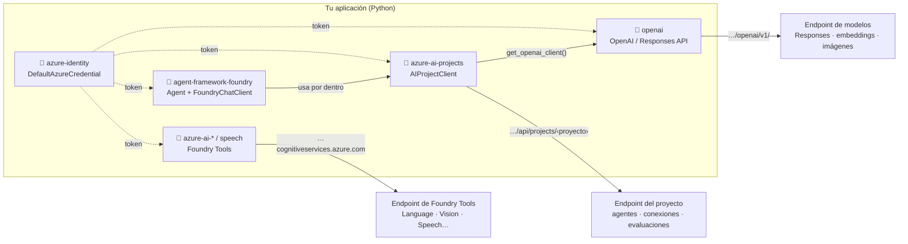
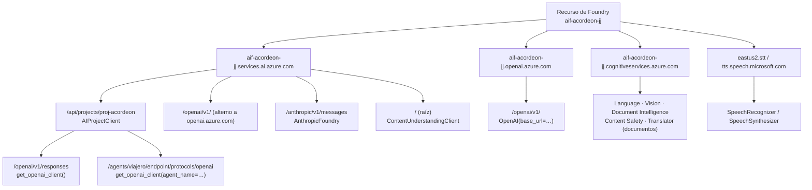
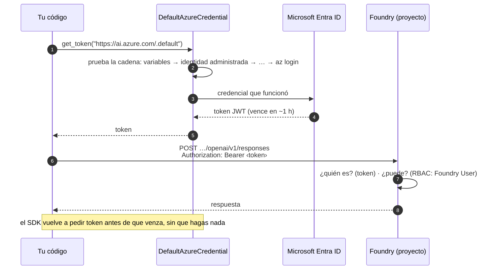
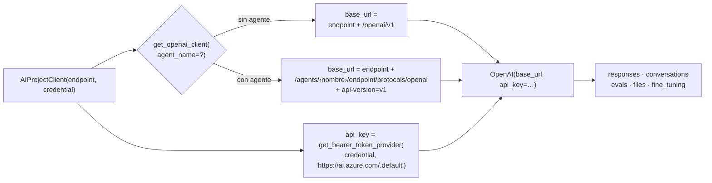
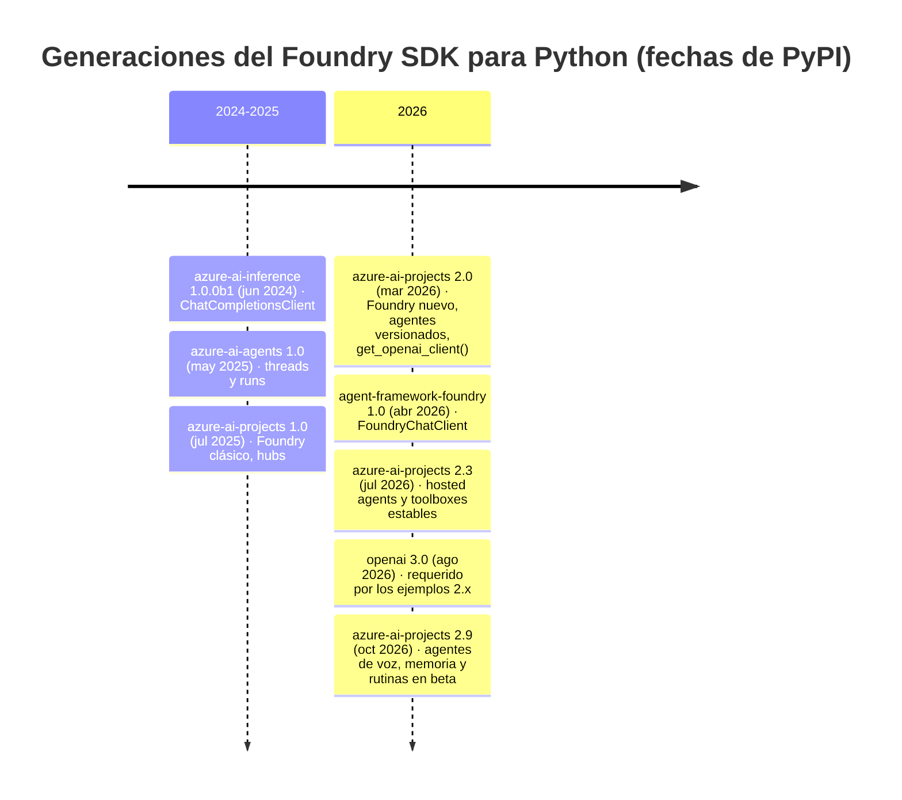
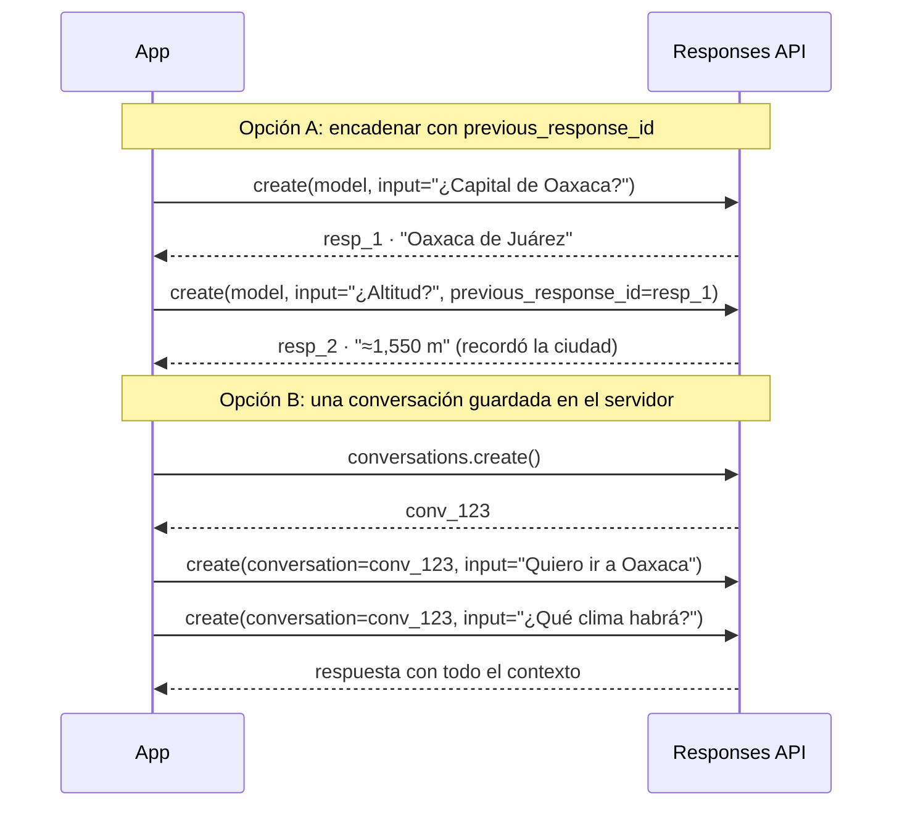
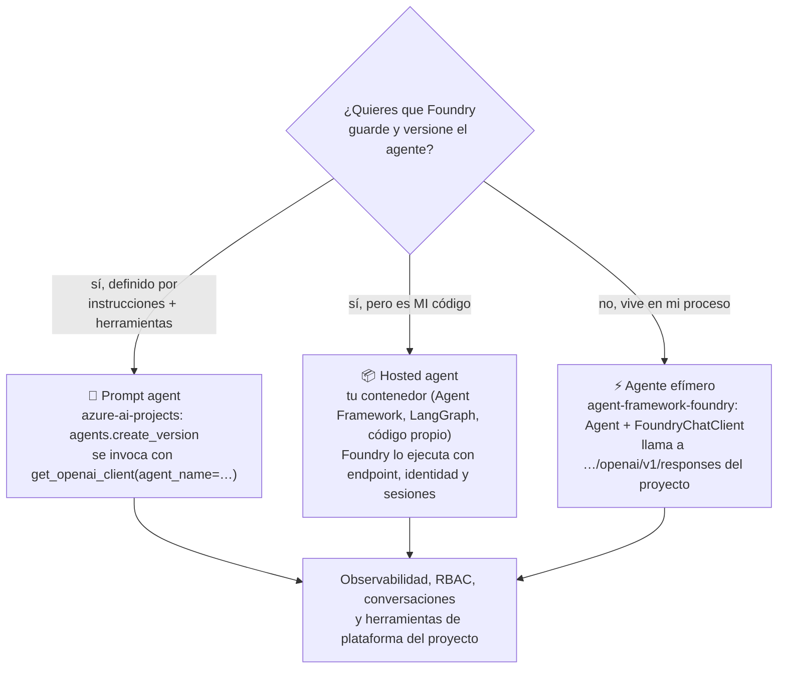

# Tema 3: Diferencias y usos entre los SDKs de Microsoft Foundry (AIProjects, OpenAI, AzureOpenAI…)

### Descripción
Una de las confusiones más comunes al empezar con Foundry es: **¿qué librería instalo?** Hay un SDK para el proyecto, otro para los modelos, otros para voz, lenguaje y extracción, y además versiones viejas que siguen apareciendo en tutoriales. Este tema es tu mapa.

Analogía: el **SDK de proyectos** (`azure-ai-projects`) es la **recepción del edificio**: te identifica, te da acceso a todas las oficinas (agentes, conexiones, índices) y te entrega un pase para hablar con los modelos. El **SDK de OpenAI** es ese **pase**: con él hablas directamente con los modelos. Los SDKs de Speech, Language o Content Understanding son **oficinas especializadas** con su propia ventanilla. Y `azure-identity` es la **credencial con foto** que todas las ventanillas te piden antes de atenderte.



*Las piezas y a dónde apunta cada una. Observa dos cosas: todo recibe tokens de `azure-identity`, y el SDK de proyectos **fabrica** clientes de OpenAI en lugar de sustituirlos.*

Al terminar sabrás qué paquete usar para cada necesidad, qué endpoint y qué permiso necesita cada uno, cómo autenticarte sin llaves, qué cambió entre las versiones 1.x y 2.x, y habrás probado los SDKs principales en Python.

---

## 1. El mapa de SDKs en Python

### 1.1 Las capas
Microsoft describe el **Foundry SDK** como un SDK *ligero* (*thin client*) que expone todas las APIs del proyecto a través de **un solo endpoint**. Las demás librerías se apoyan en él o viven a su lado:

| Capa | Paquete (versión estable al cierre de este tema) | Clase o función principal | Para qué | Estado |
|---|---|---|---|---|
| Identidad | `azure-identity` 1.27 | `DefaultAzureCredential`, `get_bearer_token_provider` | Tokens de Microsoft Entra ID sin llaves | ✅ Siempre |
| **Foundry SDK** | `azure-ai-projects` 2.9 | `AIProjectClient` | Agentes, conexiones, deployments, datasets, índices, evaluaciones, telemetría; **fabrica** un cliente de OpenAI con `get_openai_client()` | ✅ Recomendado (Foundry nuevo) |
| Modelos | `openai` 3.39 | `OpenAI` | Hablar con modelos: **Responses API**, Chat Completions, embeddings, imágenes, conversaciones, *evals* | ✅ Recomendado (API v1) |
| Modelos (estilo anterior) | `openai` | `AzureOpenAI` | Igual, pero con `api_version` y `azure_endpoint` | ⚠️ Legado: con la API v1 usa `OpenAI` |
| Modelos de Anthropic | `anthropic` 2.3 | `AnthropicFoundry` | Modelos Claude desplegados en Foundry (Messages API) | ✅ |
| Orquestación | `agent-framework-foundry` 1.15 (instala `agent-framework-core` 1.23) | `Agent`, `FoundryChatClient` | **Microsoft Agent Framework**: agentes en código, herramientas, flujos multiagente; base de los *hosted agents* | ✅ Recomendado |
| Evaluación local | `azure-ai-evaluation` 1.18 | Evaluadores | Groundedness, relevancia, seguridad… en tu máquina | ✅ |
| Foundry Tools | `azure-ai-textanalytics` 5.4 | `TextAnalyticsClient` | **Azure Language**: idioma, PII, NER, salud | ✅ (ver retiros en [6.2](#62-language-lo-que-se-queda-y-lo-que-se-retira)) |
| Foundry Tools | `azure-cognitiveservices-speech` 1.53 | `SpeechRecognizer`, `SpeechSynthesizer`, `TranslationRecognizer` | **Azure Speech**: STT, TTS, traducción de voz | ✅ |
| Foundry Tools | `azure-ai-voicelive` 1.3 | `connect()` | **Voice Live**: voz a voz en tiempo real por WebSocket (solo asíncrono) | ✅ |
| Foundry Tools | `azure-ai-contentunderstanding` 1.1 | `ContentUnderstandingClient` | Documentos, imágenes, audio y video con esquemas | ✅ |
| Foundry Tools | `azure-ai-translation-text` 2.0, `azure-ai-vision-imageanalysis` 1.0, `azure-ai-documentintelligence` 1.0, `azure-ai-contentsafety` 1.0 | `TextTranslationClient`, `ImageAnalysisClient`, `DocumentIntelligenceClient`, `ContentSafetyClient` | Traducción, análisis de imágenes, documentos, moderación | ✅ |
| Versión anterior | `azure-ai-agents` 1.1 | `AgentsClient` | Agentes "clásicos" (threads/runs) de `azure-ai-projects` **1.x** | ⚠️ Foundry clásico |
| Versión anterior | `azure-ai-inference` 1.0.0b9 | `ChatCompletionsClient` | Cliente genérico para modelos no-OpenAI | ⚠️ Legado: usa `openai` con la API v1 |

Las versiones son las publicadas en PyPI al escribir esto; revísalas con `pip index versions <paquete>`.

### 1.2 Dos clientes, dos trabajos
Microsoft resume así cuándo usar cada cliente que sale del Foundry SDK:
- **Cliente de proyecto** (`AIProjectClient`): operaciones **propias de Foundry** que no existen en OpenAI. Listar conexiones, leer propiedades del proyecto, habilitar trazas, crear o versionar agentes, subir datasets.
- **Cliente compatible con OpenAI** (el que devuelve `get_openai_client()`): todo lo que **se construye sobre conceptos de OpenAI**. Responses API, conversaciones, *evals*, *fine-tuning*… y también **hablar con tus agentes**, porque Foundry los expone con una extensión de la Responses API.

### 1.3 Un recurso, muchos endpoints
Los paquetes se distinguen sobre todo por **a dónde llaman**. Todas estas URLs salen de un mismo recurso de Foundry (`aif-acordeon-jj`, el del [Tema 1](tema1.md)) y de su proyecto:



*Cuatro hosts, un recurso. El proyecto cuelga de `services.ai.azure.com`; los modelos "pelones" de `openai.azure.com`; los Foundry Tools clásicos de `cognitiveservices.azure.com`; Speech usa hosts por región.*

| Endpoint | Formato | Lo usa | Token (scope) |
|---|---|---|---|
| Proyecto | `https://<recurso>.services.ai.azure.com/api/projects/<proyecto>` | `AIProjectClient`, `FoundryChatClient` | `https://ai.azure.com/.default` |
| Responses del proyecto | `…/api/projects/<proyecto>/openai/v1/responses` | `get_openai_client()`, REST | `https://ai.azure.com/.default` |
| Agente publicado | `…/api/projects/<proyecto>/agents/<agente>/endpoint/protocols/openai/…?api-version=v1` | `get_openai_client(agent_name=…)`, REST | `https://ai.azure.com/.default` |
| Modelos (OpenAI v1) | `https://<recurso>.openai.azure.com/openai/v1/` (o `https://<recurso>.services.ai.azure.com/openai/v1/`) | `OpenAI(base_url=…)` | `https://ai.azure.com/.default` |
| Anthropic | `https://<recurso>.services.ai.azure.com/anthropic` (Messages en `/anthropic/v1/messages`) | `AnthropicFoundry` | `https://ai.azure.com/.default` |
| Foundry Tools | `https://<recurso>.cognitiveservices.azure.com/` | Language, Vision, Document Intelligence, Content Safety, traducción de documentos | `https://cognitiveservices.azure.com/.default` |
| Content Understanding | `https://<recurso>.services.ai.azure.com/` | `ContentUnderstandingClient` | `https://cognitiveservices.azure.com/.default` |
| Speech | `https://<region>.stt.speech.microsoft.com`, `https://<region>.tts.speech.microsoft.com` | SDK de Speech | `https://cognitiveservices.azure.com/.default` |
| Translator (texto) | `https://api.cognitive.microsofttranslator.com/` | `TextTranslationClient` | `https://cognitiveservices.azure.com/.default` |

Dos detalles que ahorran horas de depuración:
- **El endpoint del proyecto no enruta embeddings.** Para `embeddings.create` usa el endpoint `/openai/v1` del recurso, como recomienda Microsoft. En la [práctica 9.1](#91-un-recurso-visto-desde-todos-sus-endpoints-endpointspy) lo verás en la tabla.
- **El endpoint `/openai/v1` no tiene agentes, evaluaciones ni herramientas de plataforma** (búsqueda de archivos, MCP, SharePoint…). Para eso necesitas la Responses API **del proyecto**.
- Si tu organización configuró un **subdominio personalizado**, sustituye `<recurso>` por ese subdominio en todas las URLs.

---

## 2. Autenticación: `azure-identity` a fondo

### 2.1 Llave vs. Microsoft Entra ID

| | API key | Microsoft Entra ID (`DefaultAzureCredential`) |
|---|---|---|
| Configuración | Copiar llave del portal | `az login` en local; identidad administrada en Azure |
| Seguridad | Si se filtra, cualquiera la usa; da **acceso total** al recurso | Basado en roles (RBAC), sin secretos en el código |
| ¿Quién llamó? | No se sabe: todos usan la misma llave | Cada llamada lleva la identidad del usuario o de la app |
| Permisos granulares | No | Sí (**Foundry User** en el proyecto, **Cognitive Services OpenAI User** en el endpoint `/openai/v1`, etc.) |
| Recomendado para | Aprender, prototipos, entornos aislados | Producción |

Con la API v1, el cliente `OpenAI()` ya sabe **renovar tokens solo**: en lugar de una llave le pasas una función que devuelve el token. Esa función la fabrica `get_bearer_token_provider`:

```python
from azure.identity import DefaultAzureCredential, get_bearer_token_provider
from openai import OpenAI

token_provider = get_bearer_token_provider(DefaultAzureCredential(), "https://ai.azure.com/.default")
client = OpenAI(base_url="https://<recurso>.openai.azure.com/openai/v1/", api_key=token_provider)
```

El **scope** dice *para qué servicio* es el token. Foundry y los modelos usan `https://ai.azure.com/.default`; los Foundry Tools usan `https://cognitiveservices.azure.com/.default`; ARM (crear recursos) usa `https://management.azure.com/.default`. Un token de un scope **no sirve** para otro: por eso `DefaultAzureCredential` pide uno distinto cada vez que un SDK lo necesita.



*Un token = una identidad + un scope + una caducidad. El SDK guarda el token en caché y lo renueva; RBAC decide si esa identidad puede hacer esa acción en ese ámbito (Tema 1).*

### 2.2 La cadena de `DefaultAzureCredential`
`DefaultAzureCredential` no es *una* forma de autenticarse: es una **cadena** que prueba varias en orden y se queda con la primera que funciona.


*El orden oficial. En verde, credenciales de **servicio desplegado**; en naranja, **herramientas de desarrollo**; el navegador interactivo está **apagado por defecto**. Fuente: [Microsoft Learn – Credential chains in the Azure Identity library for Python](https://learn.microsoft.com/en-us/azure/developer/python/sdk/authentication/credential-chains).*

| # | Credencial | Qué busca | Tipo |
|---|---|---|---|
| 1 | `EnvironmentCredential` | Variables `AZURE_CLIENT_ID`, `AZURE_TENANT_ID`, `AZURE_CLIENT_SECRET` (entidad de servicio) | Desplegado |
| 2 | `WorkloadIdentityCredential` | Workload Identity en AKS u otros hosts | Desplegado |
| 3 | `ManagedIdentityCredential` | La **identidad administrada** del App Service, Container App, VM… | Desplegado |
| 4 | `SharedTokenCacheCredential` | Cuenta de Visual Studio (solo Windows) | Desarrollo |
| 5 | `VisualStudioCodeCredential` | Cuenta de VS Code (requiere `azure-identity-broker`) | Desarrollo |
| 6 | `AzureCliCredential` | Tu sesión de **`az login`** | Desarrollo |
| 7 | `AzurePowerShellCredential` | `Connect-AzAccount` | Desarrollo |
| 8 | `AzureDeveloperCliCredential` | `azd auth login` | Desarrollo |
| 9 | `InteractiveBrowserCredential` | Abre el navegador (**excluida por defecto**) | Desarrollo |
| 10 | `BrokerCredential` | La cuenta del sistema operativo vía *broker* (requiere `azure-identity-broker`) | Desarrollo |

Reglas que explican los errores raros:
- **Política de continuación** (desde 1.14): si una credencial de *desarrollo* falla, la cadena sigue con la siguiente; si una credencial *desplegada* puede intentar y no consigue token, **detiene la cadena con error**. Así el comportamiento en producción es predecible.
- **En tu PC** casi siempre termina en `AzureCliCredential`: por eso todos los tutoriales empiezan con `az login`. En **Azure** se detiene en `ManagedIdentityCredential`, **sin cambiar una línea de código**.
- **Tenants:** si tu `az login` tiene varios tenants, puede salir `DefaultAzureCredential failed to retrieve a token`. Prueba `az login --tenant <id>` o pasa `interactive_browser_tenant_id`.


*La recomendación de Microsoft según dónde corre la app: en desarrollo, tu usuario o una entidad de servicio; en Azure, **identidad administrada**; en un servidor propio, entidad de servicio o identidad administrada con Azure Arc. Fuente: [Microsoft Learn – Authenticate Python apps to Azure services](https://learn.microsoft.com/en-us/azure/developer/python/sdk/authentication/overview).*

### 2.3 Afinar la cadena
- **Excluir credenciales:** `DefaultAzureCredential(exclude_environment_credential=True, exclude_workload_identity_credential=True)`.
- **Identidad administrada asignada por el usuario:** `DefaultAzureCredential(managed_identity_client_id="<client-id>")`, con la identidad `id-acordeon-app` del Tema 1.
- **Por variable de entorno** (sin tocar código): `AZURE_TOKEN_CREDENTIALS=prod` deja solo las credenciales desplegadas y `=dev` solo las de desarrollo (azure-identity ≥ 1.23); también acepta el nombre de una credencial, como `AzureCliCredential` (≥ 1.24). Con `DefaultAzureCredential(require_envvar=True)` obligas a que la variable exista.
- **En producción**, Microsoft recomienda sustituir `DefaultAzureCredential` por la credencial exacta (por ejemplo `ManagedIdentityCredential`): es más rápido (no prueba nada de más), más fácil de depurar y no depende de variables de la máquina. La alternativa intermedia es armar tu propia cadena:
  ```python
  from azure.identity import AzureCliCredential, AzureDeveloperCliCredential, ChainedTokenCredential
  credential = ChainedTokenCredential(AzureCliCredential(), AzureDeveloperCliCredential())
  ```
- **Depurar:** activa el logger `azure.identity` en `DEBUG` para ver qué credencial probó y por qué falló (ojo: el log incluye IDs de tenant y de objeto).

---

## 3. `azure-ai-projects`: el Foundry SDK a fondo

### 3.1 Qué hay dentro de `AIProjectClient`
```python
from azure.ai.projects import AIProjectClient
from azure.identity import DefaultAzureCredential

project_client = AIProjectClient(
    endpoint="https://<recurso>.services.ai.azure.com/api/projects/<proyecto>",
    credential=DefaultAzureCredential(),
)
```

| Atributo | Qué administra | Ejemplo |
|---|---|---|
| `.agents` | Agentes **versionados**: crear, listar, obtener, borrar, publicar, sesiones de *hosted agents* | `agents.create_version(agent_name=…, definition=PromptAgentDefinition(...))` |
| `.get_openai_client()` | Fabrica el cliente de OpenAI autenticado (Responses, Conversations, Evals, Files, Fine-tuning) | `openai_client = project_client.get_openai_client()` |
| `.deployments` | Modelos desplegados en el recurso | `deployments.list(model_publisher="OpenAI")` |
| `.connections` | Recursos conectados al proyecto (AI Search, Storage, Application Insights…) | `connections.get(nombre, include_credentials=True)` |
| `.datasets` | Subir archivos y versionar datasets | `datasets.upload_file(name=…, version=…, file_path=…)` |
| `.indexes` | Índices de búsqueda registrados en el proyecto | `indexes.list()` |
| `.evaluators`, `.evaluation_rules` | Evaluadores y reglas de evaluación continua | Tema 2 del módulo 7 |
| `.telemetry` | Cadena de conexión de Application Insights para trazas | `telemetry.get_application_insights_connection_string()` |
| `.toolboxes` | Cajas de herramientas (MCP) versionadas para agentes | `toolboxes.list()` |
| `.beta.*` | Lo que aún está en vista previa: `memory_stores`, `red_teams`, `voice_agents`, `routines`, `skills`, `models`, `insights`, `schedules` | `project_client.beta.red_teams` |

Todo esto habla con **un solo endpoint** y **una sola versión de API**: `v1`. Cada llamada va a `…/api/projects/<proyecto>/<recurso>?api-version=v1`, como verás en el *log* de la [práctica 9.4](#94-inventario-del-proyecto-inventario_proyectopy).

### 3.2 Qué hace `get_openai_client()` por dentro
No es magia: construye un `OpenAI()` normal con dos cosas calculadas por ti.



*Dos variantes del mismo cliente. Sin `agent_name` hablas con los modelos del proyecto y debes pasar `model=`; con `agent_name` hablas con **ese agente** y el modelo ya viene en su definición.*

Consecuencias:
- Puedes **sobrescribir** `base_url` o `api_key` pasándolos como argumentos a `get_openai_client(...)`, y cualquier otro argumento llega al constructor de `OpenAI`.
- El cliente que te devuelve es del paquete `openai`: todo lo que aprendas de ese SDK aplica aquí.
- El cliente atado a un agente es lo que usa el *quickstart* oficial para conversar con él; el estilo con `extra_body={"agent_reference": …}` que viste en el [Tema 4](tema4.md) sigue funcionando y sirve cuando quieres un solo cliente para varios agentes.

### 3.3 Versiones: 1.x vs. 2.x


| | `azure-ai-projects` 1.x | `azure-ai-projects` 2.x |
|---|---|---|
| Portal | Foundry **clásico** (hubs) | Foundry **nuevo** |
| Agentes | `azure-ai-agents`: *threads*, *runs*, *messages* | `agents.create_version` + Responses API (conversaciones) |
| Modelos | `azure-ai-inference` o `AzureOpenAI` | `openai` 3.x con la API v1 |
| Requisitos | — | Python 3.10+, `openai>=3.0.0` |
| Instalación | `pip install azure-ai-projects==1.0.0` | `pip install "azure-ai-projects>=2.3.0" "openai>=3.0.0"` |

**Cómo saber qué versión usa un tutorial:** si ves `AgentsClient`, `create_thread`, `create_run` o `ChatCompletionsClient`, es 1.x. Si ves `PromptAgentDefinition`, `create_version`, `get_openai_client` o `responses.create`, es 2.x. El código de 2.x **no es compatible** con 1.x, y `AttributeError`/`ModuleNotFoundError` suelen significar que instalaste la versión equivocada: revisa con `pip show azure-ai-projects`.

---

## 4. El SDK de OpenAI en Azure

### 4.1 La API v1: adiós a `api-version`
Durante años, Azure OpenAI recibía **versiones de API mensuales** (`2024-10-21`, `2025-04-01-preview`…) y necesitaba una clase especial, `AzureOpenAI`. La **API v1** (GA) elimina eso:

| | Antes (`AzureOpenAI`) | Ahora (API v1 con `OpenAI`) |
|---|---|---|
| Clase | `AzureOpenAI(azure_endpoint=…, api_version=…, api_key=…)` | `OpenAI(base_url=…, api_key=…)` |
| URL | `https://<recurso>.openai.azure.com` + `?api-version=…` en cada llamada | `https://<recurso>.openai.azure.com/openai/v1/`, sin `api-version` |
| Entra ID | `azure_ad_token_provider=…` | `api_key=token_provider` (el cliente renueva solo) |
| Mover código entre OpenAI y Azure | Cambiar de clase y parámetros | **Cambiar solo `base_url`** |
| Funciones en vista previa | Otra `api-version` | Encabezados de *feature preview* o rutas como `/openai/v1/fine_tuning/alpha/…` |

- Si ya tienes variables `OPENAI_BASE_URL` y `OPENAI_API_KEY`, basta `client = OpenAI()`.
- La API v1 también sirve para **modelos de otros proveedores** que entienden Chat Completions (DeepSeek, Grok…), con el mismo cliente.
- Lo que sigue apareciendo con `api_version="preview"` o `AzureOpenAI` en tutoriales viejos **funciona**, pero Microsoft ya no lo recomienda para código nuevo.

### 4.2 Responses API vs. Chat Completions

| | Chat Completions (`chat.completions.create`) | Responses API (`responses.create`) |
|---|---|---|
| Entrada | `messages=[...]` | `input=` (texto o lista de mensajes) + `instructions=` |
| Salida | `choices[0].message.content` | `output_text` (atajo) y `output` (lista de elementos) |
| Estado | Tú reenvías todo el historial | `previous_response_id` o `conversation` (historial en el servidor) |
| Herramientas | *Function calling* | *Function calling* + herramientas integradas (búsqueda web, archivos, MCP, imágenes…) |
| Agentes de Foundry | No | **Sí**: los agentes se invocan con ella |
| En Foundry | Compatible | **La que usa Microsoft Learn y el examen** |



*Dos formas de tener memoria sin reenviar el historial. `previous_response_id` encadena respuesta con respuesta; `conversation` guarda un hilo completo que puedes retomar días después y borrar cuando termine.*

### 4.3 Modelos de Anthropic
Los modelos Claude desplegados en Foundry **no** usan el endpoint compatible con OpenAI: tienen su propia ruta `/anthropic` y la **Messages API** del SDK `anthropic`, con el mismo *token provider* de Entra ID:
```python
from anthropic import AnthropicFoundry
from azure.identity import DefaultAzureCredential, get_bearer_token_provider

token_provider = get_bearer_token_provider(DefaultAzureCredential(), "https://ai.azure.com/.default")
client = AnthropicFoundry(azure_ad_token_provider=token_provider,
                          base_url="https://<recurso>.services.ai.azure.com/anthropic")
mensaje = client.messages.create(model="<deployment-de-claude>", max_tokens=1024,
                                 messages=[{"role": "user", "content": "Tres lugares para visitar en Oaxaca"}])
print(mensaje.content[0].text)
```

---

## 5. Agentes: tres formas de construirlos

### 5.1 El panorama


*Las tres opciones comparten el proyecto: mismos modelos, mismas herramientas de plataforma, mismo RBAC y mismas trazas. Cambia dónde vive la definición del agente y quién lo ejecuta.*

| | Prompt agent | Agente efímero | Hosted agent |
|---|---|---|---|
| Dónde vive la definición | En Foundry (recurso versionado) | En tu código | En tu imagen de contenedor, registrada en Foundry |
| Quién lo ejecuta | Foundry Agent Service | Tu proceso | Foundry, en *sandboxes* aislados por sesión |
| SDK | `azure-ai-projects` | `agent-framework-foundry` (u `openai` directo) | Agent Framework, LangGraph, OpenAI Agents SDK, código propio (Python o C#) |
| Ideal para | Empezar rápido, herramientas internas, producción sin orquestación propia | Prototipos, lógica muy a la medida, probar en local | Agentes con código propio que necesitan un endpoint administrado |
| Puedes probarlo en el portal | Sí (Playground) | No | Sí (vista previa con el protocolo Responses) |

### 5.2 Prompt agents con `azure-ai-projects`
Es el camino del [Tema 4](tema4.md): `agents.create_version` crea el agente o una **nueva versión** (nunca pierdes las anteriores) y después conversas con él a través de la Responses API. La forma más corta es el cliente atado al agente:
```python
openai_client = project_client.get_openai_client(agent_name="viajero")
conversacion = openai_client.conversations.create()
respuesta = openai_client.responses.create(conversation=conversacion.id, input="Quiero ir a Oaxaca")
```
Fíjate en que **no pasas `model=`**: el modelo está en la definición del agente. En REST es exactamente `POST …/agents/viajero/endpoint/protocols/openai/responses?api-version=v1`.

### 5.3 Agentes efímeros con Microsoft Agent Framework
**Microsoft Agent Framework** es el SDK de orquestación de Microsoft para .NET, Python y Go (este último en vista previa). Es el **sucesor directo de AutoGen y Semantic Kernel**, creado por los mismos equipos: toma las abstracciones simples de AutoGen y las capacidades empresariales de Semantic Kernel (estado por sesión, tipado, *middleware*, telemetría) y agrega **flujos de trabajo** (*workflows*) en grafo para orquestar varios agentes.

```python
# pip install agent-framework-foundry aiohttp
from agent_framework import Agent, tool
from agent_framework.foundry import FoundryChatClient

agente = Agent(
    client=FoundryChatClient(project_endpoint=..., model=..., credential=DefaultAzureCredential()),
    instructions="Eres un asistente de viajes.",
    tools=[mi_funcion_local, FoundryChatClient.get_web_search_tool()],
)
resultado = await agente.run("¿Qué clima hay en Oaxaca?")
```

- `FoundryChatClient` **usa el Foundry SDK por dentro**: crea un `AIProjectClient` con tu endpoint y llama a `get_openai_client()`. Por eso apunta a `{endpoint-del-proyecto}/openai/v1/responses` y obtiene lo que el endpoint `/openai/v1` del recurso no tiene: modelos del catálogo, herramientas de plataforma (`get_web_search_tool`, `get_file_search_tool`, `get_mcp_tool`, `get_code_interpreter_tool`, `get_sharepoint_tool`…), trazas, filtros de contenido e identidad del proyecto.
- Las funciones locales se declaran con `@tool`; el *framework* se encarga del ciclo "el modelo pide la herramienta → tu código la ejecuta → el modelo responde".
- Es **asíncrono** (`async`/`await`) y admite *streaming* con `agent.run(..., stream=True)`.
- Microsoft lo recomienda como capa única de orquestación; si vienes de AutoGen o Semantic Kernel, evalúa migrar en vez de mezclar frameworks. Su regla de oro: *si puedes resolverlo con una función, no uses un agente*.

### 5.4 Hosted agents
El mismo código de Agent Framework puede empaquetarse como **imagen de contenedor** (o zip del código) y Foundry lo ejecuta con un endpoint administrado, escalado automático en micro VMs aisladas, una identidad de Entra ID propia, estado por sesión y observabilidad de extremo a extremo:


*Tú pones el contenedor (Python o C#); Foundry pone el endpoint, la identidad, las versiones, las conversaciones y el *sandbox* por sesión que entra en reposo tras 15 minutos y se reanuda conservando `$HOME` y `/files`. Fuente: [Microsoft Learn – Hosted agents](https://learn.microsoft.com/en-us/azure/foundry/agents/concepts/hosted-agents).*


*Un hosted agent puede exponer varios protocolos. Si dudas, empieza con **Responses**: es el mismo contrato que usan los prompt agents y los SDKs de OpenAI. Fuente: [Microsoft Learn – Hosted agents](https://learn.microsoft.com/en-us/azure/foundry/agents/concepts/hosted-agents).*

Para el examen y para este acordeón basta con saber que existen y cuándo elegirlos; el detalle de contenedores queda fuera de alcance.

---

## 6. Los SDKs de Foundry Tools

### 6.1 Qué son y a dónde llaman
**Foundry Tools** (antes *Azure AI Services* / *Cognitive Services*) son soluciones **precompiladas** con SDK propio: no necesitas prompt ni modelo, mandas datos y recibes resultados **deterministas** con puntajes de confianza. Casi todos comparten el endpoint `https://<recurso>.cognitiveservices.azure.com/` del mismo recurso de Foundry; Speech y Translator tienen endpoints propios ([1.3](#13-un-recurso-muchos-endpoints)).

| Herramienta | Paquete | Qué hace | Cuándo preferirla a un modelo generativo |
|---|---|---|---|
|  Speech | `azure-cognitiveservices-speech` | STT en tiempo real, rápido o por lotes; TTS con voces neuronales y SSML; traducción de voz | Siempre que entre o salga audio |
|  Language | `azure-ai-textanalytics` | Idioma, PII, NER, Text Analytics for Health | Resultados reproducibles y auditables (por ejemplo, borrar PII **antes** de mandar texto a un modelo) |
|  Translator | `azure-ai-translation-text`, `azure-ai-translation-document` | Más de 100 idiomas, texto y documentos completos | Traducir a escala conservando formato |
|  Vision | `azure-ai-vision-imageanalysis` | Etiquetas, descripciones, OCR (Read) | OCR masivo y barato |
|  Document Intelligence | `azure-ai-documentintelligence` | Facturas, recibos, identificaciones, formularios | Campos con posición en la página y confianza |
|  Content Safety | `azure-ai-contentsafety` | Odio, violencia, sexual, autolesión; *prompt shields* | Moderar entradas y salidas de tus agentes |
|  Azure AI Search | `azure-search-documents` | Índices, vectores, recuperación agéntica | RAG ([módulo 7](../../parte1/modulo7/tema1.md)) |
| Content Understanding | `azure-ai-contentunderstanding` | Documentos, imágenes, audio y video → JSON con tu esquema | Extracción multimodal con IA generativa, sin armar el prompt |

### 6.2 Language: lo que se queda y lo que se retira
Microsoft está moviendo las capacidades de lenguaje hacia los modelos de Foundry, y lo anunció con fechas:
- **20 de marzo de 2027:** se retira **Language Studio**; todo pasa al portal de Foundry.
- **31 de marzo de 2029:** terminan estas capacidades de Azure Language: extracción de frases clave, análisis de sentimiento y opiniones, clasificación de texto personalizada, CLU, respuesta a preguntas personalizada (CQA), flujo de orquestación, resumen (de documentos y conversaciones) y vinculación de entidades.
- **Siguen con soporte:** detección de idioma, detección de PII, Text Analytics for Health, NER precompilado y NER personalizado.

Regla práctica: para **sentimiento, frases clave o resumen** en proyectos nuevos, usa un modelo de Foundry (Responses API); para **idioma, PII y entidades** sigue valiendo `azure-ai-textanalytics`, que es justo lo que usa la [práctica 9.6](#96-idioma-y-pii-con-azure-language-idioma_piipy).

### 6.3 Speech


*Las tres capacidades base de Azure Speech. Fuente: [Microsoft Learn – What is Azure Speech?](https://learn.microsoft.com/en-us/azure/ai-services/speech-service/overview).*

- El **SDK de Speech** es una biblioteca **nativa** (no Python puro) disponible para C#, C++, Go, Java, JavaScript, Objective-C/Swift y Python (Windows, Linux y macOS). Maneja micrófono, bocinas, archivos y *streams*, en tiempo real o no.
- Para **transcripción por lotes** o administrar modelos personalizados se usa la **API REST**; la **Speech CLI** permite usar casi todo sin escribir código.
- Se configura con `SpeechConfig(subscription=…, region=…)` o con `endpoint=`; las llamadas van a `wss://<region>.tts.speech.microsoft.com` (síntesis) o `…stt…` (reconocimiento), por eso la región importa.
- **Voice Live** (`azure-ai-voicelive`) es distinto: una conversación voz a voz en tiempo real con un agente, por WebSocket y solo asíncrona.


*Dónde corre Speech (nube pública, nube soberana o contenedor en tus instalaciones) y por dónde se usa (REST o SDK). Fuente: [Microsoft Learn – What is Azure Speech?](https://learn.microsoft.com/en-us/azure/ai-services/speech-service/overview).*

### 6.4 Content Understanding


*Un **analizador** recibe contenido de cualquier modalidad y devuelve JSON con los campos que tú definiste en un esquema. Fuente: [Microsoft Learn – What is Azure Content Understanding?](https://learn.microsoft.com/en-us/azure/ai-services/content-understanding/overview).*

- Usa IA generativa por dentro, pero tú **no escribes el prompt**: defines campos (`total`, `fecha`, `temas`…) y el servicio extrae, resume y clasifica documentos, imágenes, audio y video.
- Su endpoint es la **raíz** `https://<recurso>.services.ai.azure.com/`, el mismo host del proyecto, y el token usa el scope de `cognitiveservices`.
- El cliente `ContentUnderstandingClient` ofrece operaciones de larga duración: `begin_analyze`, `begin_create_analyzer`, `get_result_file`…

---

## 7. Observabilidad y depuración

### 7.1 Trazas con Application Insights
- **Del lado del servidor** (recomendado para empezar): conecta un recurso de Application Insights al proyecto y Foundry registra solo las trazas de prompt agents, hosted agents y workflows. Sin cambiar código; disponibles por 90 días en **Agents › Traces**.


*Agents › Traces › **Connect**: basta un clic para que las conversaciones de tus agentes empiecen a registrarse. Fuente: [Microsoft Learn – Set up tracing for AI agents](https://learn.microsoft.com/en-us/azure/foundry/observability/how-to/trace-agent-setup).*

- **Del lado del cliente**: para ver también tu propio código, instala `pip install azure-ai-projects azure-identity opentelemetry-sdk azure-core-tracing-opentelemetry` y exporta a Azure Monitor con la cadena de conexión que te da `project_client.telemetry.get_application_insights_connection_string()`. Las trazas siguen las convenciones **OpenTelemetry GenAI** (la instrumentación GenAI aún es experimental).


*Una conversación vista desde Traces: cada acción, llamada a agente y *run step* en orden, con tokens y duración. Fuente: [Microsoft Learn – Set up tracing for AI agents](https://learn.microsoft.com/en-us/azure/foundry/observability/how-to/trace-agent-setup).*

- Cuidado con lo que trazas: las trazas pueden incluir **prompts, salidas y argumentos de herramientas**. No metas secretos en prompts ni en atributos.

### 7.2 Logs del SDK
- `AZURE_AI_PROJECTS_CONSOLE_LOGGING=true` manda a consola los logs de `azure-ai-projects`.
- `AIProjectClient(..., logging_enable=True)` más el logger `azure` en `DEBUG` muestra la tubería HTTP **sin censura** (úsalo solo para depurar).
- El cliente de OpenAI que sale de `get_openai_client()` tiene su propio logger: `azure.ai.projects.openai_transport`.

---

## 8. Lo que hacen los SDKs por debajo: REST
Todos los SDKs terminan en llamadas HTTP. Verlas te sirve para cualquier lenguaje y para depurar con `curl`:

```bash
# Token temporal (vence en 60-90 minutos) con el scope de Foundry
AZURE_AI_AUTH_TOKEN=$(az account get-access-token --scope https://ai.azure.com/.default --query accessToken -o tsv)
P="https://<recurso>.services.ai.azure.com/api/projects/<proyecto>"

# 1) Hablar con un modelo: Responses API del proyecto (sin api-version)
curl -X POST "$P/openai/v1/responses" \
  -H "Content-Type: application/json" -H "Authorization: Bearer $AZURE_AI_AUTH_TOKEN" \
  -d '{"model": "gpt-4.1-mini", "input": "Explica qué es un token en una oración."}'

# 2) Crear (o versionar) un agente: API del proyecto, api-version=v1
curl -X POST "$P/agents?api-version=v1" \
  -H "Content-Type: application/json" -H "Authorization: Bearer $AZURE_AI_AUTH_TOKEN" \
  -d '{"name": "viajero", "definition": {"kind": "prompt", "model": "gpt-4.1-mini",
       "instructions": "Eres Viajero, asistente de viajes por México."}}'

# 3) Hablar con el agente: su propio endpoint con protocolo OpenAI
curl -X POST "$P/agents/viajero/endpoint/protocols/openai/responses?api-version=v1" \
  -H "Content-Type: application/json" -H "Authorization: Bearer $AZURE_AI_AUTH_TOKEN" \
  -d '{"input": [{"role": "user", "content": "Quiero ir a Oaxaca en noviembre"}]}'
```
- **Explicación:**
  - Son las mismas tres rutas que verás en los *logs* de las prácticas 9.3 y 9.5: `/openai/v1/responses`, `/agents?api-version=v1` y `/agents/<nombre>/endpoint/protocols/openai/responses?api-version=v1`.
  - El SDK de OpenAI pone el encabezado `Authorization` por ti; `get_openai_client()` además renueva el token.
  - Con una **llave** en lugar de token, el cliente `OpenAI` la manda igual, como `Authorization: Bearer <llave>`, contra el endpoint `/openai/v1` del recurso; el encabezado `api-key` es el de las versiones anteriores de la API.

---

## 9. Práctica en Python: los SDKs en acción
Las dos primeras prácticas corren **sin cuenta de Azure** (solo biblioteca estándar). Las demás necesitan el laboratorio del [Tema 1](tema1.md) (recurso `aif-acordeon-<iniciales>`, proyecto `proj-acordeon`), un modelo desplegado y `az login`. Instala todo de una vez:

```bash
pip install "azure-ai-projects>=2.3.0" "openai>=3.0.0" azure-identity \
            agent-framework-foundry aiohttp azure-ai-textanalytics azure-cognitiveservices-speech
```

Variables de entorno usadas (en un `.env` o exportadas):
```bash
FOUNDRY_PROJECT_ENDPOINT=https://<recurso>.services.ai.azure.com/api/projects/<proyecto>
FOUNDRY_MODEL_NAME=gpt-4.1-mini                                   # nombre de tu deployment
AZURE_OPENAI_ENDPOINT=https://<recurso>.openai.azure.com/openai/v1/
FOUNDRY_KEY=<llave del recurso>                                   # solo para la forma c) de 9.3
FOUNDRY_TOOLS_ENDPOINT=https://<recurso>.cognitiveservices.azure.com
SPEECH_KEY=<llave del recurso>   SPEECH_REGION=eastus2
```

#### 9.1) Un recurso visto desde todos sus endpoints (`endpoints.py`)
Construye las URLs de la [sección 1.3](#13-un-recurso-muchos-endpoints) y las clasifica: qué SDK, qué plano y qué *scope* de token.
```python
from urllib.parse import urlparse

RECURSO, PROYECTO, REGION, AGENTE = "aif-acordeon-jj", "proj-acordeon", "eastus2", "viajero"

# Todos los endpoints que puede tener UN recurso de Foundry (y sus hijos), construidos con una plantilla
ENDPOINTS = {
    "Proyecto (Foundry SDK)":      f"https://{RECURSO}.services.ai.azure.com/api/projects/{PROYECTO}",
    "Responses del proyecto":      f"https://{RECURSO}.services.ai.azure.com/api/projects/{PROYECTO}"
                                   f"/openai/v1/responses",
    "Agente publicado":            f"https://{RECURSO}.services.ai.azure.com/api/projects/{PROYECTO}"
                                   f"/agents/{AGENTE}/endpoint/protocols/openai/responses?api-version=v1",
    "Modelos OpenAI v1":           f"https://{RECURSO}.openai.azure.com/openai/v1/",
    "Modelos OpenAI v1 (alterno)": f"https://{RECURSO}.services.ai.azure.com/openai/v1/",
    "Anthropic (Claude)":          f"https://{RECURSO}.services.ai.azure.com/anthropic/v1/messages",
    "Foundry Tools":               f"https://{RECURSO}.cognitiveservices.azure.com/",
    "Content Understanding":       f"https://{RECURSO}.services.ai.azure.com/",
    "Speech (STT, por region)":    f"https://{REGION}.stt.speech.microsoft.com",
    "Speech (TTS, por region)":    f"https://{REGION}.tts.speech.microsoft.com",
    "Translator (global)":         "https://api.cognitive.microsofttranslator.com/",
    "Plano de control (ARM)":      f"https://management.azure.com/subscriptions/<sub>/resourceGroups/<rg>"
                                   f"/providers/Microsoft.CognitiveServices/accounts/{RECURSO}",
}

# Ámbitos (scopes) de token que piden los SDKs al autenticarse con Microsoft Entra ID
SCOPES = {
    "ai.azure.com": "https://ai.azure.com/.default",
    "cognitiveservices": "https://cognitiveservices.azure.com/.default",
    "management": "https://management.azure.com/.default",
}


def clasificar(url):
    """Dice qué SDK usa esa URL, en qué plano trabaja y qué scope de token necesita."""
    p = urlparse(url)
    host, ruta = p.netloc, p.path
    if host == "management.azure.com":
        return "azure-mgmt-* / az CLI", "control", SCOPES["management"]
    if "/anthropic" in ruta:
        return "anthropic (AnthropicFoundry)", "datos", SCOPES["ai.azure.com"]
    if "/api/projects/" in ruta:
        if "/agents/" in ruta:
            return "openai (get_openai_client(agent_name=…))", "datos", SCOPES["ai.azure.com"]
        if "/openai/v1" in ruta:
            return "openai (get_openai_client())", "datos", SCOPES["ai.azure.com"]
        return "azure-ai-projects (AIProjectClient)", "datos", SCOPES["ai.azure.com"]
    if ruta.startswith("/openai/v1"):
        return "openai (OpenAI(base_url=…))", "datos", SCOPES["ai.azure.com"]
    if host.endswith(".cognitiveservices.azure.com"):
        return "azure-ai-* (Language, Vision, Doc. Intelligence…)", "datos", SCOPES["cognitiveservices"]
    if host.endswith(".services.ai.azure.com"):
        return "azure-ai-contentunderstanding", "datos", SCOPES["cognitiveservices"]
    if ".speech.microsoft.com" in host:
        return "azure-cognitiveservices-speech", "datos", SCOPES["cognitiveservices"]
    if host == "api.cognitive.microsofttranslator.com":
        return "azure-ai-translation-text", "datos", SCOPES["cognitiveservices"]
    return "?", "?", "?"


print(f"{'Uso':<28} {'SDK':<46} {'Plano':<8} Scope del token")
for uso, url in ENDPOINTS.items():
    sdk, plano, scope = clasificar(url)
    print(f"{uso:<28} {sdk:<46} {plano:<8} {scope.split('//')[1].split('/')[0]}")

print("\nEl mismo recurso, visto por host:")
for host in sorted({urlparse(u).netloc for u in ENDPOINTS.values()}):
    usos = [uso for uso, url in ENDPOINTS.items() if urlparse(url).netloc == host]
    print(f"  {host}")
    for uso in usos:
        print(f"      - {uso}")
```

Salida:
```
Uso                          SDK                                            Plano    Scope del token
Proyecto (Foundry SDK)       azure-ai-projects (AIProjectClient)            datos    ai.azure.com
Responses del proyecto       openai (get_openai_client())                   datos    ai.azure.com
Agente publicado             openai (get_openai_client(agent_name=…))       datos    ai.azure.com
Modelos OpenAI v1            openai (OpenAI(base_url=…))                    datos    ai.azure.com
Modelos OpenAI v1 (alterno)  openai (OpenAI(base_url=…))                    datos    ai.azure.com
Anthropic (Claude)           anthropic (AnthropicFoundry)                   datos    ai.azure.com
Foundry Tools                azure-ai-* (Language, Vision, Doc. Intelligence…) datos    cognitiveservices.azure.com
Content Understanding        azure-ai-contentunderstanding                  datos    cognitiveservices.azure.com
Speech (STT, por region)     azure-cognitiveservices-speech                 datos    cognitiveservices.azure.com
Speech (TTS, por region)     azure-cognitiveservices-speech                 datos    cognitiveservices.azure.com
Translator (global)          azure-ai-translation-text                      datos    cognitiveservices.azure.com
Plano de control (ARM)       azure-mgmt-* / az CLI                          control  management.azure.com

El mismo recurso, visto por host:
  aif-acordeon-jj.cognitiveservices.azure.com
      - Foundry Tools
  aif-acordeon-jj.openai.azure.com
      - Modelos OpenAI v1
  aif-acordeon-jj.services.ai.azure.com
      - Proyecto (Foundry SDK)
      - Responses del proyecto
      - Agente publicado
      - Modelos OpenAI v1 (alterno)
      - Anthropic (Claude)
      - Content Understanding
  api.cognitive.microsofttranslator.com
      - Translator (global)
  eastus2.stt.speech.microsoft.com
      - Speech (STT, por region)
  eastus2.tts.speech.microsoft.com
      - Speech (TTS, por region)
  management.azure.com
      - Plano de control (ARM)
```
- **Explicación:**
  - `clasificar()` solo mira el **host** y la **ruta**: con eso basta para saber qué paquete y qué token usar, que es exactamente lo que hacen los SDKs por ti.
  - Fíjate en el host `services.ai.azure.com`: aloja el proyecto, la Responses API, los agentes, la ruta de Anthropic y Content Understanding. Las rutas del proyecto piden el scope `ai.azure.com`; Content Understanding, aunque comparta host, pide `cognitiveservices`.
  - Pega aquí cualquier URL que veas en un tutorial o en un error y sabrás contra qué estás hablando.

#### 9.2) ¿Qué instalo? (`elegir_sdk.py`)
La regla rápida de la sección 1, convertida en una tabla de decisión que puedes extender.
```python
# Reglas de decisión: (condición sobre la necesidad) -> (paquete, clase o función, endpoint)
REGLAS = [
    ("agentes", "azure-ai-projects", "agents.create_version + get_openai_client(agent_name=…)", "proyecto"),
    ("orquestar", "agent-framework-foundry", "Agent + FoundryChatClient", "proyecto"),
    ("conexiones", "azure-ai-projects", "AIProjectClient.connections / deployments / indexes", "proyecto"),
    ("evaluar", "azure-ai-projects", "get_openai_client().evals (+ azure-ai-evaluation)", "proyecto"),
    ("embeddings", "openai", "OpenAI(base_url=…/openai/v1/).embeddings", "openai/v1"),
    ("claude", "anthropic", "AnthropicFoundry(base_url=…/anthropic)", "anthropic"),
    ("modelo", "openai", "OpenAI(...).responses.create", "openai/v1"),
    ("voz_vivo", "azure-ai-voicelive", "connect() (asíncrono, WebSocket)", "voicelive"),
    ("voz", "azure-cognitiveservices-speech", "SpeechRecognizer / SpeechSynthesizer", "speech"),
    ("pii", "azure-ai-textanalytics", "TextAnalyticsClient.recognize_pii_entities", "cognitiveservices"),
    ("idioma", "azure-ai-textanalytics", "TextAnalyticsClient.detect_language", "cognitiveservices"),
    ("documentos", "azure-ai-contentunderstanding", "ContentUnderstandingClient.begin_analyze", "services.ai"),
    ("facturas", "azure-ai-documentintelligence", "DocumentIntelligenceClient (prebuilt-invoice)", "cognitiveservices"),
    ("traducir", "azure-ai-translation-text", "TextTranslationClient.translate", "translator"),
    ("moderar", "azure-ai-contentsafety", "ContentSafetyClient.analyze_text", "cognitiveservices"),
    ("imagen", "azure-ai-vision-imageanalysis", "ImageAnalysisClient.analyze", "cognitiveservices"),
]
SIEMPRE = ("azure-identity", "DefaultAzureCredential (az login o identidad administrada)")

ESCENARIOS = {
    "Chatbot de viáticos con memoria entre turnos":          {"agentes", "modelo"},
    "Flujo con 3 agentes que se pasan la tarea":             {"orquestar", "agentes"},
    "Buscar en mis PDFs (RAG) con vectores":                 {"embeddings", "modelo"},
    "Quitar datos personales antes de mandar al modelo":     {"pii", "modelo"},
    "Leer facturas escaneadas y sacar totales":              {"facturas"},
    "Entender videos de capacitación":                       {"documentos"},
    "Asistente telefónico de voz en tiempo real":            {"voz_vivo"},
    "Leer en voz alta el resumen diario":                    {"voz", "modelo"},
    "Comparar la misma pregunta en GPT y Claude":            {"modelo", "claude"},
    "Medir groundedness de mi RAG cada noche":               {"evaluar"},
}


def recomendar(necesidades):
    """Devuelve los paquetes a instalar, en el orden de las reglas, sin repetir."""
    elegidos, vistos = [], set()
    for clave, paquete, uso, endpoint in REGLAS:
        if clave in necesidades and paquete not in vistos:
            elegidos.append((paquete, uso, endpoint))
            vistos.add(paquete)
    desconocidas = necesidades - {clave for clave, *_ in REGLAS}
    return elegidos, desconocidas


for n, (escenario, necesidades) in enumerate(ESCENARIOS.items()):
    elegidos, desconocidas = recomendar(necesidades)
    print(("\n" if n else "") + escenario)
    for paquete, uso, endpoint in elegidos:
        print(f"  pip install {paquete:<31} -> {uso}  [{endpoint}]")
    print(f"  pip install {SIEMPRE[0]:<31} -> {SIEMPRE[1]}")
    assert not desconocidas, desconocidas

paquetes = sorted({p for _, p, *_ in REGLAS} | {SIEMPRE[0]})
print(f"\n{len(paquetes)} paquetes distintos cubren los {len(ESCENARIOS)} escenarios; "
      f"ningún escenario necesita más de {max(len(recomendar(n)[0]) for n in ESCENARIOS.values()) + 1}.")
```

Salida:
```
Chatbot de viáticos con memoria entre turnos
  pip install azure-ai-projects               -> agents.create_version + get_openai_client(agent_name=…)  [proyecto]
  pip install openai                          -> OpenAI(...).responses.create  [openai/v1]
  pip install azure-identity                  -> DefaultAzureCredential (az login o identidad administrada)

Flujo con 3 agentes que se pasan la tarea
  pip install azure-ai-projects               -> agents.create_version + get_openai_client(agent_name=…)  [proyecto]
  pip install agent-framework-foundry         -> Agent + FoundryChatClient  [proyecto]
  pip install azure-identity                  -> DefaultAzureCredential (az login o identidad administrada)

Buscar en mis PDFs (RAG) con vectores
  pip install openai                          -> OpenAI(base_url=…/openai/v1/).embeddings  [openai/v1]
  pip install azure-identity                  -> DefaultAzureCredential (az login o identidad administrada)

Quitar datos personales antes de mandar al modelo
  pip install openai                          -> OpenAI(...).responses.create  [openai/v1]
  pip install azure-ai-textanalytics          -> TextAnalyticsClient.recognize_pii_entities  [cognitiveservices]
  pip install azure-identity                  -> DefaultAzureCredential (az login o identidad administrada)

Leer facturas escaneadas y sacar totales
  pip install azure-ai-documentintelligence   -> DocumentIntelligenceClient (prebuilt-invoice)  [cognitiveservices]
  pip install azure-identity                  -> DefaultAzureCredential (az login o identidad administrada)

Entender videos de capacitación
  pip install azure-ai-contentunderstanding   -> ContentUnderstandingClient.begin_analyze  [services.ai]
  pip install azure-identity                  -> DefaultAzureCredential (az login o identidad administrada)

Asistente telefónico de voz en tiempo real
  pip install azure-ai-voicelive              -> connect() (asíncrono, WebSocket)  [voicelive]
  pip install azure-identity                  -> DefaultAzureCredential (az login o identidad administrada)

Leer en voz alta el resumen diario
  pip install openai                          -> OpenAI(...).responses.create  [openai/v1]
  pip install azure-cognitiveservices-speech  -> SpeechRecognizer / SpeechSynthesizer  [speech]
  pip install azure-identity                  -> DefaultAzureCredential (az login o identidad administrada)

Comparar la misma pregunta en GPT y Claude
  pip install anthropic                       -> AnthropicFoundry(base_url=…/anthropic)  [anthropic]
  pip install openai                          -> OpenAI(...).responses.create  [openai/v1]
  pip install azure-identity                  -> DefaultAzureCredential (az login o identidad administrada)

Medir groundedness de mi RAG cada noche
  pip install azure-ai-projects               -> get_openai_client().evals (+ azure-ai-evaluation)  [proyecto]
  pip install azure-identity                  -> DefaultAzureCredential (az login o identidad administrada)

13 paquetes distintos cubren los 10 escenarios; ningún escenario necesita más de 3.
```
- **Explicación:**
  - Cada necesidad se resuelve con **un** paquete y la combinación nunca pasa de tres, más `azure-identity`, que siempre va.
  - Cuando una necesidad es "agentes", el paquete es `azure-ai-projects`; cuando es "orquestar" varios agentes en código, se suma `agent-framework-foundry`, que lo usa por dentro.
  - Los RAG con vectores necesitan `embeddings`, y por eso apuntan al endpoint `/openai/v1` del recurso, no al del proyecto.

#### 9.3) Tres formas de llamar al mismo modelo (`tres_formas.py`)
```python
import os

from azure.ai.projects import AIProjectClient
from azure.identity import DefaultAzureCredential, get_bearer_token_provider
from openai import OpenAI

PREGUNTA = "Explica qué es un token en una oración."
MODELO = os.environ["FOUNDRY_MODEL_NAME"]            # nombre del DEPLOYMENT, no del modelo
credencial = DefaultAzureCredential()

# a) Foundry SDK: el proyecto fabrica el cliente de OpenAI (endpoint del proyecto + token de Entra ID)
project_client = AIProjectClient(endpoint=os.environ["FOUNDRY_PROJECT_ENDPOINT"], credential=credencial)
cliente_a = project_client.get_openai_client()

# b) OpenAI SDK + Entra ID: tú apuntas al endpoint /openai/v1 del recurso y le das un proveedor de tokens
token_provider = get_bearer_token_provider(credencial, "https://ai.azure.com/.default")
cliente_b = OpenAI(base_url=os.environ["AZURE_OPENAI_ENDPOINT"], api_key=token_provider)

# c) OpenAI SDK + llave: lo más corto para aprender; la llave da acceso total y no dice quién llamó
cliente_c = OpenAI(base_url=os.environ["AZURE_OPENAI_ENDPOINT"], api_key=os.environ["FOUNDRY_KEY"])

for nombre, cliente in [("a) Foundry SDK + Entra ID", cliente_a), ("b) OpenAI + Entra ID", cliente_b),
                        ("c) OpenAI + llave", cliente_c)]:
    respuesta = cliente.responses.create(model=MODELO, input=PREGUNTA)
    print(f"{nombre:<26} base_url = {cliente.base_url}")
    print(f"    -> {respuesta.output_text}")

# Encadenar turnos sin reenviar el historial: previous_response_id
primera = cliente_a.responses.create(model=MODELO, input="¿Cuál es la capital de Oaxaca?")
segunda = cliente_a.responses.create(model=MODELO, input="¿Y qué altitud tiene?", previous_response_id=primera.id)
print(f"\nSegundo turno (recordó la ciudad): {segunda.output_text}")
```
- **Explicación:**
  - **a)** `get_openai_client()` devuelve un cliente de `openai` ya apuntando a `…/api/projects/<proyecto>/openai/v1/` y con un proveedor de tokens de Entra ID. Es la forma recomendada para producción y la única que ve agentes, evaluaciones y herramientas de plataforma.
  - **b)** Tú construyes el cliente contra `…/openai/v1/` del recurso. `api_key=token_provider` hace que el cliente **pida y renueve** tokens. Microsoft pide el rol *Cognitive Services OpenAI User* para este endpoint; *Foundry User* asignado **sobre el recurso** también lo cubre, porque sus `dataActions` son `Microsoft.CognitiveServices/*` (Tema 1).
  - **c)** Igual que b), pero con llave: cero configuración y cero trazabilidad. Úsala solo para aprender.
  - `previous_response_id` encadena turnos sin reenviar el historial; es el "modo A" del diagrama de la [sección 4.2](#42-responses-api-vs-chat-completions).
  - Al correrlo verás la misma respuesta tres veces y, en el segundo turno, que el modelo recordó "Oaxaca" aunque no la repetiste.

#### 9.4) Inventario del proyecto (`inventario_proyecto.py`)
Lo que **solo** el cliente de proyecto puede hacer: ver deployments, conexiones y la cadena de Application Insights.
```python
import os

from azure.ai.projects import AIProjectClient
from azure.ai.projects.models import ConnectionType
from azure.core.exceptions import HttpResponseError, ResourceNotFoundError
from azure.identity import DefaultAzureCredential

project_client = AIProjectClient(endpoint=os.environ["FOUNDRY_PROJECT_ENDPOINT"], credential=DefaultAzureCredential())

# 1) Modelos desplegados en el recurso: lo que puedes poner en model="..."
print("Deployments:")
for d in project_client.deployments.list():
    sku = d.sku or {}
    print(f"  {d.name:<24} {d.model_publisher:<8} {d.model_name} v{d.model_version:<12} "
          f"{sku.get('name')} x{sku.get('capacity')}")

# 2) Conexiones: otros recursos (AI Search, Storage, App Insights...) que el proyecto ya sabe usar
print("\nConexiones:")
for c in project_client.connections.list():
    marca = " (predeterminada)" if c.is_default else ""
    print(f"  {c.name:<24} {getattr(c.type, 'value', c.type):<16} {c.target}{marca}")

# Filtrar por tipo y pedir credenciales (solo si tu rol lo permite)
try:
    busqueda = next(iter(project_client.connections.list(connection_type=ConnectionType.AZURE_AI_SEARCH)), None)
    if busqueda:
        detalle = project_client.connections.get(busqueda.name, include_credentials=True)
        print(f"\nAI Search '{detalle.name}' se autentica con: {getattr(detalle.credentials, 'type', '?')}")
except HttpResponseError as e:
    print(f"\nSin permiso para ver credenciales: {e.status_code} {e.reason}")

# 3) Observabilidad: la cadena de conexión de Application Insights ligada al proyecto
try:
    cadena = project_client.telemetry.get_application_insights_connection_string()
    print(f"\nApplication Insights conectado: {cadena[:36]}…")
except ResourceNotFoundError:
    print("\nSin Application Insights: conéctalo en el portal de Foundry (Agents > Traces > Connect)")
```
- **Explicación:**
  - `deployments.list()` te dice qué poner en `model=`: el **nombre del deployment**, no el del modelo (aunque suelan coincidir). También ves el tipo de SKU (`GlobalStandard`, `Standard`) y la capacidad.
  - `connections.list()` muestra los recursos que el proyecto ya sabe usar. `connection_type=ConnectionType.AZURE_AI_SEARCH` filtra (su valor interno es `CognitiveSearch`, herencia del nombre viejo).
  - `include_credentials=True` pide las credenciales de la conexión; con identidad administrada no hay llave que mostrar, solo el tipo.
  - `telemetry.get_application_insights_connection_string()` lanza `ResourceNotFoundError` si el proyecto no tiene Application Insights conectado: la [sección 7.1](#71-trazas-con-application-insights) explica cómo conectarlo.
  - Por debajo, todas son peticiones `GET …/api/projects/<proyecto>/<recurso>?api-version=v1` con tu token.

#### 9.5) El mismo agente en dos sabores (`agente_dos_sabores.py`)
Un **prompt agent** guardado en Foundry y un **agente efímero** con Agent Framework, con las mismas instrucciones.
```python
import asyncio
import os
from typing import Annotated

from agent_framework import Agent, tool
from agent_framework.foundry import FoundryChatClient
from azure.ai.projects import AIProjectClient
from azure.ai.projects.models import PromptAgentDefinition
from azure.identity import DefaultAzureCredential
from pydantic import Field

ENDPOINT, MODELO = os.environ["FOUNDRY_PROJECT_ENDPOINT"], os.environ["FOUNDRY_MODEL_NAME"]
INSTRUCCIONES = "Eres 'Viajero', asistente de viajes por México. Responde en español, máximo 3 viñetas."


# ── Sabor 1: agente PERSISTIDO en Foundry (prompt agent) ──────────────────────────────────────────
def agente_persistido():
    project_client = AIProjectClient(endpoint=ENDPOINT, credential=DefaultAzureCredential())
    version = project_client.agents.create_version(            # crea el agente o una versión nueva
        agent_name="viajero", definition=PromptAgentDefinition(model=MODELO, instructions=INSTRUCCIONES))
    print(f"Agente en Foundry: {version.name} v{version.version}")

    openai_client = project_client.get_openai_client(agent_name="viajero")   # cliente atado AL AGENTE
    print(f"  base_url del agente: {openai_client.base_url}")
    conversacion = openai_client.conversations.create()                       # historial en el servidor
    r1 = openai_client.responses.create(conversation=conversacion.id, input="Quiero ir a Oaxaca en noviembre")
    r2 = openai_client.responses.create(conversation=conversacion.id, input="¿Qué clima habrá?")
    print(f"  turno 1: {r1.output_text}\n  turno 2: {r2.output_text}")
    openai_client.conversations.delete(conversation_id=conversacion.id)


# ── Sabor 2: agente EFÍMERO con Agent Framework (vive en tu proceso) ──────────────────────────────
@tool(approval_mode="never_require")
def clima(ciudad: Annotated[str, Field(description="Ciudad de México a consultar")]) -> str:
    """Clima aproximado de una ciudad (función local: aquí iría tu API real)."""
    return f"En {ciudad}: 24 °C, soleado"


async def agente_efimero():
    agente = Agent(
        client=FoundryChatClient(project_endpoint=ENDPOINT, model=MODELO, credential=DefaultAzureCredential()),
        instructions=INSTRUCCIONES,
        tools=[clima, FoundryChatClient.get_web_search_tool()],   # función local + herramienta de plataforma
    )
    resultado = await agente.run("¿Qué clima hay en Oaxaca y qué festival hay en noviembre?")
    print(f"Agente efímero: {resultado.text}")


agente_persistido()
asyncio.run(agente_efimero())
```
- **Explicación:**
  - **Sabor 1:** `create_version` guarda (o versiona) el agente en Foundry; `get_openai_client(agent_name="viajero")` devuelve un cliente cuya `base_url` termina en `/agents/viajero/endpoint/protocols/openai/`. Por eso en `responses.create` **no se pasa `model=`**: ya está en el agente. La conversación vive en el servidor y se borra al final.
  - **Sabor 2:** `Agent` + `FoundryChatClient` arma el agente en tu proceso y llama a `…/openai/v1/responses` **del proyecto**, mandando `instructions`, la función local (`type: function`) y la herramienta de plataforma (`type: web_search`). El *framework* ejecuta `clima()` cuando el modelo la pide y vuelve a llamar al modelo con el resultado.
  - Cuándo cada uno: si varias apps o personas van a usar el agente, o quieres probarlo en el portal, persístelo (sabor 1); si es lógica de tu aplicación y quieres iterar rápido en local, efímero (sabor 2). Y si ese código necesita un endpoint administrado, lo empaquetas como *hosted agent* ([5.4](#54-hosted-agents)).
  - `FoundryChatClient` es asíncrono; de ahí el `asyncio.run`.

#### 9.6) Idioma y PII con Azure Language (`idioma_pii.py`)
```python
import os

from azure.ai.textanalytics import TextAnalyticsClient, TextDocumentInput
from azure.identity import DefaultAzureCredential

# Endpoint de Foundry Tools: https://<recurso>.cognitiveservices.azure.com
cliente = TextAnalyticsClient(endpoint=os.environ["FOUNDRY_TOOLS_ENDPOINT"], credential=DefaultAzureCredential())

MENSAJES = [
    "Hola, soy Ana López, mi teléfono es 55 1234 5678 y mi correo ana.lopez@contoso.com",
    "Please refund my ticket, card ending 4242, passenger John Smith",
]

# 1) Idioma: resultado determinista, con puntaje de confianza
idiomas = cliente.detect_language(MENSAJES)
for texto, r in zip(MENSAJES, idiomas):
    print(f"[{r.primary_language.iso6391_name}] ({r.primary_language.confidence_score:.2f}) {texto[:45]}…")

# 2) PII en el idioma detectado: el servicio devuelve el texto YA censurado y la lista de entidades
documentos = [TextDocumentInput(id=str(i), text=t, language=r.primary_language.iso6391_name)
              for i, (t, r) in enumerate(zip(MENSAJES, idiomas))]
print()
for r in cliente.recognize_pii_entities(documentos):
    if r.is_error:
        print(f"Error: {r.error.message}")
        continue
    print(f"Censurado: {r.redacted_text}")
    for e in r.entities:
        print(f"    {e.category:<14} {e.text!r:<28} confianza {e.confidence_score:.2f}")
```
- **Explicación:**
  - Mismo recurso, otro host (`cognitiveservices.azure.com`) y otro scope (`cognitiveservices.azure.com/.default`): `DefaultAzureCredential` pide el token correcto sin que hagas nada. Tu usuario necesita un rol de **datos** sobre el recurso: *Cognitive Services User* o *Foundry User* asignado en el recurso (si solo lo tienes en el proyecto, no alcanza a este host).
  - `detect_language` es determinista y devuelve un **puntaje de confianza**; úsalo para elegir el idioma del siguiente paso, como hace el script al construir `TextDocumentInput(..., language=…)`.
  - `recognize_pii_entities` devuelve el texto **ya censurado** (`redacted_text`) y cada entidad con categoría y confianza: lo típico es censurar **antes** de enviar el texto a un modelo generativo o de guardarlo en logs.
  - Ambas operaciones son una sola llamada REST: `POST …/language/:analyze-text?api-version=2023-04-01` con `kind: LanguageDetection` o `kind: PiiEntityRecognition`.

#### 9.7) Texto a voz con el SDK de Speech (`hablar.py`)
```python
import os

import azure.cognitiveservices.speech as speechsdk

# El SDK de Speech es una biblioteca nativa (C++): se configura con llave + región o con endpoint
config = speechsdk.SpeechConfig(subscription=os.environ["SPEECH_KEY"], region=os.environ["SPEECH_REGION"])
config.speech_synthesis_voice_name = "es-MX-DaliaNeural"       # voz neuronal en español de México

salida = speechsdk.audio.AudioOutputConfig(filename="resumen.wav")   # o use_default_speaker=True
sintetizador = speechsdk.SpeechSynthesizer(speech_config=config, audio_config=salida)

resultado = sintetizador.speak_text_async("Tu viaje a Oaxaca está confirmado para el 12 de noviembre.").get()

if resultado.reason == speechsdk.ResultReason.SynthesizingAudioCompleted:
    print(f"Audio generado: {len(resultado.audio_data):,} bytes en resumen.wav")
elif resultado.reason == speechsdk.ResultReason.Canceled:
    detalle = resultado.cancellation_details
    print(f"Cancelado ({detalle.reason}): {detalle.error_details}")
```
- **Explicación:**
  - El SDK de Speech se configura con **llave y región** (o `endpoint=`); en lugar de un endpoint REST abre un WebSocket contra `wss://<region>.tts.speech.microsoft.com/…`.
  - `speech_synthesis_voice_name` elige la voz neuronal; `es-MX-DaliaNeural` es una de las voces en español de México. Con **SSML** puedes afinar tono, velocidad y pausas.
  - `speak_text_async(...).get()` bloquea hasta terminar; revisa siempre `resultado.reason`, porque los errores de red o de llave no lanzan excepción: llegan como `Canceled` con `cancellation_details`.
  - Para leer un resumen generado por un modelo, encadena 9.3 con este script: el texto de `output_text` entra a `speak_text_async`.

---

## 10. Errores comunes y cómo resolverlos

| Síntoma | Causa probable | Solución |
|---|---|---|
| `DefaultAzureCredential failed to retrieve a token` | No hay sesión de `az login`, o es de otro tenant | `az login` (o `az login --tenant <id>`), y revisa el rol *Foundry User* en el proyecto |
| `401`/`403` al llamar a un modelo con Entra ID | Falta el rol de datos para ese endpoint o ámbito | *Foundry User* en el proyecto; para `/openai/v1` y Foundry Tools, *Foundry User* **en el recurso** (o *Cognitive Services OpenAI User* / *Cognitive Services User*) |
| `AttributeError: 'AIProjectClient' object has no attribute 'get_openai_client'` | Instalaste `azure-ai-projects` 1.x | `pip install "azure-ai-projects>=2.3.0" "openai>=3.0.0"` |
| `ModuleNotFoundError: azure.ai.agents` siguiendo un tutorial | El tutorial es de la 1.x | Busca la versión del tutorial para Foundry (nuevo) o usa `agents.create_version` |
| `404 Not Found` en el endpoint del proyecto | Nombre de recurso o proyecto mal escrito, o falta `/api/projects/<proyecto>` | Cópialo de `az cognitiveservices account project show … --query 'properties.endpoints."AI Foundry API"'` |
| Embeddings fallan contra el endpoint del proyecto | El proyecto no enruta embeddings | Usa `OpenAI(base_url="https://<recurso>.openai.azure.com/openai/v1/")` |
| `model` desconocido | Pasaste el nombre del modelo, no del **deployment** | `project_client.deployments.list()` y usa `d.name` |
| El agente responde sin sus instrucciones | Llamaste al modelo "pelón" | Usa `get_openai_client(agent_name=…)` o `extra_body={"agent_reference": …}` |
| `api-version` inválida con `AzureOpenAI` | Código del estilo anterior | Cambia a `OpenAI(base_url=…/openai/v1/)` |
| Speech devuelve `Canceled` | Llave, región o red incorrectas | Revisa `cancellation_details.error_details`; la región de la llave debe coincidir con `SPEECH_REGION` |

---

### Para el examen
- **`azure-ai-projects` (`AIProjectClient`)** = el **Foundry SDK**: un solo endpoint de proyecto (`https://<recurso>.services.ai.azure.com/api/projects/<proyecto>`) para agentes, conexiones, deployments, datasets, índices, evaluaciones y telemetría. **`get_openai_client()`** te da el cliente de OpenAI ya autenticado.
- **`openai` (`OpenAI`)** con la **API v1**: `base_url=https://<recurso>.openai.azure.com/openai/v1/`, sin `api-version`; **`AzureOpenAI`** es el estilo anterior. Para producción, **Entra ID** con `get_bearer_token_provider(..., "https://ai.azure.com/.default")`; la llave da acceso total y sin trazabilidad.
- **Responses API** es la que usan Foundry, los agentes y el examen: `input`/`instructions`, `output_text`, memoria con `previous_response_id` o `conversation`. Chat Completions sigue existiendo (`messages`, `choices[0].message.content`).
- El endpoint del **proyecto** da agentes, evaluaciones y herramientas de plataforma, pero **no embeddings**; el endpoint **`/openai/v1` del recurso** da modelos (incluidos embeddings) pero no agentes.
- **`azure-identity`**: `DefaultAzureCredential` prueba una cadena (variables → identidad administrada → … → `az login`); en Azure usa la **identidad administrada** sin cambiar código.
- **Agentes:** prompt agents (`agents.create_version` + `get_openai_client(agent_name=…)`), efímeros (**Microsoft Agent Framework**, sucesor de AutoGen y Semantic Kernel, `FoundryChatClient`) y *hosted agents* (tu contenedor ejecutado por Foundry).
- **Foundry Tools** tienen SDK propio y resultados deterministas: `azure-ai-textanalytics` (idioma, PII), `azure-cognitiveservices-speech` (STT/TTS), `azure-ai-voicelive` (voz en tiempo real), `azure-ai-contentunderstanding` (multimodal). Endpoint `https://<recurso>.cognitiveservices.azure.com/` y scope `cognitiveservices.azure.com`.
- **Legado:** `azure-ai-agents` y `azure-ai-inference` pertenecen a `azure-ai-projects` 1.x (Foundry clásico).

| Escenario | Respuesta |
|---|---|
| Crear un agente desde código y conversar con él | `azure-ai-projects` → `agents.create_version` + Responses API |
| Solo mandar prompts a un deployment, con el menor código | `openai` → `OpenAI(base_url=…/openai/v1/)` |
| Autenticar la app en producción sin secretos | `azure-identity` → `DefaultAzureCredential` + identidad administrada |
| Detectar idioma o PII de forma determinista | `azure-ai-textanalytics` → `TextAnalyticsClient` |
| Orquestar varios agentes en código | Microsoft Agent Framework (`agent-framework-foundry`) |
| Voz a voz en tiempo real | `azure-ai-voicelive` |
| Extraer campos de video, audio o documentos | `azure-ai-contentunderstanding` |
| Un tutorial usa `AgentsClient`/`create_thread` | Es `azure-ai-projects` 1.x (Foundry clásico) |

### Recursos
- **Foundry SDK:**
  - [Introducción a los SDKs y endpoints de Microsoft Foundry](https://learn.microsoft.com/es-es/azure/foundry/how-to/develop/sdk-overview)
  - [SDK de Foundry para Python (azure-ai-projects)](https://learn.microsoft.com/es-es/python/api/overview/azure/ai-projects-readme)
  - [Muestras oficiales de azure-ai-projects en GitHub](https://github.com/Azure/azure-sdk-for-python/tree/main/sdk/ai/azure-ai-projects/samples)
  - [Inicio rápido: Foundry SDK (modelo, agente y conversación, con REST)](https://learn.microsoft.com/es-es/azure/foundry/quickstarts/get-started-code)
- **OpenAI y otros modelos:**
  - [API v1 de Azure OpenAI](https://learn.microsoft.com/es-es/azure/foundry/openai/api-version-lifecycle)
  - [Responses API en Foundry](https://learn.microsoft.com/es-es/azure/foundry/openai/how-to/responses)
- **Autenticación:**
  - [Cadenas de credenciales en azure-identity (DefaultAzureCredential)](https://learn.microsoft.com/es-es/azure/developer/python/sdk/authentication/credential-chains)
  - [Autenticación y autorización en Foundry](https://learn.microsoft.com/es-es/azure/foundry/concepts/authentication-authorization-foundry)
- **Agentes:**
  - [Inicio rápido: agentes con la Responses API y Agent Framework](https://learn.microsoft.com/es-es/azure/foundry/agents/quickstarts/responses-api)
  - [Microsoft Agent Framework](https://learn.microsoft.com/es-es/agent-framework/overview/agent-framework-overview)
  - [Hosted agents](https://learn.microsoft.com/es-es/azure/foundry/agents/concepts/hosted-agents)
- **Foundry Tools:**
  - [SDK de Speech](https://learn.microsoft.com/es-es/azure/ai-services/speech-service/speech-sdk)
  - [Azure Language: migración de Language Studio a Foundry](https://learn.microsoft.com/es-es/azure/ai-services/language-service/migration-studio-to-foundry)
  - [Content Understanding](https://learn.microsoft.com/es-es/azure/ai-services/content-understanding/overview)
- **Observabilidad:**
  - [Configurar trazas para agentes](https://learn.microsoft.com/es-es/azure/foundry/observability/how-to/trace-agent-setup)
