# Tema 1: Modelos de IA multimodales — Fundamentos técnicos

### Descripción
Un **modelo multimodal** acepta (y a veces genera) más de un tipo de dato: texto, imágenes, audio o video. En la práctica de la AI-901, "multimodal" casi siempre significa **un LLM que también ve imágenes** ("GPT con visión" o *vision-enabled models*): le mandas una foto y una pregunta en el mismo mensaje y te responde en texto.

Analogía: un LLM de solo texto es como platicar por teléfono: solo te puede describir las cosas. Un modelo multimodal es una videollamada: le enseñas el objeto y te dice qué es. Y como en una videollamada, **la calidad de lo que ve depende de la resolución que le mandes**, y esa resolución **cuesta** (en tokens).

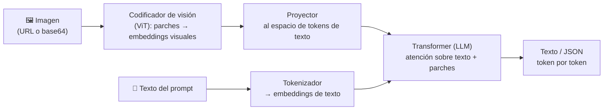

> [!NOTE]
> Los fundamentos de **cómo funciona por dentro** un Vision Transformer, el proyector y CLIP están en la Parte 1: [ViT y modelos multimodales](../../parte1/modulo5/tema4.md). Este tema se enfoca en lo que necesitas para **usar** estos modelos en Foundry: modalidades, cómo entra una imagen, cuánto cuesta, qué pueden y no pueden hacer, y cuándo elegir otro servicio. La habilidad del examen es *"Interpret visual input in prompts by using a deployed multimodal model"*.

---

### 1. Cómo procesa una imagen un LLM multimodal (resumen)

1. La imagen se **redimensiona** a lo que el modelo admite y se divide en **parches** (o mosaicos); un **Vision Transformer** convierte cada parche en un embedding.
2. Un **proyector** los lleva al mismo espacio vectorial que los tokens de texto: para el LLM, la imagen es "una secuencia más de tokens".
3. El LLM procesa texto e imagen juntos con **atención**: cada palabra de tu pregunta puede "mirar" a cada parche de la imagen.
4. El decodificador genera la respuesta **token por token**, igual que con un prompt de solo texto.

Consecuencias prácticas de este diseño (que explican casi todas las limitaciones de la sección 6):
- El modelo **no ve píxeles**, ve parches resumidos → el detalle fino (letra pequeña, objetos diminutos) se pierde si la resolución efectiva es baja.
- La imagen se convierte en tokens **de entrada** → cuesta dinero y ventana de contexto.
- No hay un "detector" dentro → no devuelve coordenadas precisas; razona en lenguaje sobre lo que vio.

---

### 2. Modalidades de entrada y salida en Foundry

| Modelo / familia | Entrada | Salida | Para qué |
|---|---|---|---|
| **GPT-4.1, 4.1-mini, 4.1-nano** | Texto, imagen | Texto | Descripción, preguntas visuales, documentos, capturas, gráficas y diagramas. Propósito general |
| **Serie GPT-5 (5.1, 5.2…)** | Texto, imagen | Texto (estructurado, herramientas) | Escenarios **agénticos** y de producción, razonamiento con contexto grande entre modalidades |
| **Modelos de socios** (p. ej. Anthropic Claude, Mistral, Llama con visión) | Texto, imagen | Texto | Alternativas del catálogo con capacidades de visión |
| **Phi-4-multimodal-instruct** | Texto, imagen, **audio** | Texto | Modelo pequeño que también escucha |
| **GPT-4o-audio / realtime / Voice Live** | Audio, texto | Audio, texto | Conversación por voz (ver [Módulo 4](../modulo4/tema2.md)) |
| **GPT-Image-1.5 / 1 / 1-Mini, FLUX** | Texto, imagen | **Imagen** | Generación y edición (ver [Tema 3](tema3.md)) |
| **Sora / Sora 2** | Texto, imagen (y video en Sora 2) | **Video** (Sora 2 también audio) | Generación de video (ver [Tema 4](tema4.md)) |

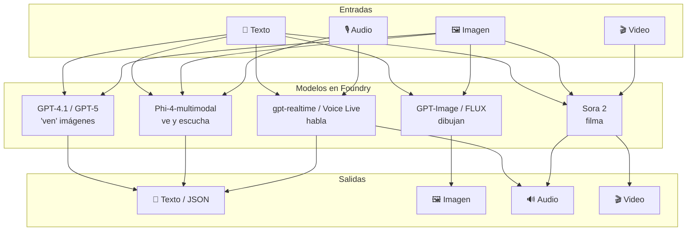

> [!TIP]
> Para el examen: "entender" (describir, preguntar, extraer) → **GPT-4.1 / GPT-5**. "Crear" una imagen → **GPT-Image**. "Crear" un clip → **Sora**. Un modelo que *ve* imágenes no necesariamente las *genera*, y viceversa.

---

### 3. Cómo entra la imagen: formatos, límites y las dos formas de enviarla

| Aspecto | Valor (Azure OpenAI / Foundry) |
|---|---|
| Formatos | **JPEG, PNG, WEBP, GIF** (solo el primer cuadro) |
| Tamaño máximo por imagen | **20 MB** |
| Imágenes por petición | **10** (puedes compararlas en el mismo prompt) |
| Formas de enviarla | **URL pública** o **data URL en base64** (`data:image/jpeg;base64,...`) |
| URLs privadas | **No**: el servicio descarga la imagen desde infraestructura de Microsoft, así que VNet, firewall o endpoints privados no funcionan. Para Blob Storage usa SAS o identidad administrada con rol *Storage Blob Data Reader* |
| Parámetro `detail` | `auto` (default), `low`, `high` |
| Metadatos | **No se procesan**: nombre de archivo, EXIF y ubicación no llegan al modelo |

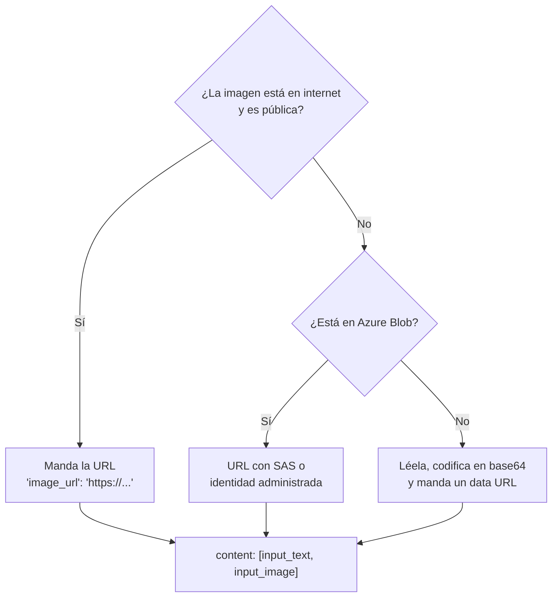

En la **Responses API** la imagen y el texto van como partes del mismo mensaje:

```python
response = client.responses.create(
    model=DEPLOYMENT_NAME,                     # nombre del DEPLOYMENT
    input=[{"role": "user", "content": [
        {"type": "input_text", "text": "¿Qué animal es? Responde en una línea."},
        {"type": "input_image", "image_url": "https://ejemplo.com/foto.jpg", "detail": "low"},
    ]}],
)
print(response.output_text)
```
- **Explicación:** `input_text` e `input_image` son **partes** de un solo mensaje de usuario; por eso el modelo "ve" la pregunta y la foto juntas. `detail` controla la resolución efectiva (y el costo) de esa imagen en particular.

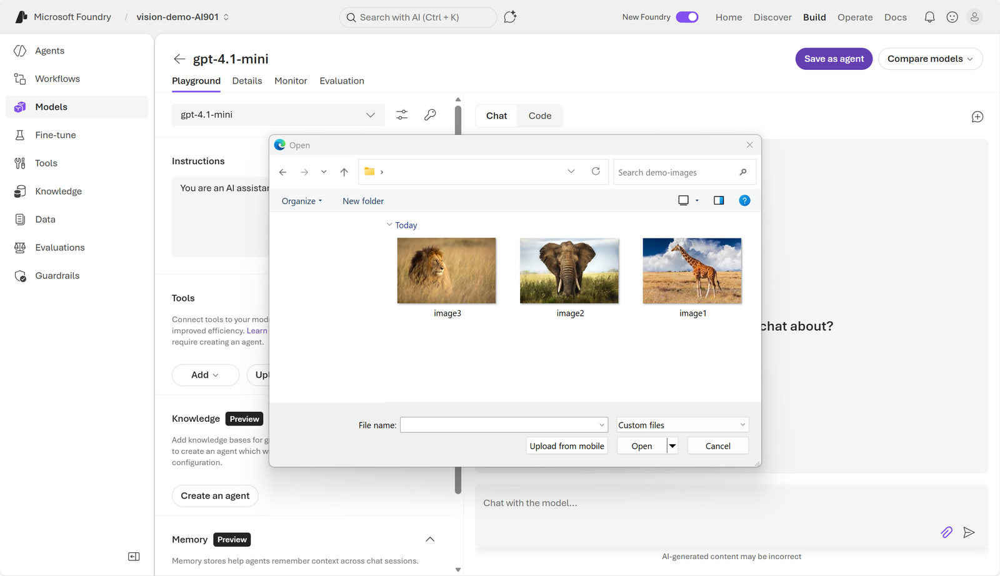

*Antes de programar: en **Build → Models → Playground** eliges un deployment con visión (gpt-4.1-mini) y adjuntas una imagen con el clip. Imagen: documentación oficial de Microsoft (CC BY 4.0).*

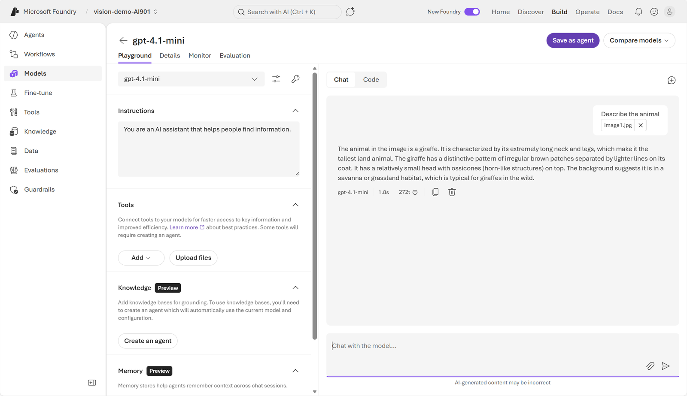

*El modelo describe la jirafa y el Playground muestra el costo: **272 tokens** y 1.8 s para la imagen + el prompt + la respuesta. Fíjate que la imagen "cuesta" como texto. Imagen: documentación oficial de Microsoft (CC BY 4.0).*

---

### 4. Tokens de imagen y costo: cuánto "pesa" una foto

Las imágenes **también consumen tokens de entrada**. Cuántos, depende de **tres cosas**: la familia del modelo, la resolución de la imagen y el nivel de `detail`. Hay dos esquemas:

#### 4.1 Modelos por mosaicos (GPT-4o, GPT-4.1, GPT-5.1)
1. La imagen se reduce para caber en **2048 × 2048**.
2. Si el **lado corto** supera **768 px**, se reduce a 768.
3. Se cuentan los **mosaicos de 512 × 512** necesarios para cubrirla.
4. **Tokens = base + mosaicos × tokens por mosaico** (GPT-4.1 / 4o: **85 + 170 × mosaicos**; GPT-5.1: 70 + 140 × mosaicos).
5. Con `detail: "low"` el modelo solo ve una versión de **512 × 512** y cobra **solo la base** (85 tokens), sin importar el tamaño original.

Ejemplo: una foto de 1024 × 1024 → lado corto a 768 → 768 × 768 → 2 × 2 = **4 mosaicos** → 85 + 4 × 170 = **765 tokens**. Una de 4000 × 3000 también termina en 1024 × 768 → **765 tokens**: el tope de 768 px protege tu bolsillo.

#### 4.2 Modelos por parches (GPT-4.1-mini, GPT-4.1-nano, GPT-5-mini, o4-mini)
1. La imagen se reduce si excede el máximo del modelo (sin agrandar las pequeñas).
2. Se cuentan **parches de 32 × 32 px**: `ceil(ancho/32) × ceil(alto/32)`.
3. Si supera el **presupuesto de parches** del modelo (históricamente 1,536 para 4.1-mini/nano) se reduce proporcionalmente.
4. **Tokens = parches × multiplicador**: 4.1-mini **× 1.62**, 4.1-nano **× 2.46**, GPT-5-mini **× 1.2**, o4-mini × 1.72.

Ejemplo: 1024 × 768 → 32 × 24 = 768 parches → × 1.62 = **1,245 tokens** en 4.1-mini. Sí: el modelo "mini" puede cobrar **más tokens por imagen** que GPT-4.1 (aunque cada token sea más barato).

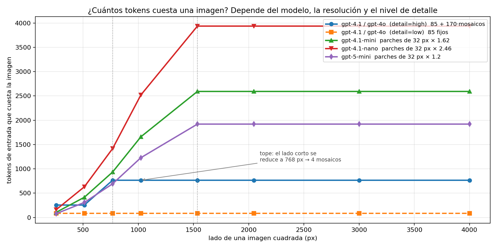

*Los modelos por mosaicos (azul) se **estancan** a partir de 768 px; los de parches siguen subiendo hasta su presupuesto. `detail=low` (naranja) es plano: 85 tokens. Cálculo con las fórmulas públicas; verifica los multiplicadores vigentes en la documentación.*

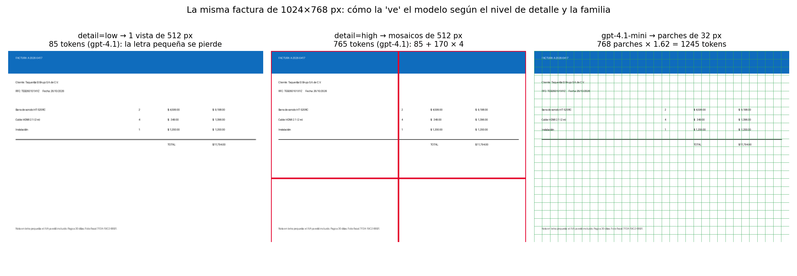

*La misma factura de 1024 × 768: con `low` el modelo ve una miniatura de 512 px (la letra pequeña del pie se vuelve ilegible); con `high` la cubre con 4 mosaicos (765 tokens); en 4.1-mini se parte en 768 parches (1,245 tokens).*

#### 4.3 Reglas prácticas para ahorrar
- **Redimensiona antes de enviar.** Para GPT-4.1 nada por encima de ~1024 px en el lado corto aporta (el servicio la reduce a 768 de todos modos); para los modelos por parches, cada píxel cuenta.
- Usa **`detail: "low"`** cuando no necesitas leer texto pequeño (clasificar "¿hay un perro?", moderar contenido, describir una escena).
- Usa **`detail: "high"`** para OCR, tablas, gráficas, capturas de pantalla y objetos pequeños.
- **Recorta** la región que importa en lugar de mandar la foto completa.
- En conversaciones largas, **no reenvíes la imagen** en cada turno si ya la analizaste: guarda el resultado en texto.
- Fija `max_output_tokens`: la salida también cuesta y una descripción puede alargarse mucho.

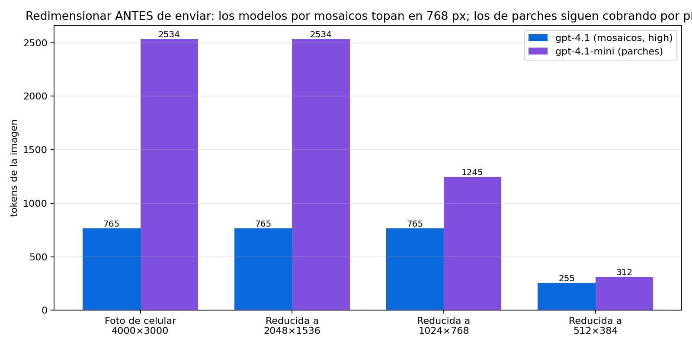

*Una foto de 4000 × 3000 cuesta lo mismo que una de 1024 × 768 en GPT-4.1 (el servicio la reduce), pero en 4.1-mini reducirla tú a 1024 px baja el costo a la mitad y a 512 px lo divide entre 8.*

---

### 5. Qué pueden hacer con imágenes (y cómo pedirlo)

| Tarea | Ejemplo de prompt | Consejo |
|---|---|---|
| **Describir escenas / alt text** | "Describe la imagen en una oración para un lector de pantalla." | Pide longitud y público; `low` suele bastar |
| **Preguntas visuales (VQA)** | "¿Cuántas personas usan casco? Responde solo el número." | Pide el formato exacto; cuenta aproximada si son muchos |
| **Leer texto (OCR implícito)** | "Transcribe el texto tal cual, sin corregir." | `high`; texto grande y sin rotar |
| **Tablas y gráficas** | "Convierte la tabla a CSV con encabezados." | `high`; pide que marque celdas ilegibles con `?` |
| **Capturas de pantalla** | "¿Qué error muestra esta pantalla y cómo lo resuelvo?" | Útil en soporte y pruebas de UI |
| **Comparar imágenes** | "¿Qué cambió entre la imagen 1 y la 2?" | Hasta 10 por petición; numéralas en el texto |
| **Extraer a JSON** | "Devuelve `{producto, cantidad, total}` de esta factura." | Usa **salidas estructuradas** (JSON Schema) |
| **Clasificar / moderar** | "Clasifica en: factura, recibo, identificación, otro." | Enumera las clases; `low` + temperatura 0 |

Patrón de prompt que funciona bien con visión:

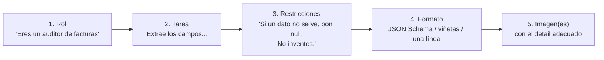

```python
# Salida estructurada: el modelo DEBE devolver este esquema (o fallar), nada de "más o menos JSON"
response = client.responses.create(
    model=DEPLOYMENT_NAME,
    input=[{"role": "user", "content": [
        {"type": "input_text", "text": "Extrae los campos de la factura. Si uno no se ve, usa null."},
        {"type": "input_image", "image_url": data_url, "detail": "high"},
    ]}],
    text={"format": {"type": "json_schema", "name": "factura", "strict": True, "schema": {
        "type": "object",
        "properties": {"folio": {"type": ["string", "null"]},
                       "total": {"type": ["number", "null"]},
                       "moneda": {"type": ["string", "null"]}},
        "required": ["folio", "total", "moneda"], "additionalProperties": False}}},
)
```
- **Explicación:** con `strict: True` la salida siempre cumple el esquema, lo que te permite **validar** y mandar a revisión humana lo que venga en `null`. Es la forma correcta de usar un multimodal "como OCR"… con la salvedad de la sección 6: **no te da confianza por campo**.

---

### 6. Limitaciones (y por qué existen)

| Limitación | Qué pasa | Causa / mitigación |
|---|---|---|
| **Alucinación** | Describe detalles que no están o lee mal un número | Es un generador de texto: pide "si no se ve, di que no se ve"; valida con reglas |
| **Conteo** | Cuentas aproximadas con muchos objetos pequeños | Los parches resumen regiones; recorta o usa detección de objetos |
| **Precisión espacial** | No da *bounding boxes* confiables ni posiciones exactas (p. ej. un tablero de ajedrez) | No hay cabeza de detección; usa Azure AI Vision o un modelo custom |
| **Texto pequeño o rotado** | Lo lee mal o se lo salta | Resolución efectiva limitada: `high`, agranda, endereza |
| **Alfabetos no latinos** | Menor precisión en japonés, coreano, etc. | Considera OCR especializado (Document Intelligence / Content Understanding) |
| **Imágenes médicas** | No apto para TAC, radiografías, diagnóstico | Fuera de alcance por IA responsable |
| **Gráficas que dependen del color** | Confunde series por colores o estilos de línea | Pide la leyenda en texto, usa `high` |
| **Panorámicas / ojo de pez** | Distorsiones confunden al modelo | Recorta en vistas normales |
| **Metadatos** | Ignora nombre de archivo, EXIF, GPS | Pásalos en el texto si importan |
| **IA responsable** | No identifica personas por su rostro; **bloquea CAPTCHAs**; filtros de contenido | Diseña el caso sin reconocimiento facial |
| **Determinismo y escala** | Cada llamada puede variar; 50,000 facturas = 50,000 inferencias de LLM | Para volumen y confianza por campo usa servicios especializados |

---

### 7. Multimodal vs. servicios de visión especializados

Un modelo multimodal es **generalista**: razona sobre cualquier imagen en lenguaje natural. Los servicios de Foundry Tools son **especialistas**: hacen una cosa, rápido, barato, determinista y con **puntuaciones de confianza**.

| Necesidad | Mejor opción | Por qué |
|---|---|---|
| Preguntas abiertas sobre una imagen, explicar un diagrama | **Modelo multimodal** | Razonamiento en lenguaje natural |
| Describir fotos para accesibilidad (alt text rico) | **Modelo multimodal** (o Azure AI Vision *captions* si es masivo) | Flexibilidad vs. costo |
| Ubicación exacta de objetos (cajas), conteo preciso | **Azure AI Vision – detección de objetos** / modelo custom | Coordenadas y confianza |
| Extraer campos de 50,000 facturas con confianza por campo | **Content Understanding** / Document Intelligence | Esquemas, confianza, escala, costo por página |
| Clasificar imágenes de producto con tus propias categorías | **Custom Vision** / fine-tuning | Determinismo y tus etiquetas |
| Reconocer personas (con consentimiento y acceso aprobado) | **Azure AI Face** | Los LLM no identifican rostros |
| Moderar contenido visual a escala | **Content Safety** | Diseñado y evaluado para eso |

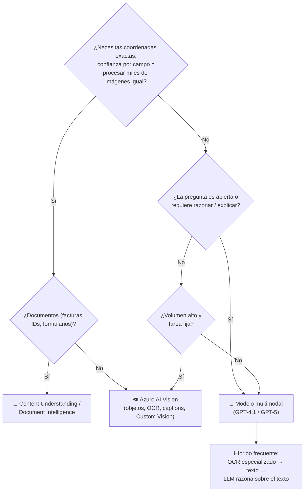

> [!TIP]
> El patrón **híbrido** aparece mucho en escenarios: Document Intelligence extrae con confianza, y el LLM **interpreta** ("¿esta factura cumple la política de viáticos?"). No es "uno u otro".

---

### 8. Más allá de la imagen fija: video y audio

- **Video:** GPT-4.1 / GPT-5 **no reciben video** como entrada. El patrón es **muestrear cuadros** (p. ej. 1 por segundo o en cambios de escena), mandarlos como varias `input_image` (máx. 10 por petición; agrupa en varias llamadas) y pedir un resumen. Para entender video a escala: **Content Understanding** (video). Para **generar** video: **Sora**.
- **Audio:** Phi-4-multimodal acepta audio directo; los modelos **realtime** y **Voice Live** conversan por voz; para transcribir con marcas de tiempo y diarización: **Azure Speech**. Un patrón común: Speech → texto → LLM (cascada), más controlable que el speech-to-speech nativo.

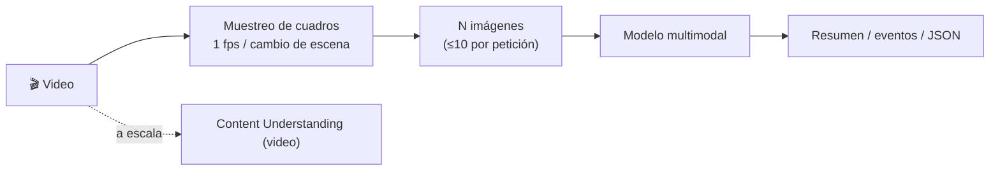

---

### 9. Cómo evaluar una solución multimodal
No te quedes con "se ve bien en el Playground". Mide:

| Tarea | Métrica | Cómo |
|---|---|---|
| Clasificación de imágenes | Exactitud, precisión, recall, F1 | Conjunto etiquetado; temperatura 0; compara `low` vs `high` |
| Extracción (OCR + campos) | Exactitud por campo, **CER/WER** del texto | Ground truth manual; mide por campo, no global |
| Descripción / VQA | Evaluadores asistidos por IA (relevancia, coherencia, groundedness) + revisión humana | **Evaluations** en Foundry |
| Costo y latencia | Tokens por imagen, p95 de latencia | El Playground y `response.usage` te dan los tokens |

---

### Práctica en Python

#### 1) Calculadora de tokens de imagen (`tokens_imagen.py`) — sin Azure
```python
import math

def tokens_mosaicos(w, h, base=85, por_mosaico=170, detail="high"):
    """GPT-4o / GPT-4.1: cabe en 2048, lado corto a 768, mosaicos de 512."""
    if detail == "low":
        return base
    s = min(1.0, 2048 / max(w, h)); w, h = w * s, h * s
    s = min(1.0, 768 / min(w, h));  w, h = w * s, h * s
    mosaicos = math.ceil(w / 512) * math.ceil(h / 512)
    return base + mosaicos * por_mosaico

def tokens_parches(w, h, mult=1.62, max_dim=2048, presupuesto=1536):
    """GPT-4.1-mini (1.62), 4.1-nano (2.46), GPT-5-mini (1.2): parches de 32 px × multiplicador."""
    s = min(1.0, max_dim / max(w, h)); w, h = int(w * s), int(h * s)
    parches = math.ceil(w / 32) * math.ceil(h / 32)
    if parches > presupuesto:
        s = math.sqrt(presupuesto / parches); w, h = int(w * s), int(h * s)
        parches = math.ceil(w / 32) * math.ceil(h / 32)
    return math.ceil(parches * mult)

for nombre, w, h in [("captura 1920x1080", 1920, 1080), ("foto 4000x3000", 4000, 3000), ("icono 256x256", 256, 256)]:
    print(f"{nombre:>18}: gpt-4.1 high={tokens_mosaicos(w,h):>5}  low={tokens_mosaicos(w,h,detail='low'):>3}  "
          f"4.1-mini={tokens_parches(w,h):>5}  4.1-nano={tokens_parches(w,h,2.46):>5}")
```
Salida:
```
 captura 1920x1080: gpt-4.1 high= 1105  low= 85  4.1-mini= 2576  4.1-nano= 3912
    foto 4000x3000: gpt-4.1 high=  765  low= 85  4.1-mini= 2534  4.1-nano= 3848
     icono 256x256: gpt-4.1 high=  255  low= 85  4.1-mini=  104  4.1-nano=  158
```
- **Explicación:** la captura 1920 × 1080 cuesta **más** que la foto 4000 × 3000 en GPT-4.1 (1,105 vs 765): la foto 4:3 cabe en 4 mosaicos tras reducir a 1024 × 768, pero la captura 16:9 queda en 1365 × 768 → 3 × 2 = 6 mosaicos. La **proporción** importa, no solo el tamaño. Y en los modelos por parches el icono de 256 px es baratísimo: **redimensionar es la palanca de costo número uno**.

#### 2) Preparar imágenes antes de enviarlas (`preparar_imagen.py`) — sin Azure
```python
# pip install pillow
import base64, io
from PIL import Image, ImageOps

def preparar(ruta, lado_max=1024, calidad=85):
    """Endereza (EXIF), reduce y codifica en base64 como data URL JPEG."""
    im = Image.open(ruta)
    im = ImageOps.exif_transpose(im)              # fotos de celular vienen 'acostadas' en EXIF: el modelo NO lee EXIF
    im = im.convert("RGB")                        # quita canal alfa / CMYK
    im.thumbnail((lado_max, lado_max))            # mantiene proporción, no agranda
    buf = io.BytesIO(); im.save(buf, "JPEG", quality=calidad, optimize=True)
    b64 = base64.b64encode(buf.getvalue()).decode()
    print(f"{ruta}: {im.size}, {len(buf.getvalue())/1024:.0f} KB -> data URL de {len(b64)/1024:.0f} KB")
    return f"data:image/jpeg;base64,{b64}"

data_url = preparar("factura.jpg")
```
- **Explicación:** tres problemas reales que esto evita: (1) fotos **rotadas** por EXIF que el modelo lee de lado; (2) PNG de 15 MB que casi tocan el límite de 20 MB y cuestan tokens de más; (3) canal alfa que algunos modelos rechazan. El resultado es la `image_url` que usas en `input_image`.

#### 3) Modelo multimodal en Foundry: `low` vs `high` en la misma imagen (`detalle.py`)
```python
# pip install openai python-dotenv pillow
import os
from dotenv import load_dotenv
from openai import OpenAI
from preparar_imagen import preparar

load_dotenv()
client = OpenAI(api_key=os.getenv("FOUNDRY_KEY"), base_url=os.getenv("ENDPOINT"))  # .../openai/v1/
data_url = preparar("factura.jpg", lado_max=1600)

for detail in ("low", "high"):
    r = client.responses.create(
        model=os.getenv("MODEL_NAME"),
        input=[{"role": "user", "content": [
            {"type": "input_text", "text": "Transcribe la nota en letra pequeña del pie de la factura, tal cual."},
            {"type": "input_image", "image_url": data_url, "detail": detail},
        ]}],
        max_output_tokens=120,
    )
    print(f"[{detail}] tokens entrada={r.usage.input_tokens}  salida={r.usage.output_tokens}")
    print("   ", r.output_text)
```
- **Explicación:** `r.usage.input_tokens` te muestra en vivo la diferencia de costo entre `low` y `high`, y la respuesta te muestra la diferencia de **calidad** (con `low` la letra pequeña suele salir inventada o incompleta). Es el experimento que vale la pena hacer antes de decidir el `detail` de un caso de uso.

#### 4) Varias imágenes en un prompt: comparar cuadros de un video (`cuadros_video.py`)
```python
# pip install opencv-python openai
import cv2, base64

def cuadros(ruta_video, cada_seg=2, maximo=10):
    """Muestrea un cuadro cada N segundos y lo devuelve como data URL (máx. 10 por petición)."""
    cap = cv2.VideoCapture(ruta_video); fps = cap.get(cv2.CAP_PROP_FPS); salida = []
    i = 0
    while len(salida) < maximo:
        cap.set(cv2.CAP_PROP_POS_FRAMES, int(i * fps * cada_seg)); ok, frame = cap.read()
        if not ok: break
        frame = cv2.resize(frame, (768, int(frame.shape[0] * 768 / frame.shape[1])))
        _, jpg = cv2.imencode(".jpg", frame, [cv2.IMWRITE_JPEG_QUALITY, 80])
        salida.append("data:image/jpeg;base64," + base64.b64encode(jpg).decode()); i += 1
    return salida

partes = [{"type": "input_text", "text": "Estos cuadros son de un video, en orden. Describe qué ocurre y en qué cuadro cambia la escena."}]
partes += [{"type": "input_image", "image_url": u, "detail": "low"} for u in cuadros("clip.mp4")]
r = client.responses.create(model=os.getenv("MODEL_NAME"), input=[{"role": "user", "content": partes}])
print(r.output_text)
```
- **Explicación:** así "ve video" un modelo que solo acepta imágenes: cuadros muestreados, reducidos a 768 px y en `low` para que 10 cuadros cuesten ~850 tokens en GPT-4.1 en lugar de miles. Para videos largos o análisis a escala, usa Content Understanding.

El tutorial completo paso a paso (URL, base64, JSON) está en el [Tema 2](tema2.md).

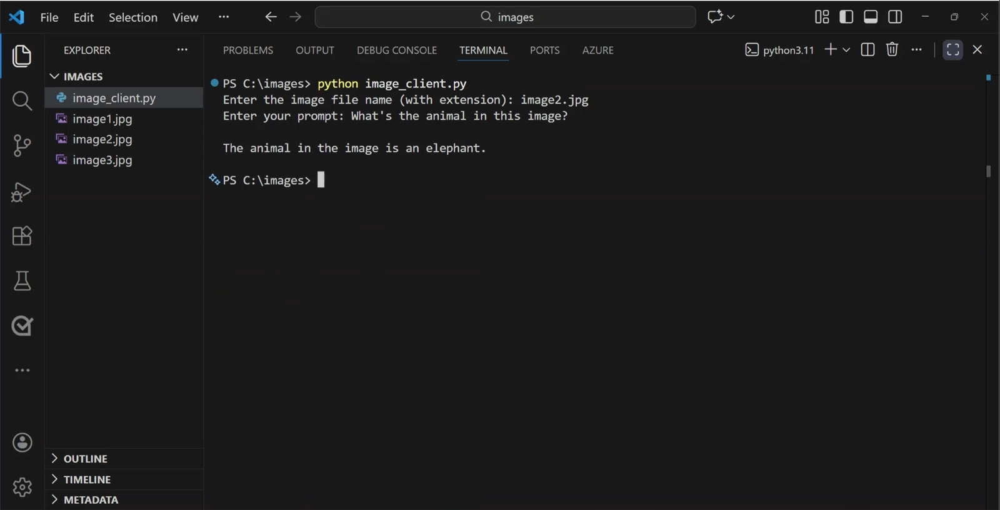

*El cliente ligero de la práctica oficial: pide el nombre de la imagen y el prompt, y el modelo responde. Imagen: documentación oficial de Microsoft (CC BY 4.0).*

---

### Para el examen
- "Una app de safari debe identificar el animal de una foto subida por el usuario" → despliega un **modelo multimodal** (GPT-4.1-mini) y envía la imagen **junto con el prompt** en el mismo mensaje (`input_text` + `input_image`).
- "¿Cómo se envía una imagen local?" → codificada en **base64** como data URL. "¿Y una en internet?" → por **URL pública** (las URLs privadas/VNet no funcionan).
- "¿Qué parámetro reduce el costo de una imagen cuando no hace falta leer texto pequeño?" → `detail: "low"`. "¿Y para leer texto pequeño, tablas o gráficas?" → `detail: "high"`.
- "¿Las imágenes consumen tokens?" → **Sí**, de entrada; dependen de resolución, `detail` y familia del modelo. Redimensionar antes de enviar ahorra.
- "Necesita describir el contenido de una foto y responder preguntas" → modelo multimodal. "Necesita crear una imagen" → GPT-Image. "Un clip de video" → Sora.
- "Necesita *bounding boxes* / coordenadas exactas" → **Azure AI Vision (detección de objetos)**, no un LLM.
- "Extraer campos de miles de facturas con confianza" → **Content Understanding / Document Intelligence**; el LLM puede **interpretar** después.
- "¿Identificar a una persona por su rostro con GPT-4.1?" → **No** (IA responsable); los CAPTCHAs también se bloquean.
- "El modelo lee mal una captura" → sube el `detail`, agranda el texto, endereza la imagen; el modelo no lee EXIF ni metadatos.
- "¿Qué es `model` en la llamada?" → el **nombre del deployment**, no el nombre del modelo.
- "¿Cuál es el máximo de imágenes por petición?" → **10**; tamaño máximo **20 MB**; formatos JPEG, PNG, WEBP, GIF (primer cuadro).
- "Respuesta en un formato fijo para procesarla" → **salidas estructuradas** (JSON Schema).

### 🖼️ Créditos de imágenes
- `ms-playground-subir-imagen.png`, `ms-playground-resultado.png`, `ms-vscode-resultado.png`: módulo *Get started with computer vision in Azure*, Microsoft Learn (CC BY 4.0).
- `tokens-por-resolucion.png`, `detalle-low-high-parches.png`, `redimensionar-ahorra.png`: elaboración propia con matplotlib (`images/parte2/modulo5/_generar_graficas.py`), a partir de las fórmulas públicas de tokens de imagen.

### Recursos
- [Multimodal models for image analysis – Microsoft Learn](https://learn.microsoft.com/en-us/training/modules/get-started-vision-azure/2-vision-enabled-models)
- [Use vision-enabled chat models – Azure OpenAI](https://learn.microsoft.com/en-us/azure/foundry/openai/how-to/gpt-with-vision)
- [Images and vision (tokens, detail, limitaciones) – OpenAI](https://developers.openai.com/api/docs/guides/images-vision)
- [Structured outputs – Azure OpenAI](https://learn.microsoft.com/en-us/azure/foundry/openai/how-to/structured-outputs)
- [Content Understanding – Microsoft Learn](https://learn.microsoft.com/en-us/azure/ai-services/content-understanding/overview)
- [Azure AI Vision – Image Analysis](https://learn.microsoft.com/en-us/azure/ai-services/computer-vision/overview-image-analysis)
- [Guía de estudio AI-901](https://learn.microsoft.com/es-es/credentials/certifications/resources/study-guides/ai-901)
