# Tema 3: Tutorial de implementación con el SDK de Python de un modelo de generación de imágenes

**Objetivo:** Generar imágenes desde código con un modelo GPT-Image desplegado en Foundry, guardarlas como PNG o JPEG, controlar tamaño, calidad y costo, editarlas (por conversación y con máscara), recibir vistas previas en streaming y manejar los errores típicos. Al final hay preguntas tipo examen.

Lectura oficial: [Modelos de generación de imágenes – Microsoft Learn](https://learn.microsoft.com/es-es/training/modules/get-started-vision-azure/3-image-generation?pivots=text)

> [!NOTE]
> Este tema es el "cómo se programa". El "cómo funciona por dentro" (difusión, espacio latente, *guidance*) está en la [Parte 1, Módulo 5](../../parte1/modulo5/tema2.md). Aquí solo lo recordamos cuando explica un parámetro.

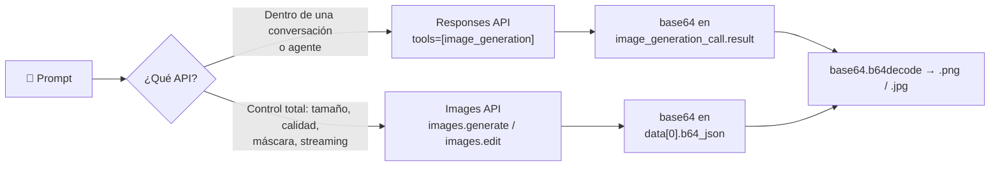

---

## Paso a Paso:

### 1. Elegir y desplegar el modelo

| Modelo | Estado en Foundry | Cuándo usarlo |
|---|---|---|
| **GPT-Image-1.5** | Acceso limitado (solicitud) | Lo que recomienda Microsoft Learn para proyectos nuevos: texto a imagen, imagen a imagen y edición precisa; más rápido y barato que GPT-Image-1 |
| **GPT-Image-1** | Acceso limitado (solicitud) | Propósito general; el más soportado en herramientas de agentes y en la Responses API; el único que documenta `background="transparent"` |
| **GPT-Image-1-Mini** | Acceso limitado (solicitud) | Menor costo y latencia para alto volumen; **no** preserva caras ni soporta `input_fidelity` |
| **GPT-Image-2** | Disponible de forma general | Tamaños arbitrarios hasta 4K (múltiplos de 16, lado largo ≤ 3840 px), mejor edición |
| **GPT-Image-2.5 Sunburst / Flare** | Disponible de forma general | Sunburst: máxima precisión de edición; Flare: generación rápida de uso diario; calidades extra `xhigh`, `max`, `auto` |
| **FLUX** (Black Forest Labs) | Foundry Models (socio) | FLUX1.1 [pro] (texto a imagen rápido), FLUX.1 Kontext [pro] (edición en contexto, consistencia de personaje), FLUX.2 [pro] / [flex] (edición multirreferencia hasta 8–10 imágenes, control de `guidance` y `steps`) |
| ~~DALL·E 3~~ | **Retirado** (marzo de 2026) | Ya no se puede desplegar; migra a un modelo `gpt-image-*` |

- Despliégalo desde el catálogo (**Build → Models**) y pruébalo en el **Playground de imágenes**.


*El Playground sirve para iterar el prompt antes de escribir código. Imagen: Microsoft Learn (CC BY 4.0).*

> [!IMPORTANT]
> GPT-Image-1, 1.5 y 1-Mini son de **acceso limitado**: hay que solicitarlo ([GPT-Image-1](https://aka.ms/oai/gptimage1access), [GPT-Image-1.5](https://aka.ms/oai/gptimage1.5access)). GPT-Image-2 y 2.5 ya están disponibles sin registro. **El examen se basa en lo que dice Microsoft Learn** (la familia GPT-Image-1); para tus prácticas usa lo que tengas en el catálogo: el código es el mismo cambiando el nombre del deployment. La cuota por defecto es de **5 imágenes por minuto** por deployment; si vas a procesar lotes, pide más cuota o agrega reintentos (sección 9).

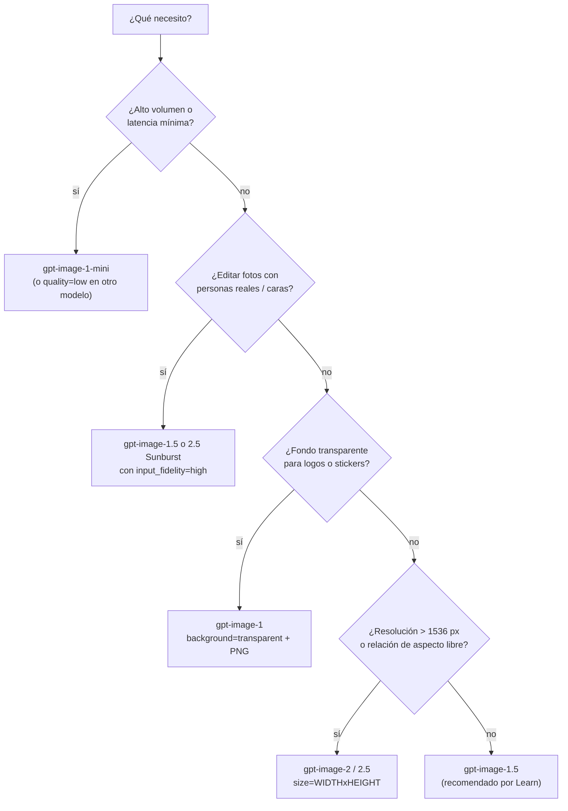

### 2. Preparar el entorno
```bash
pip install openai python-dotenv pillow
```
`.env`:
```bash
ENDPOINT=https://<recurso>.openai.azure.com/openai/v1/
FOUNDRY_KEY=<tu-llave>
MODEL_NAME=gpt-5                   # modelo de chat que orquesta la herramienta (ver nota del paso 3)
IMAGE_MODEL_NAME=gpt-image-1       # nombre de TU deployment de imágenes
```

**Sobre las dos rutas del endpoint.** Foundry acepta dos formas de llamar a los modelos de imágenes, y verás ambas en la documentación:

| Ruta | URL | Dónde va el deployment | SDK |
|---|---|---|---|
| **v1** (la que usa este acordeón) | `https://<recurso>.openai.azure.com/openai/v1/` | En el cuerpo: `model="<deployment>"` | `OpenAI(base_url=..., api_key=...)` |
| **Por deployment** (clásica) | `https://<recurso>.openai.azure.com/openai/deployments/<deployment>/images/generations?api-version=2025-04-01-preview` | En la URL | `AzureOpenAI(azure_endpoint=..., api_version=...)` |

La ruta v1 es la que recomienda Learn porque el código queda idéntico al de OpenAI y no tienes que perseguir `api-version`. Para autenticarte con **Microsoft Entra ID** en lugar de llave, sustituye `api_key` por un proveedor de tokens:

```python
from azure.identity import DefaultAzureCredential, get_bearer_token_provider
token = get_bearer_token_provider(DefaultAzureCredential(), "https://ai.azure.com/.default")
client = OpenAI(base_url=os.environ["ENDPOINT"], api_key=token)   # pip install azure-identity
```

### 3. Generar una imagen con la Responses API (`generar_imagen.py`)
Este es el patrón que muestra Microsoft Learn: pedirle a la Responses API que use la herramienta `image_generation`.
```python
import os, base64
from dotenv import load_dotenv
from openai import OpenAI

load_dotenv()
client = OpenAI(api_key=os.environ["FOUNDRY_KEY"], base_url=os.environ["ENDPOINT"])

prompt = ("Ilustración plana y moderna de un ajolote programando en una laptop, "
          "estilo vectorial limpio, colores pastel, fondo con papel picado.")

response = client.responses.create(
    model=os.environ["MODEL_NAME"],
    input=prompt,
    tools=[{"type": "image_generation"}],
    extra_headers={"x-ms-oai-image-generation-deployment": os.environ["IMAGE_MODEL_NAME"]},
)

# La imagen llega en base64 dentro del elemento de tipo "image_generation_call"
llamada = next(item for item in response.output if item.type == "image_generation_call")

with open("ajolote.png", "wb") as f:
    f.write(base64.b64decode(llamada.result))
print("Guardada: ajolote.png")
print("Prompt que realmente usó el modelo:", getattr(llamada, "revised_prompt", None))
```
- **Explicación:**
  - `tools=[{"type": "image_generation"}]` habilita la herramienta de generación de imágenes. El modelo de chat **decide** si la invoca; si tu respuesta solo trae un `message` y ningún `image_generation_call`, el modelo no enrutó la petición a imágenes (sé más explícito: "genera una imagen de...").
  - El resultado **no es una URL** sino **base64** en `item.result` del elemento `image_generation_call`; se decodifica y se guarda.
  - `revised_prompt`: el modelo orquestador **reescribe** tu prompt antes de generar (lo detalla y lo traduce). Guárdalo: explica por qué salió lo que salió y sirve para reproducir resultados.
  - **Nota sobre el `model`:** en Azure, la herramienta de imágenes la **orquesta un modelo de chat compatible** (la documentación de Foundry usa `gpt-5` como ejemplo; ambos deployments deben estar en el **mismo proyecto** y tener **nombres distintos**) y el header `x-ms-oai-image-generation-deployment` indica qué deployment de GPT-Image genera la imagen. El ejemplo simplificado de Microsoft Learn pone directamente el deployment de imágenes en `model`; si tu configuración no acepta una forma, prueba la otra o copia el código del Playground (**View code**).


*"View code" en el Playground te da el fragmento con tu endpoint y deployment ya puestos. Imagen: Microsoft Learn (CC BY 4.0).*

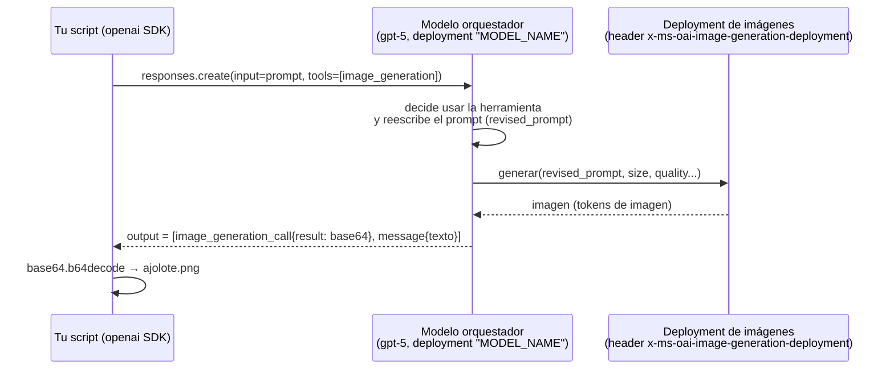

**Parámetros de la herramienta.** Puedes fijarlos dentro del objeto `tools` para no depender de lo que "decida" el orquestador:

```python
tools=[{
    "type": "image_generation",
    "size": "1024x1536",          # 1024x1024 | 1024x1536 | 1536x1024 | auto
    "quality": "low",             # low | medium | high | auto  (low = más rápido y barato)
    "output_format": "jpeg",      # png | jpeg | webp
    "output_compression": 80,     # 0-100, solo jpeg/webp
    "background": "auto",         # transparent | opaque | auto
    "moderation": "auto",         # auto | low (filtro menos estricto)
    "action": "auto",             # auto | generate | edit (fuerza generar o editar)
}]
```

### 4. Generar con la Images API (control de tamaño y calidad) (`images_api.py`)
```python
import os, base64
from dotenv import load_dotenv
from openai import OpenAI

load_dotenv()
client = OpenAI(api_key=os.environ["FOUNDRY_KEY"], base_url=os.environ["ENDPOINT"])

resultado = client.images.generate(
    model=os.environ["IMAGE_MODEL_NAME"],
    prompt="Póster minimalista del Palacio de Bellas Artes al atardecer, estilo art déco",
    size="1024x1536",        # vertical; también 1024x1024 o 1536x1024
    quality="medium",        # low | medium | high
    n=1,                     # 1-10
    output_format="png",     # png (default) | jpeg
    # background="transparent",   # solo gpt-image-1 y solo con png
    user="curso-ai901",      # etiqueta opcional para rastrear consumo por usuario/app
)

with open("bellas_artes.png", "wb") as f:
    f.write(base64.b64decode(resultado.data[0].b64_json))
print("Guardada: bellas_artes.png")
if getattr(resultado, "usage", None):
    print("Tokens:", resultado.usage.input_tokens, "entrada /", resultado.usage.output_tokens, "salida")
```
- **Explicación:**
  - `images.generate` llama **directo** al modelo de imágenes (sin orquestador ni header) y te da control de **tamaño**, **calidad**, **número** y **formato**.
  - Los modelos GPT-Image devuelven `b64_json`; `response_format="url"` **no** está soportado (eso era de DALL·E).
  - Mayor calidad y tamaño = más tokens = más costo y latencia (sección 5).
  - `n` genera varias variantes del mismo prompt en una llamada; cada una se cobra.

**¿Cuál de las dos APIs uso?** La propia documentación de la herramienta lo dice: la **Responses API / agente** es para generar imágenes dentro de una conversación o un flujo de varios pasos; la **Images API** es para **edición con máscara, varias imágenes de entrada y streaming de vistas parciales**.

| Necesidad | Responses API (`tools`) | Images API (`images.*`) |
|---|---|---|
| Generar dentro de un chat/agente, encadenar turnos | ✅ | ❌ |
| El modelo decide cuándo generar | ✅ | ❌ (siempre genera) |
| Reescritura automática del prompt (`revised_prompt`) | ✅ | ❌ |
| Edición con **máscara** | ❌ | ✅ `images.edit(mask=...)` |
| Hasta 16 imágenes de entrada | ❌ | ✅ `image=[...]` |
| Streaming de imágenes parciales | ✅ (`partial_images`) | ✅ (`stream=True`) |
| Fondo transparente | ✅ (`background`) | ✅ (`background`, gpt-image-1) |
| Requiere segundo deployment (orquestador) | ✅ | ❌ |

### 5. Entender el costo: una imagen son tokens

Un modelo GPT-Image **no cobra "por imagen" sino por tokens de imagen de salida**, y el número de tokens depende de la calidad y del tamaño. Por eso `quality` es el parámetro que más mueve la factura:

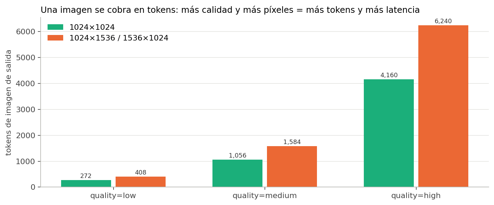

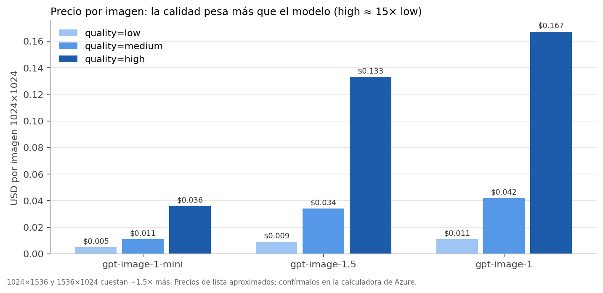

*Precios de lista aproximados (octubre de 2026). Confírmalos en la calculadora de precios de Azure.*

Reglas prácticas:

1. **Itera en `low`, entrega en `high`.** Mientras afinas el prompt, cada intento en `low` cuesta ~15 veces menos que en `high`.
2. **El tamaño vertical u horizontal cuesta ~1.5× el cuadrado**: pide 1024×1024 salvo que el formato final lo exija.
3. **Los tokens de texto también cuentan**: un prompt de 500 palabras o una imagen de referencia de entrada suman a la factura (poco, pero suman).
4. En la Responses API, además pagas los tokens del **modelo orquestador**.

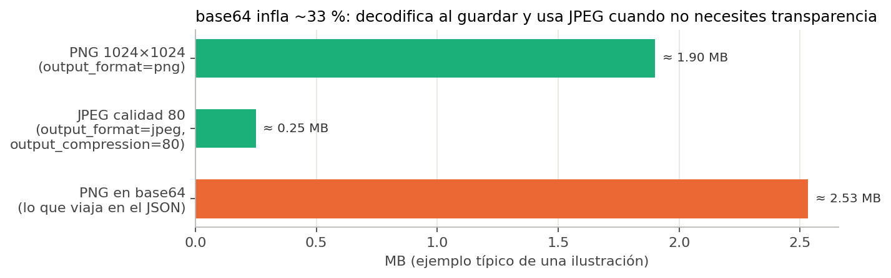

> [!TIP]
> **Base64** convierte bytes binarios en texto ASCII para que la imagen pueda viajar dentro de un JSON; infla el tamaño ~33 %. Decodifica al recibir y guarda como archivo; si no necesitas transparencia, pide `output_format="jpeg"` con `output_compression` entre 70 y 85 para ahorrar ancho de banda y almacenamiento.

### 6. Editar iterativamente (imagen a imagen) con la Responses API
Con la Responses API puedes encadenar respuestas y pedir cambios sobre la imagen anterior. El modelo recuerda la imagen generada en el turno previo:
```python
r2 = client.responses.create(
    model=os.environ["MODEL_NAME"],
    previous_response_id=response.id,          # la respuesta del paso 3
    input="Ahora ponle lentes y una taza de café de olla junto a la laptop.",
    tools=[{"type": "image_generation"}],
    extra_headers={"x-ms-oai-image-generation-deployment": os.environ["IMAGE_MODEL_NAME"]},
)
imagen_b64 = next(i.result for i in r2.output if i.type == "image_generation_call")
open("ajolote_v2.png", "wb").write(base64.b64decode(imagen_b64))
```

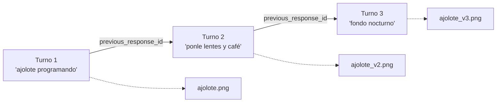

Dos variantes útiles:

- **Referenciar una imagen concreta** en vez de toda la conversación: pasa en `input` un elemento `{"type": "image_generation_call", "id": llamada.id}` junto con tu texto. Sirve cuando quieres volver a la versión 1 después de varias ediciones.
- **Editar una foto tuya** (no generada): envíala como `input_image` en base64 dentro del mensaje de usuario y pide el cambio; con `"action": "edit"` en la herramienta fuerzas que edite en lugar de generar algo nuevo.

```python
with open("foto.jpg", "rb") as f:
    foto_b64 = base64.b64encode(f.read()).decode()

r = client.responses.create(
    model=os.environ["MODEL_NAME"],
    input=[{"role": "user", "content": [
        {"type": "input_text", "text": "Convierte esta foto en una ilustración estilo lotería mexicana."},
        {"type": "input_image", "image_url": f"data:image/jpeg;base64,{foto_b64}"},
    ]}],
    tools=[{"type": "image_generation", "action": "edit", "input_fidelity": "high"}],
    extra_headers={"x-ms-oai-image-generation-deployment": os.environ["IMAGE_MODEL_NAME"]},
)
```

`input_fidelity="high"` le pide al modelo respetar al máximo los rasgos de la entrada (sobre todo **caras**); no está disponible en `gpt-image-1-mini`.

### 7. Editar con máscara (Images API) (`editar_mascara.py`)

Cuando necesitas cambiar **solo una zona** (quitar un objeto, rellenar un fondo, cambiar un producto), usas `images.edit` con una **máscara**: un PNG del mismo tamaño que la imagen cuyo **canal alfa** marca la región editable (alfa = 0 → el modelo puede cambiar; alfa = 255 → debe respetar).

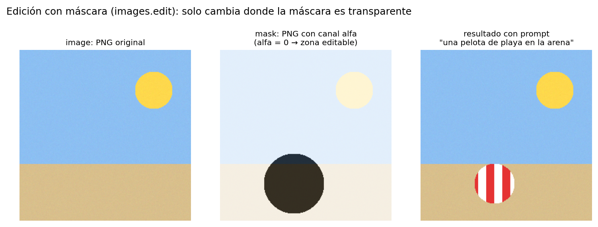

```python
import os, base64
from io import BytesIO
from PIL import Image, ImageDraw
from dotenv import load_dotenv
from openai import OpenAI

load_dotenv()
client = OpenAI(api_key=os.environ["FOUNDRY_KEY"], base_url=os.environ["ENDPOINT"])

# 1) Construir la máscara: opaca en todo, transparente (alfa 0) en la zona a editar
base = Image.open("bellas_artes.png").convert("RGBA")
mascara = Image.new("RGBA", base.size, (0, 0, 0, 255))          # todo protegido
ImageDraw.Draw(mascara).ellipse((300, 1100, 720, 1500), fill=(0, 0, 0, 0))   # zona editable
buf = BytesIO(); mascara.save(buf, format="PNG"); buf.seek(0); buf.name = "mask.png"

# 2) Editar. El prompt describe la imagen COMPLETA resultante, no solo el parche.
res = client.images.edit(
    model=os.environ["IMAGE_MODEL_NAME"],
    image=open("bellas_artes.png", "rb"),      # o una lista: [img1, img2, ...] (hasta 16)
    mask=buf,
    prompt="Póster art déco del Palacio de Bellas Artes al atardecer con un tranvía amarillo al frente",
    size="1024x1536",
    quality="medium",
    # input_fidelity="high",                   # preserva rasgos/caras (no en gpt-image-1-mini)
)
open("bellas_artes_tranvia.png", "wb").write(base64.b64decode(res.data[0].b64_json))
print("Guardada: bellas_artes_tranvia.png")
```
- **Explicación:**
  - `images.edit` usa `multipart/form-data` por debajo: por eso se pasan **archivos** (`open(..., "rb")` o un `BytesIO` con `.name`), no base64.
  - La máscara **aplica a la primera imagen** de la lista; las demás sirven como referencia de estilo o contenido.
  - La documentación advierte que el modelo "evita" la zona protegida pero puede retocarla ligeramente; si necesitas píxeles idénticos, recompón tú con Pillow pegando el original fuera de la máscara.
  - Para construir la máscara desde un PNG blanco y negro: `m = Image.open("bn.png").convert("L"); rgba = m.convert("RGBA"); rgba.putalpha(m)` (blanco = editable).

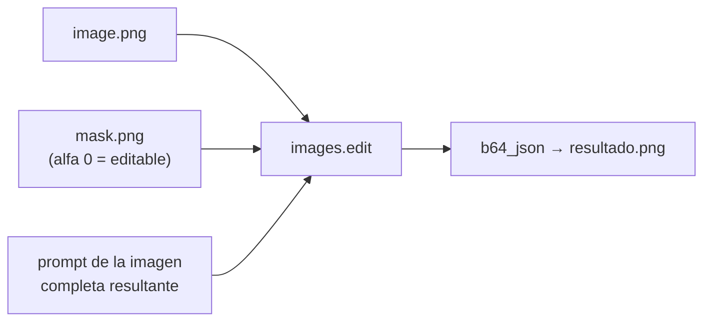

### 8. Streaming: ver la imagen mientras se genera (`stream.py`)

Generar en `high` puede tardar decenas de segundos. Con `stream=True` y `partial_images` (1 a 3) recibes **vistas previas** progresivas para mostrar algo al usuario mientras tanto:

```python
stream = client.images.generate(
    model=os.environ["IMAGE_MODEL_NAME"],
    prompt="Un colibrí bebiendo de una flor de cempasúchil, fotografía macro, luz dorada",
    size="1024x1024", quality="high",
    stream=True, partial_images=2,
)
for evento in stream:
    if evento.type == "image_generation.partial_image":
        open(f"colibri_parcial_{evento.partial_image_index}.png", "wb").write(base64.b64decode(evento.b64_json))
        print("vista previa", evento.partial_image_index)
    elif evento.type == "image_generation.completed":
        open("colibri.png", "wb").write(base64.b64decode(evento.b64_json))
        print("final lista")
```

```mermaid
gantt
    title Streaming con partial_images=2 (tiempos ilustrativos)
    dateFormat s
    axisFormat %S s
    section Servidor
    Generación completa          :a1, 0, 30s
    section Cliente recibe
    Vista previa 0 (borrosa)     :milestone, m1, 8, 0s
    Vista previa 1 (más nítida)  :milestone, m2, 18, 0s
    Imagen final                 :milestone, m3, 30, 0s
```

En la Responses API es igual pero con `stream=True` en `responses.create`, `"partial_images": 2` dentro de la herramienta y eventos `response.image_generation_call.partial_image` (`evento.partial_image_b64`). Puedes recibir **menos** parciales de las pedidas si la imagen termina antes.

### 9. Manejo de errores y buenas prácticas de producción

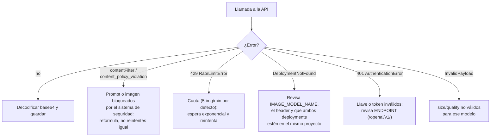

```python
import time
from openai import OpenAI, RateLimitError, BadRequestError, AuthenticationError, NotFoundError

def generar_con_reintentos(prompt, intentos=4):
    for i in range(intentos):
        try:
            return client.images.generate(model=os.environ["IMAGE_MODEL_NAME"], prompt=prompt,
                                          size="1024x1024", quality="low")
        except RateLimitError:
            espera = 2 ** i
            print(f"429: cuota agotada, reintento en {espera}s"); time.sleep(espera)
        except BadRequestError as e:
            if "contentFilter" in str(e) or "content_policy_violation" in str(e):
                raise SystemExit("Bloqueado por el filtro de contenido: reformula el prompt.")
            raise                                   # InvalidPayload u otro error de parámetros
        except NotFoundError:
            raise SystemExit("DeploymentNotFound: revisa el nombre del deployment.")
        except AuthenticationError:
            raise SystemExit("401: revisa FOUNDRY_KEY y ENDPOINT.")
    raise SystemExit("Sin cuota tras varios intentos.")
```

- **Filtro de contenido:** se aplica al **prompt** (`"Your task failed as a result of our safety system."`) y a la **imagen generada** (`"Generated image was filtered..."`). En ambos casos no hay imagen y no se cobra. Las imágenes fotorrealistas de menores están bloqueadas por defecto.
- **Cuotas:** 5 imágenes/minuto por deployment por defecto; FLUX tiene sus propios límites (6 RPM en Kontext y 1.1 pro). Para lotes grandes, pide cuota o usa varios deployments.
- **Idempotencia y trazabilidad:** guarda junto a cada PNG el `prompt`, el `revised_prompt`, el modelo, `size`, `quality` y la fecha. Los modelos GPT-Image **no exponen `seed`**, así que esa metadata es tu única forma de "reproducir" un resultado (FLUX sí acepta `seed`).
- **No metas la llave en el código:** `.env` + `.gitignore`, o mejor, Entra ID (paso 2).

### 10. Alternativa: FLUX en Foundry Models

Los modelos de Black Forest Labs se consumen de dos formas: con la **Images API compatible con OpenAI** (solo FLUX1.1 [pro] para generar y FLUX.1 Kontext [pro] para editar) o con la **API del proveedor** (todos los FLUX, con parámetros propios como `seed`, `guidance`, `steps`, `aspect_ratio` y `safety_tolerance`).

```python
# Images API compatible (recurso de Foundry Models, no de Azure OpenAI)
client = OpenAI(base_url=os.environ["FOUNDRY_MODELS_ENDPOINT"] + "/openai",   # https://<recurso>.services.ai.azure.com
                api_key=os.environ["FOUNDRY_KEY"], default_query={"api-version": "preview"})
r = client.images.generate(model="FLUX-1.1-pro", prompt="Un zorro rojo en un bosque otoñal, fotografía", n=1, size="1024x1024")
print(r.data[0].url)        # FLUX devuelve URL, no base64
```

Diferencias que importan: FLUX devuelve una **URL**, acepta **`seed`** (reproducibilidad), y **no trae el filtro de contenido de Foundry al desplegar**: la seguridad la configuras tú en la inferencia (`safety_tolerance`) o con Content Safety.

---

## Tips de prompts para imágenes
- **Sujeto + acción + entorno + estilo + iluminación + composición**: "Un colibrí (sujeto) bebiendo de una flor de cempasúchil (acción) en un jardín (entorno), fotografía macro (estilo), luz dorada de tarde (iluminación), fondo desenfocado (composición)".
- Si necesitas **texto dentro de la imagen**, escríbelo entre comillas y en pocas palabras; GPT-Image-1.5 y 2 lo escriben mucho mejor que GPT-Image-1, y en `quality=low` el texto suele salir mal.
- Sé explícito en lo que **no** quieres: "sin texto", "sin personas", "sin marca de agua".
- Nombra el **medio**: "acuarela", "render 3D", "fotografía con lente de 35 mm", "pixel art de 16 bits". El medio fija el estilo más que una lista de adjetivos.
- Para **consistencia entre imágenes** (el mismo personaje en varias escenas), edita a partir de la primera imagen (paso 6) en lugar de regenerar desde cero, o usa FLUX Kontext.
- Itera: cambia **una variable a la vez** y lee el `revised_prompt` para ver qué entendió el modelo.
- Usa `quality="low"` para explorar y sube a `high` solo en la versión final.

## IA responsable
- Los modelos bloquean contenido dañino, personas reales (famosos y rostros identificables sin consentimiento) y material con derechos de autor (personajes, logos, estilos de artistas vivos cuando se nombran). Un prompt bloqueado devuelve `contentFilter`, no una imagen "parecida".
- Informa cuando una imagen fue generada con IA (**transparencia**). Las imágenes de GPT-Image incluyen **credenciales de contenido C2PA** (metadatos firmados que indican que fueron generadas por IA); no los elimines al reprocesar.
- Revisa sesgos en las representaciones de personas (profesiones, edades, orígenes): si pides "un ingeniero" y siempre sale el mismo perfil, especifica diversidad en el prompt.
- **Privacidad:** no subas fotos de terceros para edición sin su consentimiento; `input_fidelity="high"` preserva rasgos faciales reales.
- Principios del examen que aplican aquí: **transparencia** (avisar que es IA), **equidad** (sesgos), **privacidad y seguridad** (fotos de personas), **fiabilidad y seguridad** (filtros de contenido).

---

## Preguntas tipo examen

<details>
<summary><b>1.</b> En la Responses API con <code>tools=[{"type": "image_generation"}]</code>, ¿dónde viene la imagen generada?</summary>

En el elemento de `output` de tipo **`image_generation_call`**, en su campo **`result`**, codificada en **base64** (no es una URL). Se decodifica con `base64.b64decode` y se guarda como archivo.
</details>

<details>
<summary><b>2.</b> ¿Qué parámetro reduce más el costo y la latencia de una generación con GPT-Image?</summary>

**`quality`** (`low` / `medium` / `high`): una imagen `high` usa ~15 veces más tokens de salida que una `low`. Después, el tamaño (los formatos 1024×1536 y 1536×1024 cuestan ~1.5× el cuadrado).
</details>

<details>
<summary><b>3.</b> Necesitas reemplazar solo el fondo de una foto de producto y dejar el producto intacto. ¿Qué API y qué parámetro?</summary>

**Images API `images.edit`** con una **máscara** PNG del mismo tamaño cuyo canal alfa sea transparente en la zona a cambiar. La Responses API no soporta máscaras.
</details>

<details>
<summary><b>4.</b> ¿Para qué sirve el header <code>x-ms-oai-image-generation-deployment</code> en Azure?</summary>

Para indicar **qué deployment de GPT-Image** debe usar la herramienta `image_generation` cuando la orquesta un modelo de chat (por ejemplo `gpt-5`) en la Responses API. Ambos deployments deben estar en el mismo proyecto.
</details>

<details>
<summary><b>5.</b> Un script falla con <code>"Your task failed as a result of our safety system."</code>. ¿Qué pasó y qué haces?</summary>

El **filtro de contenido** bloqueó el **prompt** (código `contentFilter`). No se generó imagen ni se cobró. Hay que **reformular** el prompt; reintentar el mismo no sirve.
</details>

<details>
<summary><b>6.</b> ¿Qué modelo recomienda Microsoft Learn para proyectos nuevos de generación de imágenes y por qué?</summary>

**GPT-Image-1.5**: mejor calidad, soporta texto a imagen, imagen a imagen y edición precisa, y es más rápido y barato que GPT-Image-1. GPT-Image-1-Mini es la opción de bajo costo/latencia; FLUX es la alternativa de terceros.
</details>

<details>
<summary><b>7.</b> ¿Cómo pides cambios sobre la imagen que acabas de generar sin volver a describirla completa?</summary>

Encadenando turnos en la Responses API con **`previous_response_id`** (o referenciando el `id` del `image_generation_call`); el modelo conserva la imagen anterior como contexto.
</details>

## Práctica oficial de Microsoft Learn
- [Ejercicio: Introducción a computer vision en Microsoft Foundry](https://learn.microsoft.com/es-es/training/modules/get-started-vision-azure/5-exercise)

## Fuentes
- [Modelos de generación de imágenes (módulo de Learn)](https://learn.microsoft.com/en-us/training/modules/get-started-vision-azure/3-image-generation?pivots=text)
- [Cómo usar los modelos de generación de imágenes de Azure OpenAI (parámetros, edición, streaming, errores)](https://learn.microsoft.com/en-us/azure/foundry/openai/how-to/dall-e)
- [Herramienta de generación de imágenes en Foundry Agent Service (header, parámetros, cuándo usar la Images API)](https://learn.microsoft.com/en-us/azure/foundry/agents/how-to/tools/image-generation)
- [Modelos FLUX en Foundry Models](https://learn.microsoft.com/en-us/azure/foundry/foundry-models/how-to/use-foundry-models-flux)
- [Guía de generación de imágenes de OpenAI (action, partial_images, edición multiturno)](https://developers.openai.com/api/docs/guides/image-generation)
- [Cookbook: generar y editar imágenes con GPT Image (máscaras con canal alfa)](https://developers.openai.com/cookbook/examples/generate_images_with_gpt_image)
- [Precios por imagen de GPT-Image (tokens por calidad)](https://pricepertoken.com/gpt-image-pricing) · [Ficha de gpt-image-1.5](https://developers.openai.com/api/docs/models/gpt-image-1.5)
