# Tema 4: Tips de generación de videos con Microsoft Foundry

**Objetivo:** Entender cómo funciona un modelo de generación de video, qué ofrece Foundry (Sora y Sora 2), cómo se pide un video desde el Playground, con REST y con Python (texto a video, imagen a video y *remix*), cómo escribir prompts que el modelo realmente obedezca, cuánto cuesta iterar y qué restricciones de IA responsable aplican. Al final hay preguntas tipo examen.

Lectura oficial: [Modelos de generación de video – Microsoft Learn](https://learn.microsoft.com/es-es/training/modules/get-started-vision-azure/4-video-generation)

> [!WARNING]
> **Estado de Sora en Foundry (noviembre de 2026).** **Sora (1)** se retiró el 28 de febrero de 2026. **Sora 2** siempre estuvo en *preview*: la versión `2025-10-06` se retiró a mediados de 2026 y la versión `2025-12-08` aparece en la [tabla oficial de retiros](https://learn.microsoft.com/es-es/azure/foundry/openai/concepts/model-retirement-schedule) con fecha **15 de octubre de 2026** y **sin reemplazo**. OpenAI, por su parte, apagó su propia API de Sora el 24 de septiembre de 2026.
>
> ¿Qué significa para ti?
> - **Para el examen:** estudia este tema tal cual. La AI-901 evalúa lo que dice Microsoft Learn (Sora, Sora 2, flujo asíncrono, *remix*, IA responsable) y eso no cambia porque un modelo se retire.
> - **Para tus prácticas:** antes de empezar busca "video" en el catálogo (**Build → Models**). Si no hay un modelo de video disponible en tu región, haz la práctica en papel con este tema: el patrón **crear → consultar → descargar** es el mismo para cualquier modelo de video que llegue después.

> [!NOTE]
> Este tema es el "cómo se usa". El "cómo funciona por dentro" la generación de imágenes (difusión, espacio latente) está en la [Parte 1, Módulo 5](../../parte1/modulo5/tema5.md), y la generación de imágenes con código en el [Tema 3](./tema3.md). Aquí solo agregamos lo que cambia cuando la imagen se mueve.

Analogía: pedir un video a Sora es como **encargar un pastel**. Das las instrucciones (prompt), te dan un **número de pedido** (`video_id`), preguntas de vez en cuando si ya está (*polling*) y cuando dice "listo" lo **recoges** (descarga). Si no pasas por él en 24 horas, lo tiran (el job expira).

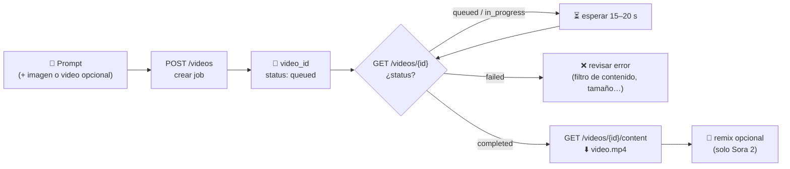

---

## Paso a Paso:

### 1. Qué hace diferente a un modelo de video

Una imagen es una matriz de píxeles; un video es **una pila de imágenes en el tiempo** (24–30 cuadros por segundo). Un clip de 8 s a 1280×720 son ~200 cuadros de casi un millón de píxeles cada uno. Generarlos uno por uno y "pegarlos" produce parpadeo: el perro cambia de color entre cuadros, el fondo tiembla. El reto no es solo que cada cuadro se vea bien, sino la **consistencia temporal**: que los objetos persistan, se muevan con física creíble y la cámara se desplace de forma continua.

Así lo resuelve Sora (según el reporte técnico de OpenAI *"Video generation models as world simulators"*):

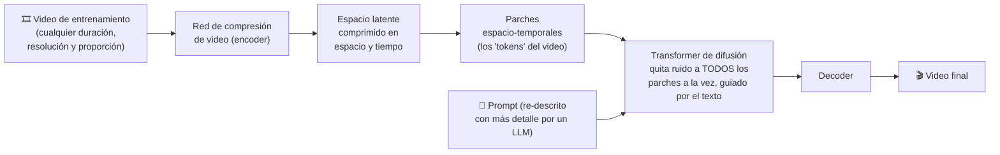

- **Parches espacio-temporales:** igual que un LLM parte el texto en tokens y un Vision Transformer parte la imagen en parches, Sora parte el video comprimido en "cubitos" que abarcan un pedazo de la imagen **y** unos cuadros de tiempo. Por eso el mismo modelo acepta distintas duraciones, resoluciones y orientaciones.
- **Difusión sobre todo el clip a la vez:** el modelo no genera cuadro por cuadro; parte de ruido en todos los parches y lo va limpiando en conjunto. Eso es lo que da coherencia entre el segundo 1 y el segundo 8.
- **Re-descripción del prompt:** internamente, el prompt corto se expande a una descripción más detallada antes de generar. Por eso un prompt vago "funciona", pero el modelo **inventa** todo lo que no especificaste (hora del día, vestuario, ángulo de cámara).
- **Por qué es caro y lento:** el costo crece con **segundos × resolución**. Por eso se cobra **por segundo generado** y tarda **1 a 5 minutos**: la API es **asíncrona** (sección 4).
- **Por qué falla en física:** el modelo aprendió patrones estadísticos de videos, no leyes físicas. Microsoft documenta como limitaciones la **física compleja**, las **relaciones causales** (la mordida que no queda marcada en la galleta), el **razonamiento espacial** (izquierda y derecha) y las **secuencias de eventos precisas en el tiempo**.

### 2. Los modelos: Sora vs. Sora 2

| | **Sora (1)** | **Sora 2** (preview) |
|---|---|---|
| Texto → video | ✅ | ✅ |
| Imagen → video | ✅ (la imagen guía la creación) | ✅ (`input_reference` = primer cuadro) |
| Video → video (**remix**) | ❌ | ✅ ediciones dirigidas sin regenerar todo |
| **Audio** generado (diálogo, ambiente, efectos) | ❌ (video mudo) | ✅ |
| Realismo, física, consistencia temporal | Base | Mejorados |
| Acceso | Azure OpenAI + Video Playground | **API v1** de Azure OpenAI + Video Playground |
| Usos típicos según Learn | Storyboards, animaciones cortas, prototipado visual | Marketing, *trailers* y previsualizaciones cinematográficas, material educativo |
| Estado | Retirado (feb. 2026) | Preview, en retiro (ver aviso) |

> [!IMPORTANT]
> Frase de examen: **los modelos Sora son los únicos modelos nativos de generación de video en Foundry.** Otros modelos son multimodales (aceptan texto, imagen o audio de **entrada**) pero **no generan video de salida**. Si la pregunta dice "crear un clip de video a partir de una descripción", la respuesta es **Sora**, no GPT-4.1 ni GPT-Image.

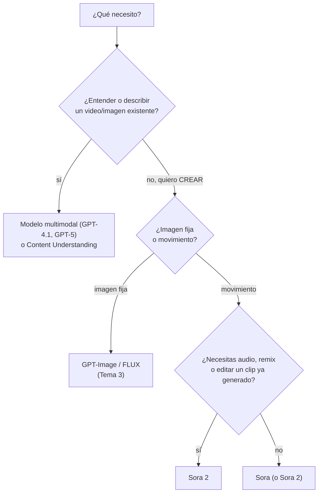

### 3. Parámetros y límites que debes conocer

Learn usa la **API v1** (`/openai/v1/videos`). Estos son sus parámetros:

| Parámetro | Para qué sirve | Valores |
|---|---|---|
| `model` | **Nombre de tu deployment** (no el nombre comercial) | p. ej. `sora-2` |
| `prompt` | Descripción del video (obligatorio) | Texto, máx. ~4,000 caracteres |
| `size` | Resolución de salida | `720x1280` (vertical, **por defecto**) o `1280x720` (horizontal) |
| `seconds` | Duración | `"4"` (**por defecto**), `"8"` o `"12"` |
| `input_reference` | Imagen que fija el **primer cuadro** | JPEG, PNG o WebP **del mismo tamaño exacto** que `size` |
| `remix_video_id` / `videos.remix(...)` | ID de un video **completado** para modificarlo | `video_...` |

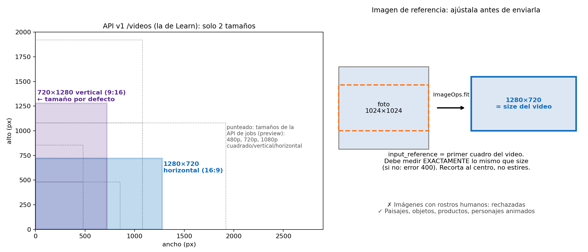

| Límite operativo | Valor |
|---|---|
| Tiempo típico de generación | **1 a 5 minutos** |
| Jobs de creación simultáneos | **2** por recurso |
| Disponibilidad del resultado | **24 horas**; después hay que volver a generarlo |
| Imágenes de entrada con **rostros humanos** | **Rechazadas** |
| Idioma del prompt | Mejor en inglés u otros idiomas de alfabeto latino (el español funciona) |
| Facturación | **Por segundo** de video generado |

> [!TIP]
> Existe una API anterior, la de **jobs** (`/openai/v1/video/generations/jobs?api-version=preview`), que verás en documentación vieja. Usa otros nombres: `width`/`height` en vez de `size`, `n_seconds` en vez de `seconds`, `n_variants` (1–4 variantes por job) y el estado final `succeeded` en vez de `completed`. Aceptaba más tamaños (480p a 1080p, cuadrado, vertical u horizontal), hasta 2 imágenes o 1 video de ≤5 s como entrada. **Si en el examen ves `completed` y `client.videos`, es la API v1; si ves `succeeded` y `jobs`, es la anterior.**

### 4. El flujo asíncrono, paso a paso

¿Por qué no es una llamada normal como la de chat? Porque una petición HTTP no puede quedarse abierta 5 minutos esperando: los proxies y los clientes cortan la conexión. Por eso la API sigue el patrón **job asíncrono**: respondo de inmediato con un número de pedido y tú preguntas después.

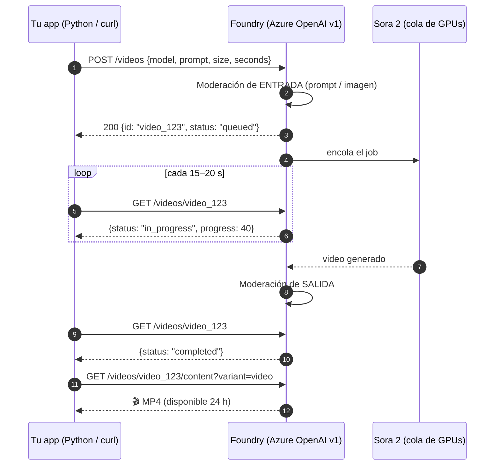

Los estados posibles del job:

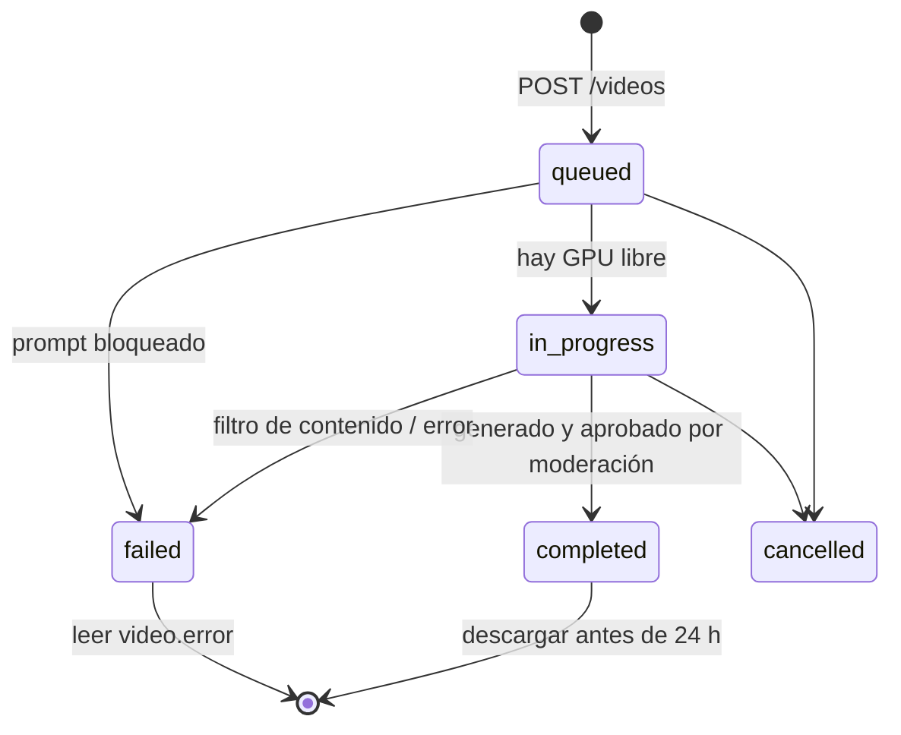

### 5. Probar primero en el Playground

1. En [ai.azure.com](https://ai.azure.com) abre tu proyecto → **Build → Models**, busca **Sora-2** y selecciona **Deploy**.
2. Abre el deployment → pestaña **Playground**.
3. Escribe el prompt y ajusta **resolución** y **duración**.
4. Selecciona **Generate** y espera unos minutos.
5. Con **View code** obtienes el ejemplo en **REST/cURL** ya llenado con tu endpoint: es la forma más rápida de pasar del Playground al código.


*Playground de video: prompt, tamaño y duración. Imagen: Microsoft Learn (CC BY 4.0).*


*"View code" genera el ejemplo REST. Imagen: Microsoft Learn (CC BY 4.0).*

### 6. El flujo con REST (curl)

```bash
# 1) Crear el job -> devuelve un id (video_...)
curl -X POST "https://<recurso>.openai.azure.com/openai/v1/videos" \
  -H "Content-Type: application/json" \
  -H "api-key: $AZURE_OPENAI_API_KEY" \
  -d '{"model": "sora-2",
       "prompt": "Primer plano cinematográfico de gotas de lluvia resbalando por una ventana con luces de neón de noche.",
       "size": "1280x720",
       "seconds": "8"}'

# 2) Consultar el estado hasta que sea "completed" (o "failed")
curl "https://<recurso>.openai.azure.com/openai/v1/videos/{video_id}" \
  -H "api-key: $AZURE_OPENAI_API_KEY"

# 3) Descargar (solo cuando el estado es "completed")
curl -L "https://<recurso>.openai.azure.com/openai/v1/videos/{video_id}/content?variant=video" \
  -H "api-key: $AZURE_OPENAI_API_KEY" --output video.mp4
```

> [!NOTE]
> **REST vs. SDK:** una API REST es la interfaz web (HTTP) que entiende cualquier lenguaje; un SDK es una capa amigable sobre esa misma interfaz. Si no hay SDK para tu lenguaje, siempre puedes usar REST. `curl` es la herramienta de línea de comandos para hacer peticiones HTTP.

### 7. Preparar el entorno de Python

```bash
pip install --upgrade openai azure-identity python-dotenv pillow
```

`.env`:
```bash
ENDPOINT=https://<recurso>.openai.azure.com/openai/v1/
FOUNDRY_KEY=<tu-llave>
VIDEO_MODEL_NAME=sora-2          # nombre de TU deployment de video
```

> [!IMPORTANT]
> Necesitas una versión reciente del paquete `openai` que incluya `client.videos`. Verifícalo con `pip show openai`. Si `client.videos` no existe, actualiza el paquete o usa los comandos REST de la sección 6.

Cliente con **llave** o con **Microsoft Entra ID** (recomendado en producción; tu usuario necesita el rol **Cognitive Services User**):

```python
# cliente.py
import os
from dotenv import load_dotenv
from openai import OpenAI

load_dotenv()

def crear_cliente(usar_entra: bool = False) -> OpenAI:
    if usar_entra:
        from azure.identity import DefaultAzureCredential, get_bearer_token_provider
        token_provider = get_bearer_token_provider(
            DefaultAzureCredential(), "https://ai.azure.com/.default"
        )
        # El SDK pide un token nuevo cada vez que lo necesita (no caduca a la hora)
        return OpenAI(base_url=os.environ["ENDPOINT"], api_key=token_provider)
    return OpenAI(base_url=os.environ["ENDPOINT"], api_key=os.environ["FOUNDRY_KEY"])
```

### 8. Texto a video en Python, versión robusta (`generar_video.py`)

El ejemplo mínimo de Learn hace un `while` sin límite. En la vida real conviene agregar **timeout**, manejo de `failed`/`cancelled` y guardar los metadatos para poder reproducir el resultado.

```python
# generar_video.py
import json, os, time
from cliente import crear_cliente

client = crear_cliente()
MODELO = os.environ.get("VIDEO_MODEL_NAME", "sora-2")

PROMPT = """Estilo documental de naturaleza, película de 35 mm, colores cálidos.
Plano general al amanecer en los canales de Xochimilco: una trajinera de colores
avanza lentamente entre neblina ligera. La cámara, en dron, avanza a ras del agua
hacia la proa. Garzas blancas levantan el vuelo en segundo plano.
Paleta: rosa mexicano, verde agua, dorado suave.
Audio: agua chapoteando contra la madera, aves a lo lejos, sin música."""


def esperar(video_id: str, intervalo: int = 15, timeout: int = 600):
    """Consulta el estado hasta completed/failed/cancelled o hasta agotar el timeout."""
    inicio = time.time()
    while True:
        video = client.videos.retrieve(video_id)
        progreso = getattr(video, "progress", None)
        print(f"[{int(time.time() - inicio):>3}s] {video.status}" + (f" {progreso}%" if progreso is not None else ""))
        if video.status in ("completed", "failed", "cancelled"):
            return video
        if time.time() - inicio > timeout:
            raise TimeoutError(f"El job {video_id} no terminó en {timeout} s; guarda el id y consulta después")
        time.sleep(intervalo)


def main():
    video = client.videos.create(
        model=MODELO,          # nombre del deployment
        prompt=PROMPT,
        size="1280x720",       # horizontal; el default es 720x1280 (vertical)
        seconds="4",           # boceta corto (sección 12); el final puede ser "8" o "12"
    )
    print("Job creado:", video.id)

    video = esperar(video.id)

    if video.status == "completed":
        contenido = client.videos.download_content(video.id, variant="video")
        contenido.write_to_file("xochimilco.mp4")
        print("✅ Guardado: xochimilco.mp4 (descárgalo antes de 24 h si lo vas a volver a pedir)")
    else:
        error = getattr(video, "error", None)
        print("❌", video.status, "→", getattr(error, "message", error))

    # Guarda TODO lo necesario para reproducir o hacer remix después
    with open("xochimilco.json", "w", encoding="utf-8") as f:
        json.dump({"video_id": video.id, "status": video.status, "model": MODELO,
                   "size": "1280x720", "seconds": "4", "prompt": PROMPT}, f, ensure_ascii=False, indent=2)


if __name__ == "__main__":
    main()
```

**Explicación:**
- `client.videos.create(...)` **no devuelve el video**: devuelve el job con su `id` y `status="queued"`.
- `client.videos.retrieve(id)` es el *polling*. Consulta cada 15–20 s: más seguido no acelera nada y gasta cuota de peticiones.
- `download_content(id, variant="video")` solo funciona con `status == "completed"`; antes regresa error.
- El SDK también trae `create_and_poll(...)`, que hace crear + esperar en una sola llamada. Es cómodo para scripts, pero en una app web es mejor separar crear y consultar (sección 13).
- `seconds` se manda como **texto** (`"4"`, `"8"`, `"12"`), igual que en el JSON de REST.

### 9. Imagen a video: fijar el primer cuadro (`imagen_a_video.py`)

`input_reference` le dice al modelo "**empieza aquí**": el personaje, el producto, el vestuario o la estética quedan fijados en el primer cuadro y el prompt describe **qué pasa después**. Reglas:
- La imagen debe medir **exactamente** lo mismo que `size` (1280×720 o 720×1280). Si no, error 400.
- JPEG, PNG o WebP.
- **Sin rostros humanos** (se rechazan). Usa paisajes, productos, objetos o personajes animados.

Truco: genera ese primer cuadro con **GPT-Image** ([Tema 3](./tema3.md)) a la medida correcta, valida la estética en imagen (barato) y solo entonces anímala en video (caro).

```python
# imagen_a_video.py
import io, os
from PIL import Image, ImageOps
from cliente import crear_cliente
from generar_video import esperar

client = crear_cliente()
TAMANO = (1280, 720)

# 1) Ajustar la imagen al tamaño EXACTO: recorta al centro sin deformar
img = Image.open("alebrije.png").convert("RGB")
img = ImageOps.fit(img, TAMANO, method=Image.LANCZOS, centering=(0.5, 0.5))
buffer = io.BytesIO(); img.save(buffer, format="PNG"); buffer.seek(0)
buffer.name = "primer_cuadro.png"      # el SDK usa el nombre para inferir el tipo de archivo

# 2) El prompt describe el MOVIMIENTO, no vuelve a describir la imagen completa
video = client.videos.create(
    model=os.environ.get("VIDEO_MODEL_NAME", "sora-2"),
    prompt=("El alebrije abre lentamente las alas, parpadea dos veces y despega del pedestal. "
            "La cámara hace un tilt hacia arriba siguiéndolo. Se escucha un aleteo suave."),
    size=f"{TAMANO[0]}x{TAMANO[1]}",
    seconds="4",
    input_reference=buffer,
)
video = esperar(video.id)
if video.status == "completed":
    client.videos.download_content(video.id, variant="video").write_to_file("alebrije.mp4")
```

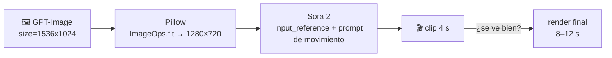

### 10. Remix: editar sin empezar de cero (`remix.py`)

El **remix** (solo Sora 2) toma un video **ya completado** y aplica un cambio **conservando** la estructura: transiciones, composición, *layout*. Es mucho más predecible que regenerar con un prompt modificado, porque el modelo parte de lo que ya te gustó.

```python
# remix.py
import json
from cliente import crear_cliente
from generar_video import esperar

client = crear_cliente()
original = json.load(open("xochimilco.json", encoding="utf-8"))

remix = client.videos.remix(
    video_id=original["video_id"],                       # debe estar en status "completed"
    prompt="Mismo plano y mismo movimiento de cámara; cambia la hora a atardecer con tonos naranjas.",
)
remix = esperar(remix.id)
if remix.status == "completed":
    client.videos.download_content(remix.id, variant="video").write_to_file("xochimilco_atardecer.mp4")
```

Regla de oro: **un solo cambio, claramente descrito, por remix.** Si cambias tres cosas a la vez, no sabrás cuál arruinó el resultado.

| ❌ Remix confuso | ✅ Remix dirigido |
|---|---|
| "Hazlo más bonito y diferente" | "Mismo plano, cambia a lente de 85 mm" |
| "Cambia todo a de noche, con lluvia, otro bote y música" | "Misma iluminación, nueva paleta: verde azulado, arena y óxido" |
| "Que se vea más cinematográfico" | "Mismo encuadre, agrega profundidad de campo reducida (fondo desenfocado)" |

### 11. Cómo escribir prompts de video que el modelo obedezca

Piensa como **director de fotografía que le da instrucciones a su equipo**, no como alguien que describe una foto. Un prompt de video tiene más dimensiones que uno de imagen: **cámara, movimiento y tiempo**.

**Anatomía del prompt (Microsoft Learn):**

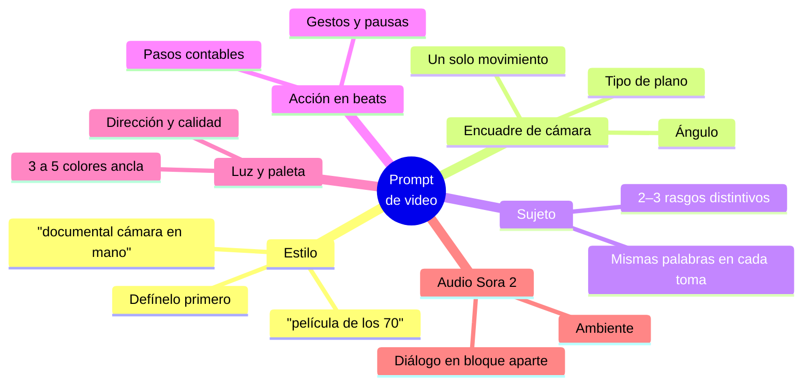

**Plantilla** (adaptada de la guía de prompting de Sora 2 de OpenAI):

```text
[Descripción en prosa de la escena: personajes, vestuario, escenario, clima y detalles.
Sé tan descriptivo como necesites para que el video se parezca a lo que imaginas.]

Cinematografía:
Plano: [encuadre y ángulo, p. ej. plano general de establecimiento a la altura de los ojos]
Movimiento: [UN movimiento, p. ej. travelling lateral lento de izquierda a derecha]
Lente / foco: [p. ej. 35 mm, profundidad de campo reducida]
Luz y paleta: [fuente y calidad de luz + 3–5 colores]
Ambiente: [tono, p. ej. cinematográfico y tenso, juguetón, nostálgico]

Acciones:
- [Beat 1: una acción concreta y contable]
- [Beat 2: otra acción distinta dentro del clip]
- [Beat 3: otra acción o una línea de diálogo]

Diálogo:
[Si hay diálogo: líneas cortas y naturales, con hablantes etiquetados.
4 s ≈ 1–2 intercambios; 8 s ≈ unos pocos más.]

Audio de fondo: [p. ej. murmullo de un café, sin música]
```

**Vago vs. concreto** (ejemplos de Learn):

| ❌ Débil | ✅ Fuerte | Por qué |
|---|---|---|
| "Una calle bonita de noche" | "Asfalto mojado, paso de cebra, letreros de neón reflejados en los charcos" | Detalles **visibles** en lugar de adjetivos |
| "Una persona se mueve rápido" | "Un ciclista pedalea tres veces, frena y se detiene en el paso peatonal" | Acción en **beats contables** |
| "Look cinematográfico" | "Lente anamórfico 2.0x, profundidad de campo reducida, luz volumétrica" | Lenguaje **técnico de cámara** |

**Vocabulario de cámara** (puedes escribirlo en español, pero el término en inglés suele ser más preciso para el modelo):

| Concepto | En el prompt | Qué produce |
|---|---|---|
| Plano general / de establecimiento | *wide / establishing shot* | Ubica la escena completa |
| Plano medio | *medium shot* | Persona o sujeto de la cintura hacia arriba |
| Primer plano / detalle | *close-up / extreme close-up* | Emoción, textura, producto |
| Picado / contrapicado | *high angle / low angle* | Sujeto vulnerable / poderoso |
| Paneo | *pan left/right* | La cámara gira sobre su eje en horizontal |
| Tilt | *tilt up/down* | Gira sobre su eje en vertical |
| Travelling / dolly | *tracking shot / dolly in-out* | La cámara se **desplaza** con el sujeto o hacia él |
| Dron | *aerial / drone shot* | Vista aérea en movimiento |
| Cámara en mano | *handheld* | Sensación documental, ligera vibración |
| Plano fijo | *static / locked-off shot* | Sin movimiento: la opción más estable |

**Tips que más impacto tienen:**
1. **Un movimiento de cámara y una acción del sujeto por toma.** Es la causa número uno de resultados raros.
2. **Clips cortos.** El modelo sigue mejor las instrucciones en clips cortos: Learn recomienda **generar dos clips de 4 s y unirlos** en lugar de uno de 8 s (sección 12).
3. **Define el estilo al principio.** "Película de 16 mm en blanco y negro" condiciona todo lo demás.
4. **Consistencia:** reutiliza **exactamente las mismas palabras** para describir a un personaje en cada toma ("xoloitzcuintle negro con collar rojo").
5. **Paleta de 3–5 colores** para que el *look* se mantenga entre tomas y *remixes*.
6. **Lo que no especificas, el modelo lo inventa.** Si importa la hora del día, el clima o el vestuario, dilo.
7. **El prompt no cambia los parámetros:** escribir "hazlo de 12 segundos" o "en vertical" no sirve; eso va en `seconds` y `size`.
8. **Diálogo en su propio bloque**, corto y con hablantes etiquetados; los discursos largos se desincronizan con los labios.
9. **Si una toma falla repetidamente, simplifica:** congela la cámara, reduce la acción, limpia el fondo. Luego agrega complejidad poco a poco.
10. **Trata el prompt como una lista de deseos, no como un contrato:** el mismo prompt da resultados distintos cada vez; a veces el segundo intento es el bueno.

Ejemplo completo:

```text
Comercial de producto, estética limpia de estudio, colores saturados.
Una barra de sonido negra mate descansa sobre un mueble de madera clara frente a una
pared verde olivo. Junto a ella, una planta de interior.

Cinematografía:
Plano: plano medio, ligeramente picado.
Movimiento: dolly in lento hacia la barra de sonido.
Lente / foco: 50 mm, fondo ligeramente desenfocado.
Luz y paleta: luz suave de ventana desde la izquierda; negro mate, verde olivo, madera clara.
Ambiente: moderno y acogedor.

Acciones:
- Las hojas de la planta vibran levemente con el primer golpe de bajo.
- Un haz de luz cálida recorre la superficie de la barra de izquierda a derecha.

Audio de fondo: un golpe de bajo profundo y luego un acorde de guitarra suave, sin voces.
```

### 12. Historias más largas: unir clips con continuidad

Con la API v1 el máximo es 12 s por clip, y los clips cortos salen mejor. Para una pieza de 20–30 s:

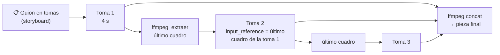

```bash
# Extraer el último cuadro de la toma 1 (será el primer cuadro de la toma 2)
ffmpeg -sseof -0.1 -i toma1.mp4 -frames:v 1 -update 1 ultimo_cuadro.png

# Unir las tomas (mismo modelo y tamaño = mismo códec, se puede copiar sin recodificar)
printf "file 'toma1.mp4'\nfile 'toma2.mp4'\nfile 'toma3.mp4'\n" > lista.txt
ffmpeg -f concat -safe 0 -i lista.txt -c copy pieza_final.mp4
```

> [!TIP]
> Si el último cuadro tiene una persona de frente, recuerda que las imágenes de entrada con rostros se rechazan: planea cortes en momentos sin caras (de espaldas, un objeto, un paisaje). Para editar, cortar y sonorizar el resultado tienes herramientas como Clipchamp, DaVinci Resolve o CapCut.

### 13. Costos: se paga por segundo

Foundry cobra **por segundo de video generado**: más duración y más resolución = más costo y más espera. Como referencia, la lista pública de OpenAI fue de **$0.10 USD/s** para `sora-2` en 720p y **$0.30 USD/s** para `sora-2-pro` en 720p (consulta la [página de precios de Azure OpenAI](https://azure.microsoft.com/es-mx/pricing/details/cognitive-services/openai-service/) para tu región y acuerdo).

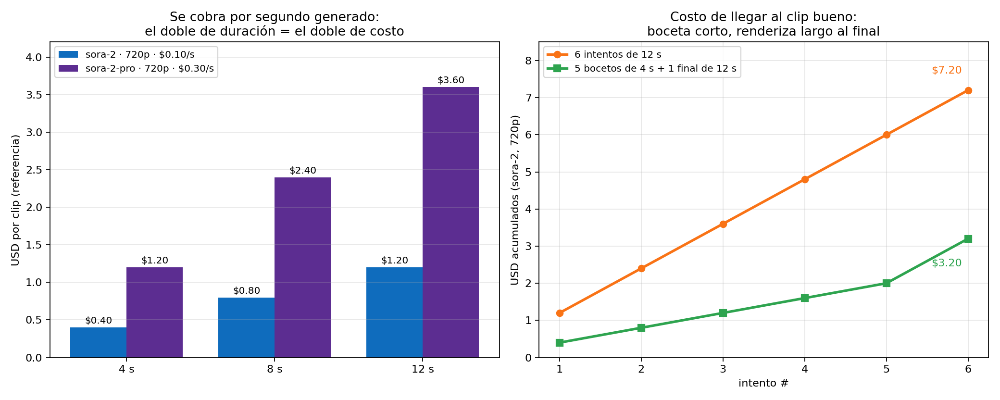

**Estrategia de ahorro:**
- **Boceta en 4 s**, ajusta el prompt hasta que el plano, la luz y la acción sean correctos, y **renderiza largo solo al final**.
- **Valida la estética en imagen primero** (GPT-Image cuesta centavos) y anímala con `input_reference`.
- Usa **remix** en lugar de regenerar desde cero cuando el clip ya está "casi".
- Una petición bloqueada por el filtro de contenido **no genera video**: reformula, no reintentes igual.

### 14. Errores típicos y cómo resolverlos

| Síntoma | Causa probable | Solución |
|---|---|---|
| `401 Unauthorized` | Llave incorrecta o sesión de Entra caducada | Revisa `FOUNDRY_KEY` o ejecuta `az login` |
| `403 Forbidden` | Tu identidad no tiene permisos | Asigna el rol **Cognitive Services User** |
| `404 Not Found` | Endpoint mal escrito o nombre de deployment incorrecto | `model=` es el **nombre del deployment**; el endpoint termina en `/openai/v1/` |
| `400` por dimensiones | `size` no soportado o `input_reference` de otro tamaño | Usa `1280x720` / `720x1280` y ajusta la imagen con `ImageOps.fit` |
| `400` por imagen | La imagen de referencia tiene un rostro humano | Usa otra imagen sin caras |
| `429 Too Many Requests` | Más de 2 jobs simultáneos o cuota agotada | Espera y reintenta con *backoff*; pide más cuota en el portal |
| `status: failed` | Filtro de contenido u otro error interno | Lee `video.error`; si es contenido, **reformula** el prompt |
| El *polling* "nunca termina" | Cola saturada o job muy pesado | Timeout de ~10 min, guarda el `id` y consulta después |
| Error al descargar | El video no está `completed` o ya pasaron 24 h | Descarga solo con `completed`; si expiró, genera de nuevo |
| `AttributeError: 'OpenAI' object has no attribute 'videos'` | Paquete `openai` viejo | `pip install --upgrade openai` o usa REST |
| `404` en un deployment que antes funcionaba | La versión del modelo se **retiró** | Revisa la tabla de retiros y el catálogo |

### 15. De script a aplicación: buenas prácticas de producción

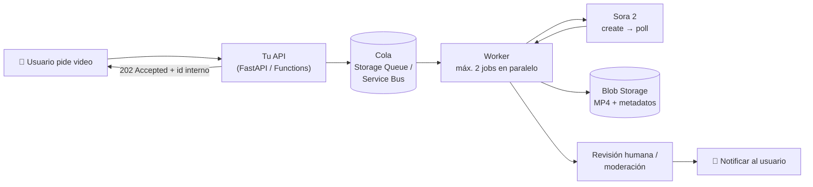

- **No bloquees al usuario:** responde `202 Accepted` con un id y notifica cuando esté listo. Es el mismo patrón asíncrono, ahora en tu propia app.
- **Respeta el límite de 2 jobs simultáneos** con una cola y un *worker* (o un semáforo / `ThreadPoolExecutor(max_workers=2)`).
- **Copia el MP4 a tu almacenamiento** (Blob Storage) en cuanto esté `completed`: en 24 h desaparece.
- **Guarda el prompt y los parámetros** junto con el `video_id`: así puedes reproducir resultados, hacer *remix* y auditar.
- **Reintentos con *backoff* exponencial** para `429` y errores `5xx`, pero **nunca** para un bloqueo de contenido.
- **Entra ID + identidad administrada** en lugar de llaves en el código.
- **Monitorea los retiros de modelos** (Service Health, tabla de retiros) y no dependas de una sola versión: con Sora quedó claro que los modelos en *preview* pueden desaparecer.

### 16. IA responsable

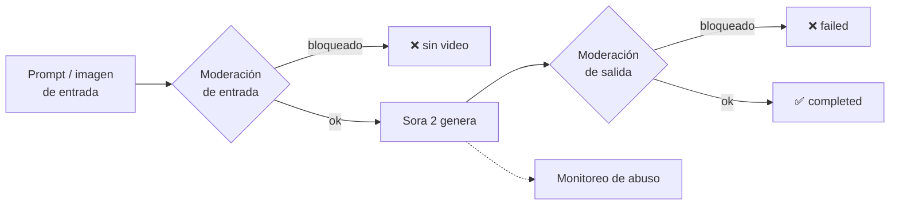

Restricciones documentadas para Sora 2 en Foundry:
- Solo contenido **apto para menores de 18 años**.
- **Personas reales**, incluidas figuras públicas: **no se pueden generar**.
- **Personajes y música con derechos de autor:** rechazados.
- **Imágenes de entrada con rostros humanos:** rechazadas.
- Contenido dañino: el prompt se bloquea y **no se devuelve video**.

Y de tu lado, como desarrollador (conecta con los [principios de IA responsable](../../parte1/modulo1/tema7.md) y los [guardrails de Foundry](../modulo7/tema5.md)):
- **Transparencia:** etiqueta el contenido como generado con IA. Un video realista puede usarse para desinformar (*deepfakes*).
- **Revisión humana** antes de publicar: el modelo puede producir errores físicos, sesgos o detalles inapropiados.
- **Privacidad:** no subas imágenes de terceros sin consentimiento, aunque el filtro no las detecte.
- **Derechos:** revisa los términos de uso antes de usar el video comercialmente.

## Usos típicos

| Uso | Ejemplo | Tip |
|---|---|---|
| Storyboards y previsualización | Validar una idea de comercial antes de filmar | 4 s, plano fijo, iterar rápido |
| Marketing de producto | Producto girando con luz de estudio | `input_reference` con la foto del producto (sin personas) |
| Material educativo | Animar un proceso (ciclo del agua, una fábrica) | Estilo 3D o animación, una idea por clip |
| Redes sociales | Clip vertical para Reels/TikTok | `size="720x1280"` |
| Prototipado cinematográfico | *Trailer* conceptual | Guion en tomas + unión con ffmpeg |

---

## Preguntas tipo examen

<details>
<summary><b>1.</b> Necesitas generar un clip corto a partir de una descripción de texto en Microsoft Foundry. ¿Qué tipo de modelo usas?</summary>

Un modelo de **generación de video: Sora / Sora 2**. Son los únicos modelos nativos de video en Foundry; los multimodales (GPT-4.1, GPT-5) aceptan imágenes de entrada pero no generan video, y GPT-Image genera imágenes fijas.
</details>

<details>
<summary><b>2.</b> ¿Qué capacidades agrega Sora 2 frente a Sora?</summary>

**Remix (video a video)** para ediciones dirigidas, **generación de audio** y mejor realismo y consistencia. Ambos hacen texto a video y aceptan imágenes como entrada.
</details>

<details>
<summary><b>3.</b> ¿Por qué la API de video es asíncrona y cuáles son sus tres pasos?</summary>

Porque generar video consume muchos recursos y tarda **1 a 5 minutos**, demasiado para mantener abierta una petición HTTP. Pasos: **1) crear el job** (`POST /videos` → `video_id`), **2) consultar el estado** (`GET /videos/{id}`) hasta `completed` o `failed`, **3) descargar** (`GET /videos/{id}/content?variant=video`).
</details>

<details>
<summary><b>4.</b> Ya tienes un video que te gusta, pero quieres que sea de atardecer en lugar de mediodía. ¿Qué haces?</summary>

Un **remix** con Sora 2 (`client.videos.remix(video_id=..., prompt=...)`) describiendo **solo ese cambio**. Conserva la composición y las transiciones, y es más predecible que regenerar desde cero.
</details>

<details>
<summary><b>5.</b> Quieres que el video empiece exactamente con la foto de tu producto. ¿Qué parámetro usas y qué requisito tiene la imagen?</summary>

`input_reference`. La imagen (JPEG, PNG o WebP) debe tener **exactamente la misma resolución que `size`** (p. ej. 1280×720) y **no debe contener rostros humanos**.
</details>

<details>
<summary><b>6.</b> Tu prompt pide un video de un actor famoso bailando. ¿Qué pasa?</summary>

Se rechaza: las restricciones de IA responsable de Sora impiden generar **personas reales**, incluidas figuras públicas. Tampoco se permiten personajes ni música con derechos de autor.
</details>

<details>
<summary><b>7.</b> Un compañero generó un video el lunes y el miércoles la descarga falla aunque tiene el <code>video_id</code>. ¿Por qué?</summary>

Los videos generados solo están disponibles **24 horas**. Después hay que crear un job nuevo. Por eso conviene copiar el MP4 a tu propio almacenamiento en cuanto el estado sea `completed`.
</details>

<details>
<summary><b>8.</b> Para un clip de 8 s, ¿qué recomienda Learn para que el modelo siga mejor las instrucciones?</summary>

Generar **dos clips de 4 s y unirlos**, porque el modelo sigue las instrucciones con más fidelidad en clips cortos. También: un movimiento de cámara y una acción del sujeto por toma.
</details>

<details>
<summary><b>9.</b> En tu código escribiste <code>model="Sora 2"</code> y recibes 404. ¿Qué está mal?</summary>

`model` debe ser el **nombre de tu deployment** (por ejemplo `sora-2`), no el nombre comercial del modelo. Revisa también que el endpoint termine en `/openai/v1/`.
</details>

<details>
<summary><b>10.</b> ¿Cuáles de estos elementos ayudan más a un prompt de video: "hermoso, increíble, cinematográfico" o "plano medio, dolly in lento, luz de ventana desde la izquierda, la mujer da tres pasos y se detiene"?</summary>

El segundo. Microsoft recomienda describir **encuadre, sujeto, acción en beats, luz y paleta, y estilo** con detalles **visibles y concretos**, en lugar de adjetivos vagos.
</details>

## Práctica oficial de Microsoft Learn
- [Ejercicio: Introducción a computer vision en Microsoft Foundry](https://learn.microsoft.com/es-es/training/modules/get-started-vision-azure/5-exercise)
- Para profundizar (nivel intermedio): módulo [Generate videos with Microsoft Foundry](https://learn.microsoft.com/es-es/training/modules/generate-video-with-foundry/) y su [ejercicio con Sora 2](https://learn.microsoft.com/es-es/training/modules/generate-video-with-foundry/5-exercise)

> [!NOTE]
> Si al hacer la práctica Sora 2 ya no aparece en el catálogo, revisa la unidad y las preguntas del módulo de todos modos: el contenido sigue siendo materia de examen.

## Fuentes
- [Modelos de generación de video (módulo de Learn de la AI-901)](https://learn.microsoft.com/es-es/training/modules/get-started-vision-azure/4-video-generation)
- [Generate videos with Microsoft Foundry (módulo de Learn: despliegue, prompts, Python y remix)](https://learn.microsoft.com/en-us/training/modules/generate-video-with-foundry/)
- [Sora 2 video generation overview (parámetros, tamaños, límites, IA responsable, troubleshooting)](https://learn.microsoft.com/en-us/azure/foundry/openai/concepts/video-generation)
- [Model retirement schedule – Microsoft Foundry](https://learn.microsoft.com/en-us/azure/foundry/openai/concepts/model-retirement-schedule)
- [Microsoft Q&A: fechas de retiro de Sora 2 en Foundry](https://learn.microsoft.com/en-us/answers/questions/5881436/azure-ai-foundry-sora-2-retirement-date-feels-too)
- [Sora 2 Prompting Guide – OpenAI Cookbook](https://developers.openai.com/cookbook/examples/sora/sora2_prompting_guide)
- [Video generation models as world simulators – reporte técnico de Sora (OpenAI)](https://openai.com/index/video-generation-models-as-world-simulators/)
- [Filtros de contenido en Azure OpenAI](https://learn.microsoft.com/es-es/azure/ai-foundry/openai/concepts/content-filter)
- [Precios de Azure OpenAI](https://azure.microsoft.com/es-mx/pricing/details/cognitive-services/openai-service/)
