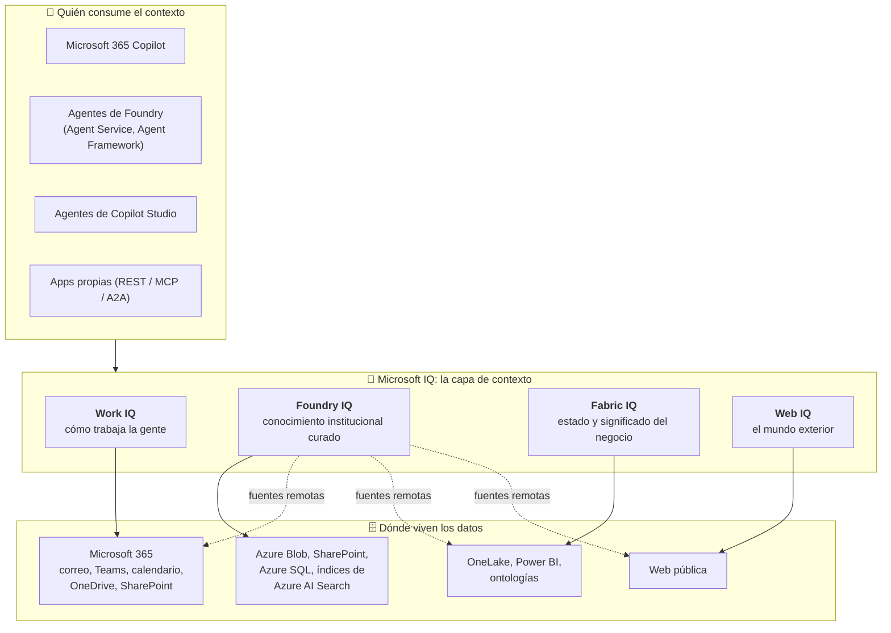
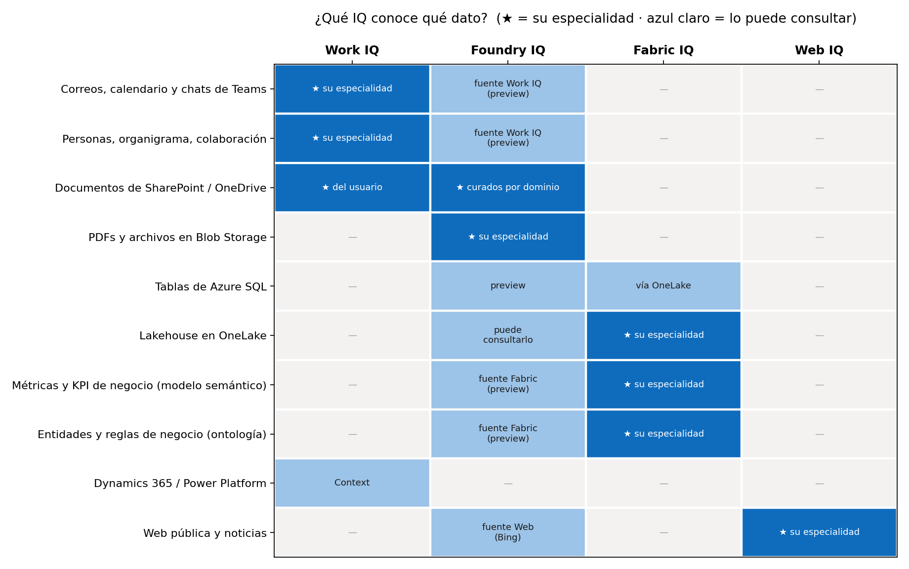
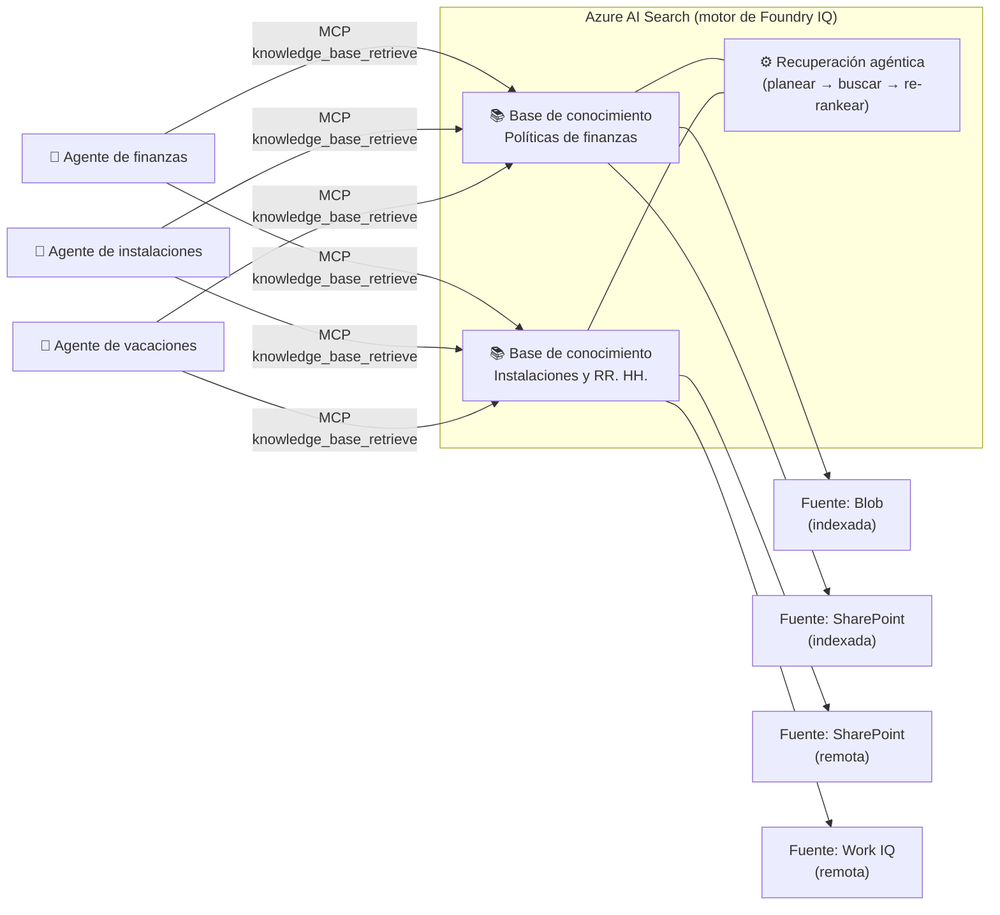
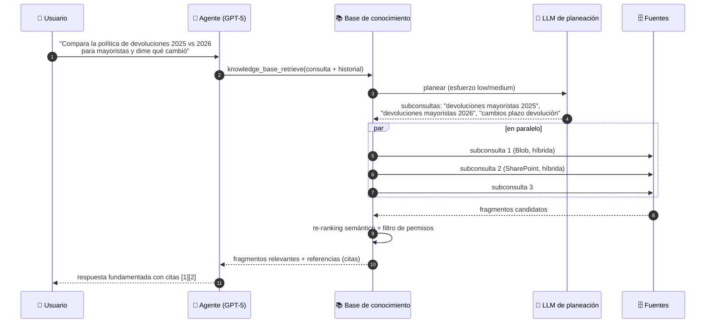
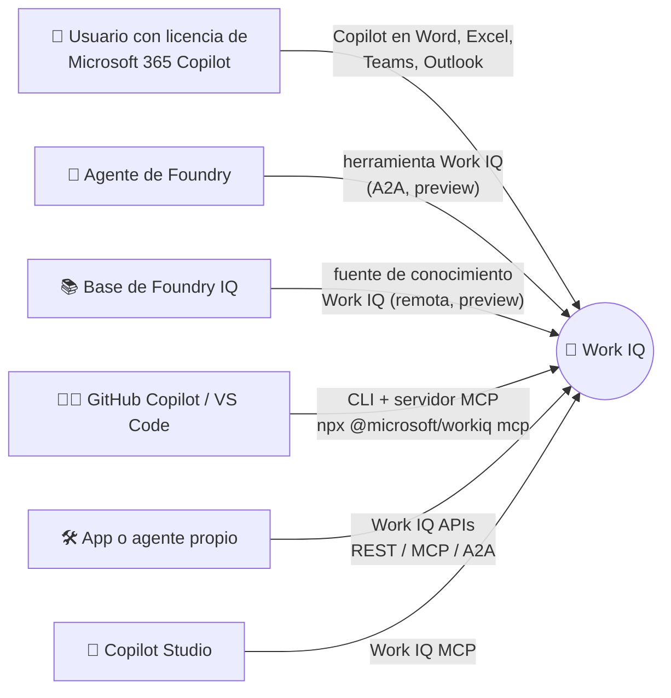
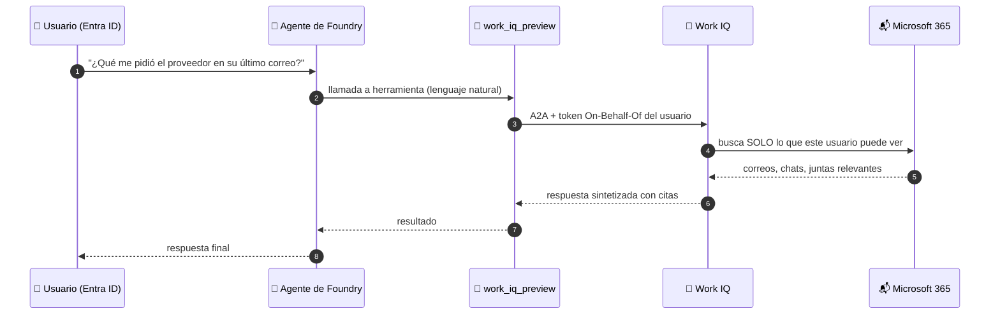
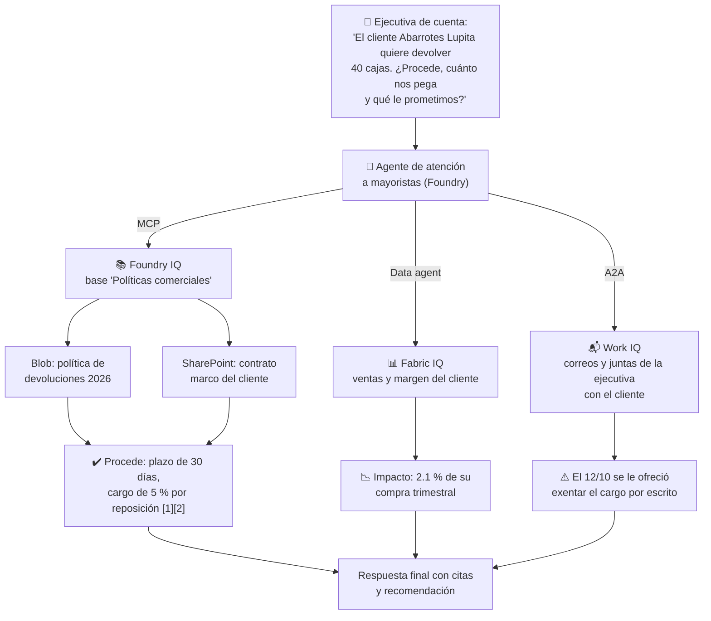
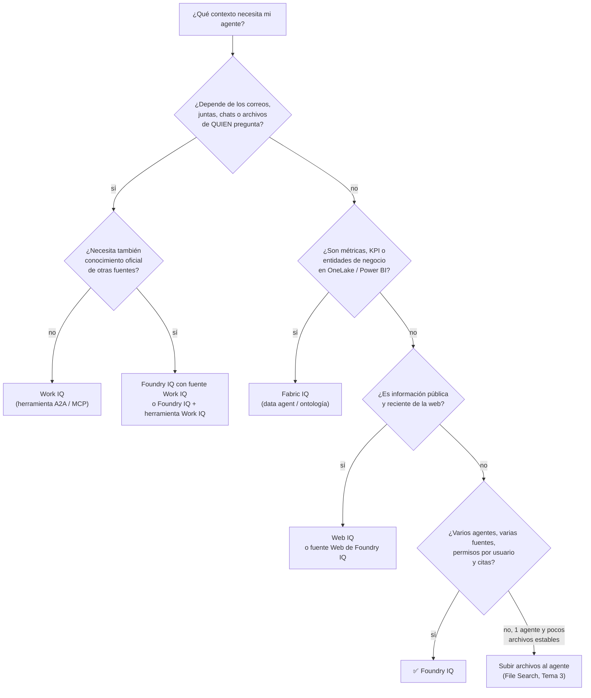

# Tema 1: Diferencia entre Foundry IQ y Work IQ

**Objetivo:** Distinguir con precisión qué es **Foundry IQ**, qué es **Work IQ** (y sus primos **Fabric IQ** y **Web IQ**), qué tipo de conocimiento aporta cada uno, cómo se conecta a un agente de Microsoft Foundry, con qué identidad y permisos trabaja, cuánto cuesta y cuándo conviene uno, otro o ambos. Al final hay preguntas tipo examen.

Lectura oficial: [¿Qué es Foundry IQ? – Microsoft Learn](https://learn.microsoft.com/es-es/training/modules/get-started-foundry-iq/2-explore-foundry-iq)

> [!NOTE]
> Este tema es el "**cuál y por qué**". El "cómo se conecta paso a paso" Foundry IQ a un agente está en el [Tema 4](./tema4.md), y la diferencia entre Foundry IQ y subir archivos directo al agente en el [Tema 3](./tema3.md). Los fundamentos de RAG están en la [Parte 1, Módulo 7](../../parte1/modulo7/tema1.md).

---

## 1. El problema que resuelven: un modelo listo pero sin contexto

Un LLM sabe mucho del mundo hasta su fecha de corte, pero **no sabe nada de tu empresa**: no conoce tus políticas, no ha leído tus correos, no sabe cuánto vendiste ayer ni qué publicó hoy un periódico. Ese contexto vive en lugares muy distintos y con reglas distintas:

| Tipo de contexto | Dónde vive | Quién lo "posee" | Qué tan rápido cambia |
|---|---|---|---|
| **Cómo trabaja cada persona** (correos, juntas, chats, con quién colabora) | Microsoft 365 | Cada usuario | Minuto a minuto |
| **Conocimiento institucional** (políticas, manuales, contratos, procedimientos) | SharePoint, Blob Storage, bases de datos | Un área dueña del contenido | Semanas o meses |
| **Estado del negocio** (ventas, inventario, clientes, KPI) | OneLake, Power BI | Equipos de datos | Horas o en tiempo real |
| **El mundo exterior** (noticias, precios públicos, regulación) | La web | Nadie en particular | Constantemente |

En Ignite 2025 Microsoft presentó una "**capa de inteligencia**" para agentes con una pieza para cada tipo de contexto. Hoy la familia se llama **Microsoft IQ** y tiene **cuatro** cargas de trabajo:



**Analogía:** imagina a un nuevo director que llega a la empresa.
- **Work IQ** es su **asistente personal**: conoce sus correos, juntas, chats y archivos, y sabe con quién trabaja y en qué está metido. Lo que sabe es **suyo**: el asistente de otro director sabe otras cosas.
- **Foundry IQ** es la **biblioteca corporativa con bibliotecario experto**: el contenido está curado y organizado por áreas, el bibliotecario entiende preguntas complicadas, busca en varios estantes a la vez, te entrega los fragmentos exactos con su referencia y solo te muestra lo que tienes permiso de ver. La misma biblioteca atiende a **todos**.
- **Fabric IQ** es el **analista de negocio**: sabe qué significa "cliente activo", cómo se calcula el margen y qué región vendió más.
- **Web IQ** es el **corresponsal**: te trae lo que está pasando afuera, hoy.

> [!IMPORTANT]
> Para la AI-901 lo central es **Foundry IQ** (es lo que enseña el módulo). Work IQ aparece como **fuente de conocimiento** dentro de Foundry IQ y como concepto que debes saber distinguir. Fabric IQ y Web IQ te sirven para no confundirte con los nombres.

---

## 2. La comparación a fondo

| | **Work IQ** | **Foundry IQ** |
|---|---|---|
| **Qué es** | Capa de **inteligencia del trabajo** sobre Microsoft 365: entiende personas, colaboración y flujos de trabajo | Capa de **conocimiento administrada** para datos empresariales, construida sobre **Azure AI Search** |
| **Pregunta típica** | "¿Qué acordamos en la junta con el proveedor y qué me falta enviar?" | "¿Cuál es la política de devoluciones para clientes mayoristas?" |
| **Naturaleza del conocimiento** | **Personal y dinámico**: cambia con cada correo y reunión | **Curado e institucional**: la "fuente de verdad" de un dominio |
| **Datos** | Correo, calendario, reuniones, chats de Teams, archivos, personas y organigrama; además datos de Dynamics 365 y Power Platform | Blob Storage, SharePoint, OneLake, Azure SQL, índices de AI Search, web, servidores MCP, Fabric… y **Work IQ** como fuente |
| **Unidad de organización** | El **usuario** (cada quien ve su propio trabajo) | La **base de conocimiento** por **dominio de negocio** ("Políticas de finanzas") |
| **Quién lo configura** | Administradores de Microsoft 365 (consentimiento, facturación) | **Desarrolladores** en Foundry (bases, fuentes, recuperación) |
| **Cómo razona** | Work IQ **recupera, razona y sintetiza** él mismo la respuesta (es un agente par) | **Recuperación agéntica**: planea subconsultas, busca en paralelo, re-rankea y devuelve **fragmentos con citas**; tu agente sintetiza |
| **Cómo se conecta a un agente de Foundry** | Herramienta **Work IQ** (protocolo **A2A**) o como **fuente** de una base de Foundry IQ | Herramienta **MCP** (`knowledge_base_retrieve`) o API REST de Azure AI Search |
| **Identidad** | **Siempre delegada**: corre como el usuario que inició sesión (On-Behalf-Of). **No** admite modo solo aplicación | La identidad del agente/proyecto (identidad administrada) y, en fuentes compatibles, la **identidad del usuario** para filtrar por permisos |
| **Permisos** | Lo que el usuario ya puede ver en M365 (RBAC, etiquetas de confidencialidad, barreras de información) | ACL sincronizadas de las fuentes compatibles + etiquetas de **Microsoft Purview** |
| **Costo** | Incluido en experiencias de Copilot para usuarios con licencia de **Microsoft 365 Copilot**; agentes propios y de terceros → facturación por uso en **Copilot Credits** | Nivel de **Azure AI Search** + **tokens** del modelo que planea la recuperación (hay nivel gratuito para pruebas) |
| **Estado (oct. 2026)** | APIs de Work IQ **GA** desde el 16 de junio de 2026; la **herramienta Work IQ en Foundry** está en **preview** | Algunas funciones **GA** y otras **preview** según la versión de la API de Azure AI Search |



Fíjate en la columna de Foundry IQ: es la que **más casillas puede consultar**, porque su trabajo es **orquestar fuentes**. Por eso Microsoft la describe como la capa que da a los agentes "acceso centralizado y fundamentado al conocimiento", incluso al de otras IQ.

---

## 3. Foundry IQ por dentro

### 3.1 Los tres componentes



| Componente | Qué es | Analogía |
|---|---|---|
| **Base de conocimiento** (*knowledge base*) | Recurso de nivel superior: agrupa fuentes de un mismo dominio, define el modelo de recuperación, el **esfuerzo de razonamiento** y las instrucciones de recuperación. Es la **única interfaz** que ve el agente | Una sala de la biblioteca ("Finanzas") |
| **Fuente de conocimiento** (*knowledge source*) | Conexión a contenido **indexado** (se copia, se trocea y se vectoriza en AI Search) o **remoto** (se consulta en vivo) | Cada estante o cada catálogo externo |
| **Recuperación agéntica** (*agentic retrieval*) | Proceso que **planea** subconsultas con un LLM, elige fuentes, busca **en paralelo**, **re-rankea** semánticamente y devuelve un resultado unificado **con citas** | El bibliotecario experto |

Ejemplo de Microsoft Learn: una organización quiere tres agentes (finanzas, instalaciones, vacaciones). Si cada uno tiene su propio RAG, se **duplican** el procesamiento de documentos, los embeddings, los índices, la lógica de recuperación, los permisos y el monitoreo, y los resultados pueden ser **inconsistentes**. Con Foundry IQ se crean bases por **dominio** y se conectan a los agentes que las necesitan: **una mejora en la base beneficia a todos**.


*Varios agentes, una capa de conocimiento. Imagen: Microsoft Learn (CC BY 4.0).*

### 3.2 Tipos de fuente de conocimiento

| Fuente | Indexada / remota | Estado | Nota |
|---|---|---|---|
| Índice de Azure AI Search existente | Indexada | GA | Reutilizas un índice que ya tenías |
| **Azure Blob Storage** | Indexada | GA | Genera solo el *pipeline* de indexación desde un contenedor |
| **OneLake** (lakehouse) | Indexada | GA | |
| Archivo (subida directa) | Indexada | Preview | Sin almacenamiento externo ni indexador |
| Azure SQL | Indexada | Preview | Tabla o vista |
| SharePoint indexado | Indexada | Preview | Respeta etiquetas de confidencialidad |
| SharePoint remoto | Remota | Preview | Consulta en vivo; **sin URL de cita** |
| **Work IQ** | Remota | Preview | Inteligencia organizacional de Microsoft 365 |
| Fabric Data Agent / Fabric Ontology | Remota | Preview | Respuestas de negocio desde Fabric IQ |
| Servidor MCP | Remota | Preview | Resultados en vivo de una herramienta externa |
| **Web** (Bing) | Remota | GA | Información pública en tiempo real; sin URL de cita |

- **Indexada** = Foundry IQ hace **chunking, embeddings y extracción de metadatos** automáticamente y refresca con ejecuciones programadas del indexador. Se busca por **palabras clave, vectores o híbrido**.
- **Remota** = **nunca se copia**: el motor llama a la API nativa de la plataforma al momento de la consulta.
- Todas pasan por **el mismo pipeline de ranking**, por eso la respuesta es una sola lista ordenada y no "tres respuestas pegadas".

### 3.3 La recuperación agéntica, paso a paso



El **esfuerzo de razonamiento** se configura por base de conocimiento:

| Esfuerzo | Qué hace el LLM | Cuándo usarlo |
|---|---|---|
| `minimal` | **Nada**: no hay planeación con LLM; busca directo | Preguntas simples, máxima velocidad y menor costo |
| `low` | Planea subconsultas y **elige fuentes** | El punto de partida razonable |
| `medium` | Lo de `low` + una **pasada iterativa** para profundizar | Preguntas compuestas o comparativas |

Para elegir fuentes, el LLM se guía por el **nombre** de cada fuente, la **descripción** del índice y las **instrucciones de recuperación** (`retrievalInstructions`), que funcionan como un prompt ("para preguntas de precios consulta primero la lista vigente"). Si una fuente debe consultarse **siempre**, se marca con `alwaysQuery`.

> [!TIP]
> Por eso Learn insiste en **planear** la base: **alcance**, **autoridad** (¿cuál es la fuente de verdad?), **frescura**, **metadatos**, **calidad del contenido** y **acceso**. Meter todo en una sola base vuelve la recuperación **menos precisa**: el contenido no relacionado o contradictorio diluye los resultados.

---

## 4. Work IQ por dentro

### 4.1 Qué es realmente

Work IQ es la capa que hace que **Microsoft 365 Copilot "conozca tu contexto"**. No es solo acceso a datos: construye continuamente un **entendimiento semántico** de la organización (índice semántico, memoria personal, personas y estructura organizacional, patrones de colaboración) y lo expone a cualquier agente con gobernanza integrada.

Sus cuatro piezas:

| Pieza | Qué hace | Ejemplo |
|---|---|---|
| **Chat** | Acceso programático a Microsoft 365 Copilot: responde con **citas**, como Copilot | "Resume mis correos recientes sobre el proyecto Contoso" |
| **Context** | Reúne el contenido que Copilot usaría para una pregunta y lo devuelve **sin sintetizar**, listo para que tu agente razone | Los 8 fragmentos más relevantes de correos y documentos |
| **Tools** | Un conjunto pequeño de herramientas genéricas (el **MCP de Work IQ** expone **10**) sobre correo, calendario, archivos, personas, chat y sitios | Enviar un correo, agendar una reunión, subir un documento |
| **Workspaces** | Almacenamiento de trabajo dentro del tenant (SharePoint Embedded) para tareas largas | Memoria y resultados intermedios de un agente que trabaja durante horas |

Se consume por **tres protocolos**: **A2A** (agente a agente), **MCP remoto** y **REST**.

> [!NOTE]
> **¿No es lo mismo que Microsoft Graph?** No. **Microsoft Graph** es la API de **datos crudos** de Microsoft 365, con cientos de permisos granulares: tú haces la búsqueda, el ranking y el razonamiento. **Work IQ** está por encima: ya entiende el contenido y a las personas, usa pocos permisos amplios evaluados por un **motor de políticas** en cada petición, y te devuelve contexto o respuestas listas para un agente.

### 4.2 Las puertas de entrada a Work IQ



### 4.3 Conectar Work IQ a un agente de Foundry (herramienta A2A)

El agente emite una llamada a la herramienta `work_iq_preview`; Foundry reenvía la pregunta a Work IQ por **A2A**; Work IQ recupera, razona y responde **como el usuario que inició sesión**; Foundry incorpora esa respuesta en la del agente.



**Configuración (una sola vez, la hace un administrador):**
1. Aprovisionar el **service principal de Work IQ** en el tenant.
2. Registrar una app en **Microsoft Entra ID** con el permiso **delegado** `WorkIQAgent.Ask` y dar **consentimiento de administrador** (requiere Global Administrator; actívalo solo a tiempo con PIM).
3. Habilitar la **facturación por uso** (Copilot Credits) o verificar la licencia que pida el conector.
4. En Foundry: **Settings → Connections → New connection → Work IQ** (OAuth2, scope `api://workiq.svc.cloud.microsoft/WorkIQAgent.Ask`) y agregar la URL de redirección que te muestra Foundry a la app registrada. Los campos de la conexión **no se pueden editar** después: si te equivocas, bórrala y créala de nuevo.

**El agente** (`pip install "azure-ai-projects>=2.3.0" azure-identity python-dotenv`):

```python
# agente_work_iq.py
import os
from dotenv import load_dotenv
from azure.identity import DefaultAzureCredential
from azure.ai.projects import AIProjectClient
from azure.ai.projects.models import PromptAgentDefinition, WorkIQPreviewTool

load_dotenv()
# FOUNDRY_PROJECT_ENDPOINT: endpoint del proyecto (página Overview)
# WORK_IQ_PROJECT_CONNECTION_ID: id completo de la conexión Work IQ del proyecto

with (
    DefaultAzureCredential() as credential,
    AIProjectClient(endpoint=os.environ["FOUNDRY_PROJECT_ENDPOINT"], credential=credential) as project,
):
    herramienta_work_iq = WorkIQPreviewTool(
        project_connection_id=os.environ["WORK_IQ_PROJECT_CONNECTION_ID"],
    )

    agente = project.agents.create_version(
        agent_name="asistente-trabajo",
        definition=PromptAgentDefinition(
            model="gpt-5-mini",
            instructions=(
                "Responde en español de México. Usa Work IQ para preguntas sobre los correos, "
                "reuniones, chats y archivos del usuario. Cita de dónde sale cada dato. "
                "Nunca envíes correos ni agendes reuniones sin confirmación explícita del usuario."
            ),
            tools=[herramienta_work_iq],
        ),
    )
    print(f"Agente creado: {agente.name} v{agente.version}")

    with project.get_openai_client(agent_name=agente.name) as openai:
        r = openai.responses.create(input="Resume mis correos recientes sobre el proyecto Contoso.")
        print(r.output_text)

    # Limpieza para no acumular versiones de prueba
    project.agents.delete_version(agent_name=agente.name, agent_version=agente.version)
```

**Explicación:**
- `WorkIQPreviewTool` solo necesita el **id de la conexión**: la autenticación OAuth y el token del usuario los maneja la conexión.
- La identidad es **delegada** (On-Behalf-Of): la respuesta depende de **quién** pregunta. Dos usuarios con la misma pregunta obtienen respuestas distintas, y está bien.
- **No hay modo solo aplicación**: un proceso nocturno sin usuario **no puede** usar Work IQ para "leer el correo de todos". Si necesitas eso, no es un caso de Work IQ.
- La identidad del agente necesita el rol **Foundry User** en la cuenta **y** en el proyecto.

---

## 5. ¿Work IQ como herramienta o como fuente de Foundry IQ?

Hay **dos formas** de que un agente de Foundry use Work IQ, y no son equivalentes:

| | **Herramienta Work IQ** (A2A) | **Fuente Work IQ dentro de una base de Foundry IQ** |
|---|---|---|
| Quién sintetiza | **Work IQ** responde como un agente par | **Tu agente**, con los fragmentos que devuelve la base |
| Combinación con otras fuentes | Tu agente decide cuándo llamar a cada herramienta | La recuperación agéntica **mezcla y re-rankea** Work IQ con Blob, SharePoint, web… en una sola lista |
| Acciones (enviar, agendar) | Posibles mediante las herramientas de Work IQ | No: una base de conocimiento solo **recupera** |
| Ideal para | Asistente personal de productividad | Agente de dominio que necesita "lo oficial + lo que se ha hablado" |
| Ejemplo | "Prepárame la junta de mañana con lo que tengo pendiente" | "¿Qué dice la política de devoluciones y qué le prometimos a este cliente por correo?" |

---

## 6. Fabric IQ y Web IQ en dos minutos

| | **Fabric IQ** | **Web IQ** |
|---|---|---|
| Qué aporta | **Significado de negocio** sobre los datos de OneLake: los agentes razonan con "clientes, envíos, activos" en vez de tablas | Información **fresca del mundo**: páginas web, noticias, imágenes, videos |
| Piezas | **Ontología** (entidades, relaciones, reglas y métricas ligadas a datos vivos), **Graph**, **Data agents**, **modelos semánticos** de Power BI, **Operations agents** | APIs de búsqueda web, navegación, noticias, imágenes, video y contenido de página completa |
| Cómo llega a un agente de Foundry | Publicando un **Data agent** de Fabric en Foundry, o como fuentes **Fabric Data Agent / Fabric Ontology** de Foundry IQ | SDK (Python/TypeScript) o **servidor MCP**; en Foundry IQ también existe la fuente **Web** (Bing) |
| Pregunta típica | "¿Qué región tuvo mayor margen el trimestre pasado?" | "¿Qué cambió esta semana en la regulación de facturación electrónica?" |

---

## 7. Combinarlos: un caso completo

Las IQ **no compiten**: cada una es independiente, pero se combinan para un contexto completo. Imagina el agente de atención a clientes mayoristas de una distribuidora (por ejemplo, la *Distribuidora Río Claro* del proyecto final):



- **Foundry IQ** responde lo **oficial** (política y contrato) y cualquier agente de la empresa puede reutilizar esa base.
- **Fabric IQ** responde con **números de negocio** consistentes con los reportes de Power BI.
- **Work IQ** aporta lo que **solo la ejecutiva sabe**: lo que se habló en sus correos. Otro usuario no vería esos correos.

---

## 8. Árbol de decisión



---

## 9. Seguridad y gobernanza: lo que cambia entre uno y otro

| Pregunta de seguridad | Work IQ | Foundry IQ |
|---|---|---|
| ¿Con qué identidad se consulta? | **Siempre la del usuario** (delegada, On-Behalf-Of) | La del agente/proyecto (**identidad administrada** con el rol *Search Index Data Reader*) y, en fuentes compatibles, la del usuario para filtrar |
| ¿Puede ver algo que el usuario no puede? | **No**, por diseño | No, en fuentes con **ACL sincronizadas**; en fuentes **sin** permisos por usuario, todos los usuarios del agente ven lo mismo |
| Etiquetas de confidencialidad (Purview) | Respetadas | Respetadas en fuentes compatibles |
| ¿Dónde se procesan los datos? | Dentro de la frontera del tenant de M365, pero las llamadas desde Foundry **pueden salir de la frontera de cumplimiento de Azure**: revisa residencia y región | En tu servicio de Azure AI Search (tu suscripción y región) |
| Red privada | Work IQ sigue siendo un destino **HTTPS público** aunque tu proyecto tenga *private endpoint* | Admite ingesta privada en varias fuentes indexadas |
| Auditoría | Cada invocación se registra y se evalúa con un motor de políticas | Registros de Azure AI Search y trazas de Foundry |
| Quién paga | Usuario con licencia de Copilot o **Copilot Credits** por uso | Tu suscripción de Azure (AI Search + tokens) |

---

## 10. Confusiones típicas

| ❌ Mito | ✅ Realidad |
|---|---|
| "Foundry IQ y Work IQ hacen lo mismo con distinto nombre" | Foundry IQ = conocimiento **institucional curado** y compartido; Work IQ = contexto **personal** del trabajo de cada usuario |
| "Foundry IQ es solo un índice vectorial" | Es una capa **sobre** Azure AI Search con bases, varias fuentes (indexadas y remotas), **recuperación agéntica**, permisos y citas |
| "Foundry IQ solo sirve para agentes de Foundry" | También para Microsoft Agent Framework, apps propias por **REST/SDK** y agentes de **Copilot Studio** (preview) |
| "Work IQ es Microsoft Graph" | Graph es la API de datos crudos; Work IQ **entiende** y **razona** sobre ellos y devuelve contexto listo para agentes |
| "Para usar Work IQ en un agente propio todos necesitan licencia de Copilot" | El acceso por API se cobra **por uso** (Copilot Credits); algunos conectores sí pueden pedir licencia por usuario |
| "Puedo usar Work IQ en un proceso automático sin usuario" | **No**: solo admite autenticación **delegada**; no hay modo solo aplicación |
| "Conectar la base al agente garantiza que la use" | Hay que **instruirlo**: cuándo recuperar, cómo citar y qué decir si no hay evidencia ([Tema 4](./tema4.md)) |
| "Mientras más fuentes en una base, mejor" | Bases por **dominio**: mezclar todo **reduce** la precisión |

## 11. Errores típicos

| Síntoma | Causa probable | Solución |
|---|---|---|
| **403** al probar una base de Foundry IQ en el Playground | La identidad administrada del proyecto no tiene **Search Index Data Reader** en AI Search | Asigna el rol |
| La base responde con contenido de otras áreas | Base demasiado amplia o fuentes contradictorias | Divide por dominio; usa `retrievalInstructions` y descripciones claras |
| **403** en la herramienta Work IQ | Facturación (Copilot Credits) no habilitada o falta licencia del conector | Habilita la facturación o verifica la licencia |
| **403** con `Required scopes = [...]` | Falta el **consentimiento de administrador** | Un Global Administrator da consentimiento a `WorkIQAgent.Ask` |
| **401** en Work IQ | Token emitido para otra audiencia | Pide el token para `api://workiq.svc.cloud.microsoft` |
| `Principal does not have access to API/Operation` | La identidad del agente no tiene **Foundry User** | Asígnalo en la cuenta y en el proyecto |
| Work IQ devuelve vacío | El usuario no tiene acceso a ese contenido o aún no se indexa | Verifica permisos en M365 y vuelve a intentar más tarde |

---

## Para el examen
- "Varios agentes de Foundry deben responder con documentos de SharePoint y Blob Storage, con **citas** y **permisos**, sin construir un RAG para cada uno" → **Foundry IQ**.
- "¿Qué proceso divide la pregunta en subconsultas, busca en varias fuentes en paralelo y re-rankea?" → **recuperación agéntica**.
- "¿Sobre qué servicio de Azure está construido Foundry IQ?" → **Azure AI Search**.
- "¿Qué rol necesita la identidad del proyecto para probar la base en el Playground?" → **Search Index Data Reader**.
- "¿Cómo se conecta una base de conocimiento a un agente?" → como **herramienta MCP**.
- "Un usuario de Microsoft 365 quiere que Copilot prepare su junta con sus correos y chats" → **Work IQ**.
- "¿Qué fuente de Foundry IQ trae el contexto de Microsoft 365 Copilot?" → **Work IQ**.
- "Un agente debe entender métricas de negocio definidas en modelos semánticos de Power BI" → **Fabric IQ**.

## Preguntas tipo examen

<details>
<summary><b>1.</b> Una empresa tiene tres agentes (finanzas, instalaciones y vacaciones) y cada uno tiene su propio pipeline de RAG. ¿Qué problema resuelve Foundry IQ?</summary>

La **duplicación** de procesamiento, embeddings, índices, lógica de recuperación, permisos y monitoreo, y la **inconsistencia** entre agentes. Con Foundry IQ se crean **bases de conocimiento por dominio** que varios agentes comparten; una mejora en la base beneficia a todos.
</details>

<details>
<summary><b>2.</b> ¿Cuáles son los tres componentes de Foundry IQ?</summary>

**Base de conocimiento** (recurso de nivel superior que agrupa fuentes y controla la recuperación), **fuente de conocimiento** (conexión a contenido indexado o remoto) y **recuperación agéntica** (planea, busca, re-rankea y devuelve resultados con citas).
</details>

<details>
<summary><b>3.</b> ¿Qué diferencia hay entre una fuente de conocimiento indexada y una remota?</summary>

La **indexada** se copia a Azure AI Search, donde se hace chunking, embeddings y extracción de metadatos (p. ej. Blob Storage, OneLake). La **remota** **no se copia**: se consulta en vivo por la API de la plataforma al momento de la pregunta (p. ej. SharePoint remoto, Work IQ, web).
</details>

<details>
<summary><b>4.</b> Un usuario pregunta a Copilot: "¿Qué pendientes me quedaron de la reunión del lunes con el proveedor?". ¿Qué capa aporta ese contexto?</summary>

**Work IQ**: entiende los correos, reuniones, chats y archivos **de ese usuario** en Microsoft 365.
</details>

<details>
<summary><b>5.</b> Un agente de soporte necesita responder con la política oficial de garantías y citar el documento. Varios agentes de la empresa usarán esa misma política. ¿Qué usas?</summary>

**Foundry IQ**: una base de conocimiento del dominio "Garantías" conectada a los agentes como **herramienta MCP**, con citas a la fuente original.
</details>

<details>
<summary><b>6.</b> Dos empleados hacen la misma pregunta a un agente que usa Work IQ y reciben respuestas distintas. ¿Es un error?</summary>

No. Work IQ trabaja con **identidad delegada** (On-Behalf-Of): cada respuesta se basa **solo** en lo que ese usuario puede ver en Microsoft 365.
</details>

<details>
<summary><b>7.</b> El agente devuelve 403 al consultar la base de conocimiento desde el Playground. ¿Qué falta?</summary>

Asignar a la **identidad administrada del proyecto** de Foundry el rol **Search Index Data Reader** sobre el recurso de **Azure AI Search**.
</details>

<details>
<summary><b>8.</b> ¿En qué servicio está construido Foundry IQ y qué tipos de búsqueda soporta?</summary>

En **Azure AI Search**. Soporta búsqueda por **palabras clave**, **vectorial** e **híbrida**, más **re-ranking semántico**.
</details>

<details>
<summary><b>9.</b> Un analista pregunta "¿Qué sucursal tuvo mejor margen el trimestre pasado según nuestro modelo de Power BI?". ¿Qué IQ es la especialista?</summary>

**Fabric IQ**: aporta significado de negocio (modelos semánticos, ontologías) sobre los datos de OneLake y Power BI.
</details>

<details>
<summary><b>10.</b> ¿Qué ventaja tiene agregar Work IQ como <i>fuente</i> de una base de Foundry IQ en lugar de usarlo como herramienta aparte?</summary>

La **recuperación agéntica** combina y **re-rankea** el contenido de Work IQ junto con las demás fuentes (políticas, contratos, web) en un **solo resultado con citas**, en vez de que el agente tenga que coordinar herramientas por separado.
</details>

## Práctica oficial de Microsoft Learn
- [Ejercicio: Introducción a Foundry IQ en Microsoft Foundry](https://learn.microsoft.com/es-es/training/modules/get-started-foundry-iq/5-exercise)
- Para profundizar: [Integrar tu agente con Microsoft 365](https://learn.microsoft.com/es-es/training/modules/integrate-foundry-agent-with-m365/)

## Fuentes
- [¿Qué es Foundry IQ? (módulo de Learn de la AI-901)](https://learn.microsoft.com/es-es/training/modules/get-started-foundry-iq/2-explore-foundry-iq)
- [What is Foundry IQ? – Microsoft Foundry (componentes, recuperación agéntica, relación con Work IQ y Fabric IQ)](https://learn.microsoft.com/en-us/azure/foundry/agents/concepts/what-is-foundry-iq)
- [Knowledge sources for agentic retrieval – Azure AI Search (tipos de fuente y esfuerzo de razonamiento)](https://learn.microsoft.com/en-us/azure/search/agentic-knowledge-source-overview)
- [Microsoft IQ (las cuatro cargas de trabajo)](https://learn.microsoft.com/microsoft-iq/)
- [Work IQ – Microsoft 365 Copilot extensibility (Chat, Context, Tools, Workspaces; licenciamiento)](https://learn.microsoft.com/en-us/microsoft-365/copilot/extensibility/work-iq)
- [Connect agents to Microsoft 365 with Work IQ (preview) – Microsoft Foundry](https://learn.microsoft.com/en-us/azure/foundry/agents/how-to/tools/work-iq)
- [Work IQ CLI y servidor MCP](https://learn.microsoft.com/microsoft-365-copilot/extensibility/workiq-overview)
- [Announcing the new Work IQ APIs – Microsoft 365 Blog (junio de 2026)](https://www.microsoft.com/en-us/microsoft-365/blog/2026/06/02/announcing-the-new-work-iq-apis/)
- [What is Fabric IQ? – Microsoft Fabric](https://learn.microsoft.com/en-us/fabric/iq/overview)
- [Microsoft Web IQ](https://learn.microsoft.com/en-us/web-iq/)
- [Microsoft debuts Work IQ, Fabric IQ and Foundry IQ – Cloud Wars](https://cloudwars.com/ai/microsoft-debuts-work-iq-fabric-iq-and-foundry-iq-a-unified-intelligence-layer-for-the-ai-powered-enterprise/)
