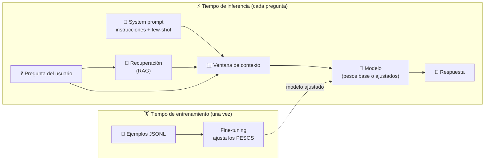
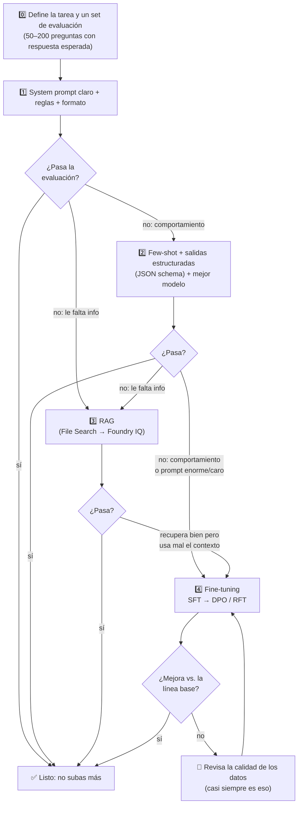
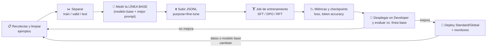
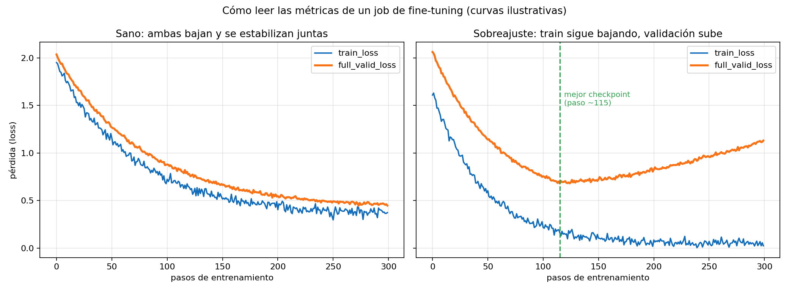
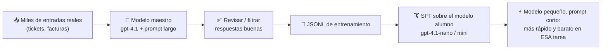
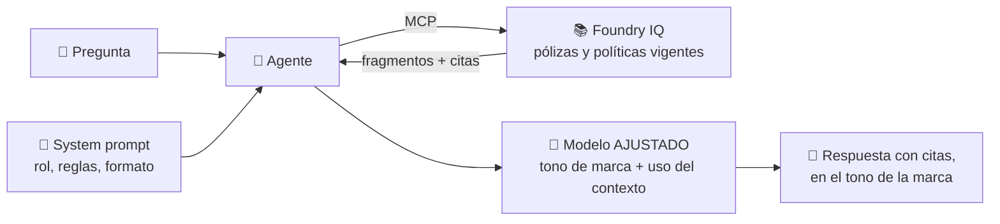

# Tema 2: Cuándo usar system prompt, cuándo usar RAG y cuándo usar fine-tuning

**Objetivo:** Saber diagnosticar **qué le falta** a tu solución de IA (instrucciones, conocimiento o habilidad), elegir la palanca correcta (system prompt, RAG o fine-tuning), entender a fondo cómo funciona el fine-tuning en Microsoft Foundry (SFT, DPO, RFT, niveles de entrenamiento, despliegue y costos) y saber cuándo combinarlas. Al final hay preguntas tipo examen.

Lectura oficial: [Cuándo usar fine-tuning en Microsoft Foundry](https://learn.microsoft.com/es-es/azure/foundry/openai/concepts/fine-tuning-considerations)

> [!NOTE]
> Este tema es el "**cuál elijo y por qué**". El "cómo escribir" un buen system prompt y cómo inyectar el contexto del RAG está en la [Parte 1, Módulo 2, Tema 2](../../parte1/modulo2/tema2.md), y la arquitectura completa de un RAG en la [Parte 1, Módulo 7](../../parte1/modulo7/tema1.md). Aquí no lo repetimos: nos enfocamos en **decidir** y en el **fine-tuning**, que no se cubre en otro lado del acordeón.

Hay **tres palancas** para adaptar un modelo a tu caso de uso, y elegir la incorrecta sale caro:
- **System prompt (ingeniería de prompts):** le dices al modelo **cómo comportarse**.
- **RAG (generación aumentada por recuperación):** le das **información** que no tiene, en el momento de la pregunta.
- **Fine-tuning (ajuste fino):** **reentrenas** parcialmente el modelo con ejemplos para cambiar su comportamiento **de forma permanente**.

**Analogía:** preparar a un nuevo empleado.
- **System prompt** = el **instructivo** que le das el primer día ("sé amable, responde en viñetas, nunca prometas fechas").
- **RAG** = acceso a la **biblioteca de manuales** para que consulte cuando lo necesite. No tiene que memorizarlos y, si un manual cambia, consulta la versión nueva.
- **Fine-tuning** = mandarlo a un **curso intensivo** hasta que el estilo y la habilidad se le vuelvan naturales. Ya no necesita leer el instructivo cada vez… pero lo que aprendió en el curso **no se actualiza solo**.

---

## 1. La pregunta correcta: ¿qué le falta al modelo?

Antes de elegir tecnología, diagnostica. Casi todos los problemas caen en **dos ejes independientes**:


| Eje | Pregunta | Palanca |
|---|---|---|
| **Conocimiento** ("le falta **saber**") | ¿El modelo no tiene la información: es privada, reciente o muy específica? | **RAG** |
| **Comportamiento** ("le falta saber **hacer**") | ¿Tiene la información, pero no responde con el formato, tono, criterio o habilidad que necesitas? | **Prompt** → y si no basta, **fine-tuning** |

> [!IMPORTANT]
> El error más común (y la trampa favorita del examen) es usar **fine-tuning para enseñarle datos**: "entreno el modelo con el catálogo de productos para que conteste precios". Es la palanca equivocada. Los datos cambian, el modelo ajustado no cita fuentes, no respeta permisos y puede **inventar** precios con mucha seguridad. Para **datos** → **RAG**. Para **comportamiento** → **prompt / fine-tuning**.

### Dónde actúa cada palanca



- **System prompt y RAG** viven en la **ventana de contexto**: son la "memoria de trabajo" del modelo. Se cambian al instante y **se pagan en cada llamada** (tokens de entrada).
- **Fine-tuning** vive en los **pesos**: es la "memoria de largo plazo". Cuesta entrenar y hospedar, pero ya no ocupa tokens en cada llamada.

---

## 2. La comparación a fondo

| | **System prompt** | **RAG** | **Fine-tuning** |
|---|---|---|---|
| Cambia… | Comportamiento, tono, formato, reglas | **Conocimiento** disponible en cada respuesta | **Comportamiento aprendido** (pesos) |
| ¿Modifica el modelo? | No | No | **Sí** |
| Datos necesarios | Ninguno (algunos ejemplos *few-shot*) | Tus documentos o bases de datos | De decenas a miles de ejemplos **de alta calidad** |
| Información actualizada | No aplica | ✅ Actualizas el índice y listo | ❌ Hay que reentrenar |
| Citas y trazabilidad | No | ✅ | ❌ |
| Permisos por usuario | No | ✅ (con Foundry IQ / filtros de seguridad) | ❌ Todos comparten lo que aprendió |
| Costo inicial | Mínimo | Medio (indexar, servicio de búsqueda) | Alto (entrenar + evaluar) |
| Costo recurrente | Tokens del prompt en **cada** llamada | Tokens del contexto recuperado + servicio de búsqueda | **Hospedaje por hora** + tokens (prompt más corto) |
| Latencia | Crece con el largo del prompt | + tiempo de búsqueda | Baja (prompt corto, modelo más pequeño posible) |
| Tiempo para implementar | Minutos | Horas o días | Días o semanas |
| Iteración | Instantánea | Rápida | Lenta (cada cambio = nuevo entrenamiento) |
| Riesgo principal | Prompts largos y frágiles | Mala recuperación ("basura entra, basura sale") | Sobreajuste, olvido de habilidades, mantenimiento, costo |
| Cuando el modelo base se retira | Nada que hacer | Nada que hacer | **Reentrenar** sobre el nuevo modelo base |

---

## 3. La escalera: en qué orden subir

Microsoft lo dice claro: el fine-tuning es "**un proceso iterativo de ingeniería, no una mejora garantizada**", y sus beneficios hay que **demostrarlos** contra una línea base. Por eso se sube por escalones y **se mide en cada uno**:



**Señales de que el prompt ya no da para más:**
- El system prompt pasó de miles de tokens por tantos ejemplos y casos especiales, y aun así **falla en casos raros**.
- El formato sale bien el 90 % de las veces, pero necesitas el 99.9 % (un sistema que procesa miles de documentos al día).
- El tono de marca "casi" se logra, pero siempre suena genérico.
- La latencia o el costo por llamada se volvieron un problema **por el tamaño del prompt**.
- Necesitas que un modelo **pequeño y barato** haga lo que hoy solo logra uno grande.

**Señales de que lo que falta es RAG (y no fine-tuning):**
- El modelo **inventa** datos de tu empresa (precios, políticas, nombres de productos).
- La información **cambia** cada semana o cada mes.
- Necesitas **citas** o necesitas que cada usuario vea solo **lo que tiene permiso** de ver.

---

## 4. Diagnóstico por síntoma

| Síntoma | Causa | Primera palanca | Si no basta |
|---|---|---|---|
| Inventa políticas, precios o datos internos | Le falta **conocimiento** | **RAG** | Mejorar chunking, búsqueda híbrida, re-ranking |
| La información que da está desactualizada | Conocimiento congelado | **RAG** con fuentes sincronizadas | — (nunca fine-tuning) |
| Responde en inglés o en un tono que no quieres | Instrucciones | **System prompt** | Few-shot; luego **DPO** |
| El JSON a veces viene incompleto o mal formado | Formato | **Salidas estructuradas** (JSON schema) | **SFT** |
| No conoce siglas o términos internos | Vocabulario | Glosario en el **prompt** o como fuente de **RAG** | SFT si son cientos de términos usados en contexto |
| Clasifica mal en tus 40 categorías internas | Criterio de la tarea | Few-shot con ejemplos de cada categoría | **SFT** |
| Elige mal la herramienta o llena mal sus argumentos | Uso de herramientas | Mejores **nombres y descripciones** de herramientas | **SFT** con ejemplos de llamadas a herramientas |
| Recupera los documentos correctos pero responde con datos irrelevantes | Usa mal el contexto | Instrucciones de cómo usar la evidencia | **SFT** con ejemplos que incluyen contexto ruidoso |
| Prompt de 6,000 tokens, lento y caro | Costo y latencia | Recortar el prompt; caché de prompts | **SFT / destilación** a un modelo pequeño |
| Razona mal en un problema experto con respuesta verificable | Habilidad de razonamiento | Modelo de razonamiento + mejor prompt | **RFT** |
| Revela información o se sale de su rol | Seguridad | System prompt + **guardrails** ([Tema 5](./tema5.md)) | Fine-tuning **no** sustituye los controles de seguridad |

---

## 5. Fine-tuning a fondo

### 5.1 Qué pasa por dentro

Un modelo base ya sabe lenguaje, razonamiento y mucho del mundo. El fine-tuning **continúa el entrenamiento** con tus ejemplos para **mover un poco los pesos** en la dirección de tu tarea. No se entrena desde cero: se construye sobre lo que el modelo ya sabe.

- En la práctica no se reentrenan los miles de millones de parámetros: se usan técnicas eficientes como **LoRA** (*Low-Rank Adaptation*), que entrenan pequeñas matrices "adaptadoras" que se suman a los pesos originales. Por eso Foundry habla de **adaptadores** y por eso un adaptador **no es intercambiable** entre modelos base parecidos.
- Lo que el fine-tuning enseña bien: **patrones** (formato, estilo, criterio, cuándo llamar a una herramienta, cómo usar el contexto).
- Lo que enseña mal: **hechos**. El modelo puede "recordarlos" de forma aproximada y mezclarlos, sin poder citar de dónde salieron.
- Riesgo: si entrenas demasiado con datos muy estrechos, el modelo puede **perder habilidades generales** (olvido catastrófico) o **memorizar** los ejemplos (sobreajuste).

### 5.2 Los tres métodos de Managed Training

| Método | Señal de entrenamiento | Cuándo encaja | Ejemplo |
|---|---|---|---|
| **SFT** (*Supervised Fine-Tuning*) | Prompts y **respuestas deseadas** | Puedes **demostrar** el comportamiento correcto | Clasificar tickets; extraer campos de una factura a un JSON fijo |
| **DPO** (*Direct Preference Optimization*) | Respuesta **preferida** y **rechazada** para la misma entrada | La calidad depende de **preferencias** (tono, completitud) más que de una única respuesta correcta | Que el asistente suene a tu marca, ni muy formal ni muy coloquial |
| **RFT** (*Reinforcement Fine-Tuning*) | Prompts + un **calificador** (*grader*) que puntúa las respuestas generadas | Hay **muchas soluciones válidas** y puedes **calificarlas de forma confiable** | Razonar un dictamen de riesgo financiero cuya conclusión se puede verificar |

Se pueden **apilar**: primero **SFT** para enseñar la tarea y luego **DPO** para pulir el estilo.

**Formato de los datos (JSONL, una línea por ejemplo):**

SFT, el formato de chat de siempre:
```json
{"messages": [{"role": "system", "content": "Clasifica el ticket en una categoría de Río Claro."}, {"role": "user", "content": "Me llegaron 3 cajas de aceite menos de lo facturado"}, {"role": "assistant", "content": "{\"categoria\": \"Faltante en entrega\", \"prioridad\": \"alta\"}"}]}
```

DPO, la misma entrada con una respuesta preferida y una rechazada:
```json
{"input": {"messages": [{"role": "user", "content": "¿Ya salió mi pedido?"}]}, "preferred_output": [{"role": "assistant", "content": "¡Sí! Tu pedido salió hoy a las 10:40 y llega mañana antes de las 2 pm. ¿Te ayudo con algo más?"}], "non_preferred_output": [{"role": "assistant", "content": "Estimado cliente: le informamos que su solicitud ha sido procesada conforme a los lineamientos vigentes."}]}
```

RFT, prompt + dato de referencia que usará el calificador (estructura simplificada; revisa la guía de RFT para el formato exacto de tu modelo):
```json
{"messages": [{"role": "user", "content": "Cliente con 3 facturas vencidas a 45 días y crédito de $200,000. ¿Se le libera un pedido de $80,000?"}], "decision_correcta": "rechazar"}
```

> [!TIP]
> **¿Cuántos ejemplos?** La guía de OpenAI pone el mínimo en **10**, reporta mejoras con **50 a 100** y recomienda empezar con **50 ejemplos bien hechos** y evaluar. Si con 50 mejora, agrega más; si con 50 no cambia nada, replantea la tarea o el prompt antes de juntar más datos. Importa más la **calidad** que la cantidad: ejemplos **precisos, consistentes y representativos**, sin duplicados, sin sesgos y **sin datos personales sensibles**. Separa siempre **entrenamiento**, **validación** y **prueba final**.

### 5.3 Modelos, niveles de entrenamiento y despliegue

**Modelos (selección, octubre de 2026):**

| Modelo | Métodos | Nota |
|---|---|---|
| gpt-4.1, gpt-4.1-mini, gpt-4.1-nano | SFT, DPO | La opción más común para empezar |
| gpt-4o, gpt-4o-mini | SFT (DPO en gpt-4o) | |
| o4-mini | **RFT** | Modelo de razonamiento |
| gpt-5 | **RFT** | Requiere invitación |
| gpt-oss-20b / gpt-oss-120b | SFT (RFT en 120b, preview) | Modelos abiertos de OpenAI |
| Llama-3.3-70B, Qwen3-32B, Ministral-3B, entre otros | SFT | Modelos abiertos en Foundry |

**Niveles de entrenamiento:**

| Nivel | Dónde entrena | Para qué |
|---|---|---|
| **Standard** | En la región de tu recurso, **con** residencia de datos | Producción con requisitos de cumplimiento |
| **Data zone** | Dentro de una zona de datos (hoy solo EE. UU.) | Residencia por zona |
| **Global** | Capacidad fuera de tu región: **más barato y colas más rápidas**, **sin** residencia de datos | La mayoría de los casos |
| **Developer** | Capacidad ociosa: **lo más barato**, sin SLA, el job puede ser **interrumpido** | Experimentar |

**Despliegue del modelo ajustado:**
- **Standard / Global Standard:** pago por token **más una tarifa de hospedaje por hora** (en la familia GPT-4.1 ronda **$1.70 USD/hora**, aunque no lo uses). Revisa la [página de precios](https://azure.microsoft.com/es-mx/pricing/details/cognitive-services/openai-service/).
- **Developer:** pago por token, **sin** cargo por hora, **solo para evaluar**: dura **24 horas** y no tiene SLA. Ideal para comparar *checkpoints* antes de pagar hospedaje.
- **Provisioned Throughput (PTU):** capacidad reservada para cargas grandes y predecibles.

> [!WARNING]
> Cancelar un job de entrenamiento **no** borra los deployments ni detiene sus cargos. Un deployment de un modelo ajustado cobra hospedaje **cada hora**: bórralo cuando termines de probar. Borra también los archivos de entrenamiento que ya no uses.

### 5.4 El ciclo completo



### 5.5 El código (`finetune_sft.py`)

```python
# pip install "azure-ai-projects>=2.0.0" azure-identity python-dotenv openai
import os, time
from dotenv import load_dotenv
from azure.identity import DefaultAzureCredential
from azure.ai.projects import AIProjectClient

load_dotenv()
project = AIProjectClient(endpoint=os.environ["FOUNDRY_PROJECT_ENDPOINT"],
                          credential=DefaultAzureCredential())
client = project.get_openai_client()

# 1) Subir los datos (un archivo de entrenamiento y otro de validación)
with open("train.jsonl", "rb") as f:
    train = client.files.create(file=f, purpose="fine-tune")
with open("valid.jsonl", "rb") as f:
    valid = client.files.create(file=f, purpose="fine-tune")
client.files.wait_for_processing(train.id)
client.files.wait_for_processing(valid.id)

# 2) Crear el job (deja los hiperparámetros en "auto" la primera vez)
job = client.fine_tuning.jobs.create(
    model=os.environ["FINE_TUNING_MODEL"],          # p. ej. gpt-4.1-mini
    training_file=train.id,
    validation_file=valid.id,
    suffix="tickets-rioclaro",                       # aparece en el nombre del modelo ajustado
    method={
        "type": "supervised",                        # SFT
        "supervised": {"hyperparameters": {
            "n_epochs": "auto", "batch_size": "auto", "learning_rate_multiplier": "auto"}},
    },
    extra_body={"trainingType": os.environ["FINE_TUNING_TRAINING_TYPE"]},  # Standard / Global / Developer
)
print("Job:", job.id, job.status)

# 3) Esperar (puede tardar de minutos a horas) y revisar eventos
while job.status not in ("succeeded", "failed", "cancelled"):
    time.sleep(60)
    job = client.fine_tuning.jobs.retrieve(job.id)
    print("Estado:", job.status)

for evento in client.fine_tuning.jobs.list_events(job.id).data:
    print(evento.created_at, evento.message)

if job.status == "succeeded":
    print("Modelo ajustado:", job.fine_tuned_model)
    for cp in client.fine_tuning.jobs.checkpoints.list(job.id).data:
        print("Checkpoint:", cp.fine_tuned_model_checkpoint, cp.metrics)
else:
    print("Error:", job.error)
```

**Explicación:**
- Los hiperparámetros clave son **épocas** (cuántas veces ve cada ejemplo), **tamaño de lote** y **multiplicador de tasa de aprendizaje**. Microsoft recomienda dejar los valores por defecto en el primer job.
- El **despliegue** del modelo ajustado se hace en el portal de Foundry. Después se llama como cualquier otro: `model="<nombre-de-tu-deployment>"`, con un prompt **mucho más corto**, porque ya no necesitas los ejemplos *few-shot*.
- Para cambiar a **DPO** el `method` es `{"type": "dpo", ...}`; para **RFT**, `{"type": "reinforcement", ...}` con la definición del calificador.

### 5.6 Cómo leer las métricas



| Métrica | Qué es | Qué esperar |
|---|---|---|
| `train_loss` | Error en el lote de entrenamiento actual | Que **baje** |
| `full_valid_loss` | Error en todo el set de validación al final de cada época | Que baje **junto** con la de entrenamiento |
| `train_mean_token_accuracy` | Fracción de tokens objetivo que acierta en entrenamiento | Que **suba** |
| `full_valid_mean_token_accuracy` | Lo mismo, en validación | Que suba |

- Si la de entrenamiento baja y la de validación **sube**, el modelo está **memorizando** (sobreajuste): usa un *checkpoint* anterior, baja las épocas o agrega datos más variados.
- **No** asumas que el último *checkpoint* es el mejor: compáralos con tu **set de prueba** y con métricas de la tarea (exactitud de la categoría, JSON válido, calificación humana), no solo con la pérdida.
- En **RFT**, que la recompensa suba **no** prueba que el modelo mejoró: puede estar "haciéndole trampa" al calificador (*reward hacking*). Prueba el calificador con respuestas correctas, incorrectas y adversarias.

### 5.7 Destilación: un modelo chico que imita a uno grande



Es uno de los usos más rentables del fine-tuning: el modelo grande genera ejemplos de calidad ("maestro") y el pequeño aprende a imitarlo **solo en esa tarea** ("alumno").

### 5.8 ¿Cuándo se paga solo?

El fine-tuning cambia la estructura del costo: pagas **hospedaje fijo por hora**, pero cada llamada usa un **prompt más corto** y puede usar un **modelo más pequeño**.


*Supuestos ilustrativos (USD por millón de tokens de entrada/salida): A gpt-4.1 base $2/$8; B gpt-4.1-mini base $0.40/$1.60; C gpt-4.1-mini ajustado $0.80/$3.20 + $1.70/h de hospedaje 24/7. No incluye el costo de entrenamiento. Verifica precios vigentes.*

Lecciones:
- Contra un modelo **grande** con un prompt enorme, el fine-tuning se paga con **volumen moderado**.
- Contra un modelo **pequeño** con prompt largo, solo se paga con **mucho volumen**… salvo que la razón sea **calidad**, no costo.
- Con **poco volumen**, el hospedaje por hora domina: el prompt bien hecho casi siempre gana.

### 5.9 Riesgos y responsabilidades

- **Seguridad:** el fine-tuning **no reemplaza** los filtros de contenido ni los guardrails de la aplicación. Para los modelos de OpenAI, Foundry revisa los datos de entrenamiento y el modelo resultante con evaluaciones de seguridad antes de permitir el despliegue.
- **Privacidad:** lo que pongas en los datos de entrenamiento puede "salir" en las respuestas. No incluyas datos personales ni secretos.
- **Residencia de datos:** los niveles **Global** y **Developer** pueden entrenar fuera de tu región.
- **Mantenimiento:** cuando el modelo base se acerca a su retiro, hay que **reentrenar** sobre el nuevo. Con RAG y prompts no tienes ese problema.
- **Deployments inactivos:** un deployment de modelo ajustado que no se usa durante un tiempo puede eliminarse automáticamente; el modelo sigue existiendo y lo puedes volver a desplegar.

---

## 6. No son excluyentes: patrones de combinación

| Patrón | Cuándo | Ejemplo |
|---|---|---|
| **Solo prompt** | El modelo ya sabe hacerlo; solo hay que orientarlo | Redactar correos con un tono definido |
| **Prompt + RAG** (el más común) | Hay datos privados o cambiantes | Asistente de políticas de RR. HH. con Foundry IQ |
| **Prompt + fine-tuning** | Tarea muy repetitiva, sin datos cambiantes, con alto volumen | Clasificar 50,000 tickets al día con un modelo pequeño |
| **Prompt + RAG + fine-tuning** | Producción madura: conocimiento cambiante **y** un comportamiento muy específico | Asistente de una aseguradora con tono de marca que responde sobre las pólizas del cliente |

En el último patrón, el fine-tuning no le enseña los datos: le enseña a **usar bien el contexto recuperado** (priorizar lo relevante e ignorar lo irrelevante), que es uno de los casos de uso que Microsoft lista explícitamente.



---

## 7. Caso práctico: la evolución de un clasificador

La *Distribuidora Río Claro* recibe ~3,000 tickets de soporte al día y quiere clasificarlos en **40 categorías internas** y extraer el número de pedido. Así evoluciona la solución (números ilustrativos):

| Versión | Qué se hizo | Exactitud | Costo / 1,000 tickets | Lección |
|---|---|---|---|---|
| v1 | gpt-4.1 + system prompt con la lista de categorías | 71 % | ~$4 | Confunde categorías parecidas |
| v2 | + 3 ejemplos *few-shot* por categoría (prompt de ~6,000 tokens) | 86 % | ~$13 | Mejoró, pero el prompt es enorme |
| v3 | + RAG con el **manual de categorías** | 87 % | ~$15 | Casi no ayudó: **no le faltaba información, le faltaba criterio** |
| v4 | **SFT** de gpt-4.1-mini con 1,500 tickets etiquetados, prompt de 300 tokens | 94 % | ~$1.50 + hospedaje | El comportamiento se volvió consistente y barato |

La lección de la v3 es la más importante: **agregar RAG a un problema de comportamiento no lo arregla**. Diagnosticar el eje correcto ahorra semanas.

---

## 8. Mitos

| ❌ Mito | ✅ Realidad |
|---|---|
| "Fine-tuning para que el modelo se sepa mis documentos" | Para **conocimiento** → **RAG**. El fine-tuning enseña **comportamiento** |
| "El fine-tuning siempre mejora el modelo" | No está garantizado: hay que **compararlo** con la línea base en datos que no vio |
| "Fine-tuning elimina las alucinaciones" | Puede **aumentarlas** si le pides hechos; RAG con citas es lo que las reduce |
| "Si uso RAG ya no necesito system prompt" | El system prompt le dice **cómo usar** el contexto: citar, no inventar, qué hacer si no hay evidencia |
| "Más épocas = mejor" | Más épocas puede significar **memorizar** (sobreajuste) |
| "Entreno una vez y listo" | Los datos cambian y los modelos base se retiran: el fine-tuning se **mantiene** |
| "El fine-tuning sustituye a los filtros de contenido" | No: los guardrails y filtros siguen siendo necesarios |

---

## Para el examen
- "El modelo debe responder siempre en español formal y en viñetas" → **system prompt**.
- "Responder con información privada que cambia cada trimestre, con citas y permisos" → **RAG** (Foundry IQ).
- "Un estilo o formato muy consistente que no se logra con prompts, o un prompt enorme y caro" → **fine-tuning**.
- "¿Qué técnica modifica los pesos del modelo?" → **fine-tuning** (prompt y RAG no los modifican).
- "¿Por dónde se empieza?" → **siempre por el prompt**.
- SFT = respuestas deseadas; DPO = preferida vs. rechazada; RFT = calificador.

## Preguntas tipo examen

<details>
<summary><b>1.</b> Un banco quiere que su asistente conteste sobre las tasas de interés vigentes, que cambian cada semana. ¿Qué palanca usas?</summary>

**RAG**. La información cambia con frecuencia; con RAG actualizas la fuente y la siguiente respuesta ya usa el dato nuevo. Con fine-tuning tendrías que reentrenar cada semana y el modelo no podría citar la fuente.
</details>

<details>
<summary><b>2.</b> ¿Cuál de las tres técnicas modifica los pesos del modelo?</summary>

Solo el **fine-tuning**. El system prompt y el RAG trabajan sobre la **ventana de contexto** en cada llamada, sin cambiar el modelo.
</details>

<details>
<summary><b>3.</b> Tu system prompt tiene 5,000 tokens de ejemplos para lograr un formato de salida muy específico, y cada llamada es lenta y cara. ¿Qué técnica reduce tokens y latencia?</summary>

**Fine-tuning (SFT)**: el modelo aprende el formato con los ejemplos de entrenamiento y ya no necesitas incluirlos en cada prompt. Antes, verifica si las **salidas estructuradas** (JSON schema) resuelven el formato sin entrenar.
</details>

<details>
<summary><b>4.</b> Tienes pares de respuestas para la misma pregunta: una que el equipo de marca prefiere y otra que rechaza. ¿Qué método de fine-tuning usas?</summary>

**DPO** (*Direct Preference Optimization*): aprende de respuestas **preferidas vs. rechazadas** sin necesitar un modelo de recompensa separado.
</details>

<details>
<summary><b>5.</b> Un problema tiene muchas soluciones válidas, pero puedes verificar automáticamente si la conclusión es correcta. ¿Qué método encaja?</summary>

**RFT** (*Reinforcement Fine-Tuning*) con un **calificador** que puntúa las respuestas. Encaja con modelos de razonamiento como o4-mini.
</details>

<details>
<summary><b>6.</b> Después de entrenar, <code>train_loss</code> sigue bajando pero <code>full_valid_loss</code> empezó a subir. ¿Qué pasa y qué haces?</summary>

**Sobreajuste**: el modelo memoriza los ejemplos de entrenamiento. Usa un **checkpoint anterior**, reduce las épocas o agrega datos más variados, y evalúa contra el set de prueba.
</details>

<details>
<summary><b>7.</b> Un agente debe responder sobre pólizas de seguro del cliente con el tono de la marca y citando la póliza. ¿Qué combinas?</summary>

**System prompt** (rol, reglas, citas) **+ RAG** (las pólizas, con permisos y citas). Si el tono no se logra con el prompt, agrega **fine-tuning** (p. ej. DPO) **sin** quitar el RAG.
</details>

<details>
<summary><b>8.</b> Quieres que gpt-4.1-nano haga una tarea de extracción tan bien como gpt-4.1, pero más barato. ¿Cómo se llama esta estrategia?</summary>

**Destilación**: el modelo grande (maestro) genera respuestas de calidad que se usan como datos de **SFT** para el modelo pequeño (alumno).
</details>

<details>
<summary><b>9.</b> Ya probaste un modelo ajustado y canceló el job de un segundo intento. ¿Dejas de pagar?</summary>

No necesariamente: cancelar un job **no** borra los **deployments** existentes, que cobran **hospedaje por hora**. Hay que eliminarlos. Para evaluar sin ese cargo existe el deployment **Developer** (24 horas).
</details>

<details>
<summary><b>10.</b> Un equipo hizo fine-tuning con su catálogo de 20,000 productos para que el chatbot conteste precios, y el bot inventa precios. ¿Qué hicieron mal?</summary>

Usaron fine-tuning para **conocimiento**. Los precios son **datos** que cambian y deben citarse: la solución es **RAG** sobre el catálogo (o una herramienta que consulte la base de datos de precios).
</details>

## Recursos
- [Cuándo usar fine-tuning en Microsoft Foundry](https://learn.microsoft.com/es-es/azure/foundry/openai/concepts/fine-tuning-considerations)
- [Fine-tuning en Microsoft Foundry: métodos, niveles de entrenamiento, modelos y despliegue](https://learn.microsoft.com/es-es/azure/foundry/fine-tuning/overview)
- [Personalizar un modelo con fine-tuning (SFT): formato JSONL, código y métricas](https://learn.microsoft.com/es-es/azure/foundry/openai/how-to/fine-tuning)
- [Precios de Azure OpenAI (entrenamiento, hospedaje e inferencia de modelos ajustados)](https://azure.microsoft.com/es-mx/pricing/details/cognitive-services/openai-service/)
- [Supervised fine-tuning – OpenAI (cuántos ejemplos y cómo iterar)](https://developers.openai.com/api/docs/guides/supervised-fine-tuning)
- [Distillation – OpenAI](https://developers.openai.com/api/docs/guides/distillation)
- [Microsoft Foundry fine-tuning: estado, métodos y precios de entrenamiento (DevelopersDigest, oct. 2026)](https://www.developersdigest.tech/models/fine-tuning/azure-foundry)
