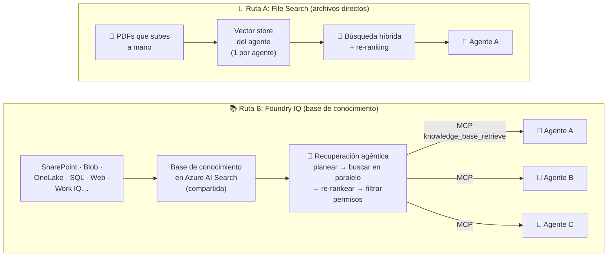
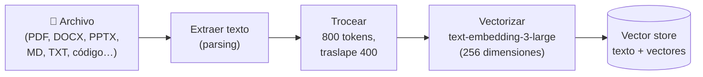
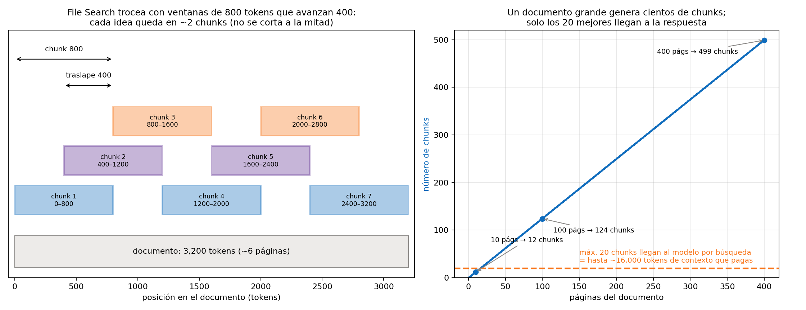
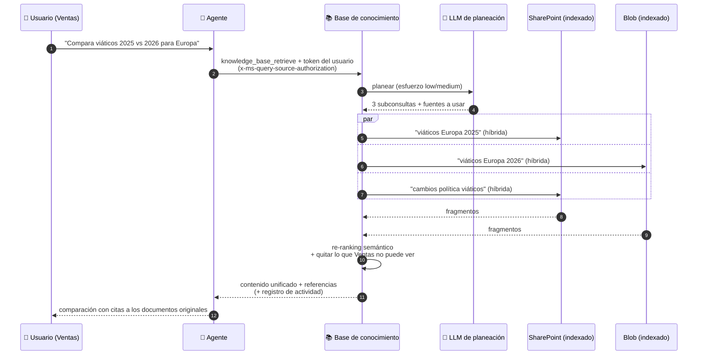
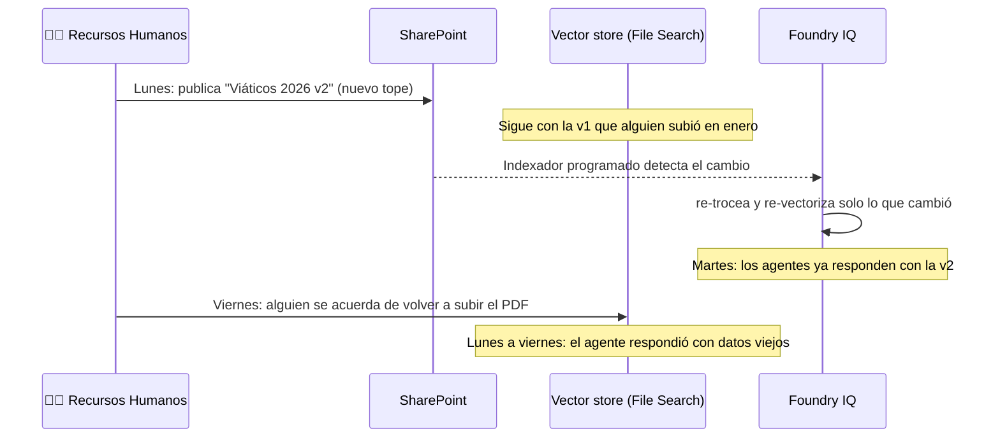
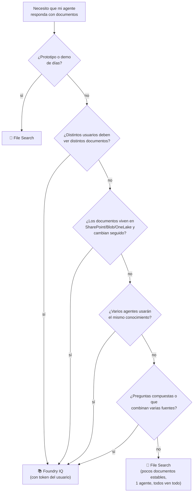

# Tema 3: Qué diferencia hay técnicamente y en respuesta entre usar Foundry IQ y cargar archivos directo al agente de Microsoft Foundry

**Objetivo:** Entender qué pasa por dentro cuando subes archivos directo a un agente (herramienta **File Search**) y cuando lo conectas a una base de conocimiento de **Foundry IQ**: cómo se trocea e indexa el contenido, cómo se busca, cuánto contexto llega al modelo, cómo se manejan permisos y frescura, cuánto cuesta y, sobre todo, **cómo cambia la respuesta** que recibe el usuario. Al final hay preguntas tipo examen.

Lectura oficial: [¿Qué es Foundry IQ? – Microsoft Learn](https://learn.microsoft.com/es-es/training/modules/get-started-foundry-iq/2-explore-foundry-iq)

> [!NOTE]
> Qué es Foundry IQ y cómo se compara con Work IQ está en el [Tema 1](./tema1.md); el tutorial paso a paso para conectar Foundry IQ a un agente, en el [Tema 4](./tema4.md); y los fundamentos de chunking, embeddings y búsqueda híbrida, en la [Parte 1, Módulo 7](../../parte1/modulo7/tema1.md). Aquí nos enfocamos en **comparar las dos rutas lado a lado**.

En Foundry hay dos formas comunes de darle documentos a un agente:
1. **Cargar archivos directo al agente** (herramienta **File Search**, en el portal *Knowledge → Files*): subes PDFs al agente y Foundry crea un **vector store** solo para él.
2. **Conectar una base de conocimiento de Foundry IQ**: una capa de conocimiento **compartida** sobre Azure AI Search, con varias fuentes y **recuperación agéntica**, que el agente usa como **herramienta MCP**.

**Analogía:** cargar archivos al agente es como darle a un empleado una **carpeta personal** con 20 documentos fotocopiados: la lee rápido, pero si alguien actualiza el original, su copia sigue vieja, y cualquiera que le pregunte recibe lo que hay en la carpeta. Foundry IQ es darle acceso a la **biblioteca corporativa con bibliotecario**: miles de documentos de distintas áreas, conectados a los originales, compartidos por todos los empleados y que solo muestran lo que cada quien tiene permiso de ver.

---

## 1. Las dos rutas en un diagrama



La diferencia de fondo: en la ruta A **el conocimiento pertenece al agente**; en la ruta B **el conocimiento es un recurso de la organización** que los agentes consumen.

---

## 2. Ruta A por dentro: File Search

### 2.1 Qué hace Foundry cuando subes un archivo



Valores por defecto que documenta Microsoft:

| Ajuste | Valor |
|---|---|
| Tamaño de chunk | **800 tokens** |
| Traslape entre chunks | **400 tokens** |
| Modelo de embeddings | **text-embedding-3-large** a **256 dimensiones** |
| Máximo de chunks que llegan al modelo | **20** |



¿Por qué el traslape? Si una regla importante cae justo en el corte entre dos chunks, el traslape garantiza que quede **completa** en al menos uno. El precio: cada idea se guarda ~2 veces.

¿Y por qué importa el máximo de 20? Porque un manual de 400 páginas genera ~500 chunks, pero **solo los 20 mejores** llegan al modelo en cada búsqueda. Si la respuesta necesita información repartida en 40 lugares del documento, una sola búsqueda **no la alcanza a ver completa**. Y esos 20 chunks (hasta ~16,000 tokens) se pagan como tokens de entrada en cada llamada.

### 2.2 Qué hace cuando el usuario pregunta

1. **Reescribe** la pregunta para que funcione mejor como búsqueda.
2. **Descompone** las preguntas complejas en búsquedas paralelas.
3. Ejecuta **búsqueda híbrida** (palabras clave + vectores) sobre el vector store.
4. **Re-rankea** y entrega los fragmentos más relevantes al modelo, que responde con **anotaciones de cita** al archivo.

> [!NOTE]
> File Search **no es** "solo búsqueda vectorial ingenua": también reescribe, descompone y re-rankea. La diferencia con Foundry IQ no es que uno sea "tonto" y el otro "listo", sino **dónde vive el conocimiento**, **cuántas fuentes** puede combinar, **quién puede ver qué** y **qué tan fresco** está.

### 2.3 Dónde se guardan los datos: configuración básica vs. estándar

| | **Configuración básica** | **Configuración estándar** |
|---|---|---|
| Archivos | Almacenamiento administrado por Microsoft | **Tu** cuenta de **Azure Blob Storage** |
| Vector store | Recurso de búsqueda administrado por Microsoft | **Tu** recurso de **Azure AI Search** |
| Código | Idéntico | Idéntico |
| Cuándo | Prototipos | Cuando necesitas control de los datos, red privada o cumplimiento |

### 2.4 Límites que debes conocer

| Límite | Valor |
|---|---|
| Tamaño máximo por archivo | **512 MB** |
| Tokens máximos por archivo | **5,000,000** |
| Archivos por vector store | **10,000** |
| Vector stores por agente | **1** |
| Vector stores por conversación | **1** |
| Vida de un vector store creado para una **conversación** | Expira **7 días** después de su última actividad; después, las ejecuciones fallan hasta que lo recrees |
| Aislamiento por usuario | **No existe**: todos los usuarios del proyecto comparten los vector stores configurados |

### 2.5 El código (`agente_archivos.py`)

```python
# pip install "azure-ai-projects>=2.0.0" azure-identity python-dotenv
import os
from pathlib import Path
from dotenv import load_dotenv
from azure.identity import DefaultAzureCredential
from azure.ai.projects import AIProjectClient
from azure.ai.projects.models import FileSearchTool, PromptAgentDefinition

load_dotenv()
project = AIProjectClient(endpoint=os.environ["FOUNDRY_PROJECT_ENDPOINT"],
                          credential=DefaultAzureCredential())
openai = project.get_openai_client()      # archivos y vector stores van por {endpoint}/openai/v1

# 1) Crear el vector store y subir los archivos (espera a que terminen de procesarse)
vector_store = openai.vector_stores.create(name="politicas-viajes")
for ruta in ["politica_viaticos_2026.pdf", "politica_cancelaciones.pdf"]:
    with Path(ruta).open("rb") as f:
        archivo = openai.vector_stores.files.upload_and_poll(vector_store_id=vector_store.id, file=f)
        print(ruta, "→", archivo.status)

# 2) Crear el agente con la herramienta File Search apuntando a ESE vector store
agente = project.agents.create_version(
    agent_name="agente-viajes-archivos",
    definition=PromptAgentDefinition(
        model=os.environ["FOUNDRY_MODEL_NAME"],
        instructions=("Responde en español de México sobre políticas de viajes usando SOLO los archivos. "
                      "Cita el archivo de cada afirmación. Si no está en los archivos, dilo."),
        tools=[FileSearchTool(vector_store_ids=[vector_store.id])],
    ),
)

# 3) Preguntar
conversacion = openai.conversations.create()
r = openai.responses.create(
    conversation=conversacion.id,
    input="¿Cuánto me pagan de hotel en un viaje a Madrid?",
    extra_body={"agent_reference": {"name": agente.name, "type": "agent_reference"}},
)
print(r.output_text)
```

**Explicación:**
- `upload_and_poll` sube el archivo y espera a que el chunking y los embeddings terminen. Si preguntas antes de que el vector store esté `completed`, la respuesta puede ignorar el archivo.
- El conocimiento queda **amarrado al vector store**: para que otro agente lo use, tienes que pasarle el mismo `vector_store_id`, y si el PDF original cambia, **tú** tienes que volver a subirlo.
- Rol necesario para subir archivos en la configuración estándar: **Storage Blob Data Contributor** sobre la cuenta de almacenamiento del proyecto.

---

## 3. Ruta B por dentro: Foundry IQ

### 3.1 Lo que cambia respecto a File Search



Diferencias técnicas clave:
- **Muchas fuentes, una interfaz:** la base agrupa fuentes **indexadas** (se copian a AI Search y se sincronizan con ejecuciones programadas del indexador) y **remotas** (se consultan en vivo, sin copiar).
- **Planeación con LLM configurable:** el **esfuerzo de razonamiento** `minimal` (sin LLM, más rápido), `low` (planea y elige fuentes) o `medium` (además, una pasada iterativa).
- **Permisos por usuario:** el agente envía el token del usuario en el encabezado `x-ms-query-source-authorization`, y la base filtra los resultados con las **ACL** sincronizadas y las etiquetas de **Purview**.
- **Respuesta estructurada:** siempre devuelve el **contenido fusionado**; opcionalmente las **referencias** a las fuentes y un **registro de actividad** (qué subconsultas fueron a qué fuente), útil para depurar.
- **Citas a los originales:** las fuentes de Blob devuelven la URL del documento original; las remotas, como SharePoint remoto y Web, no siempre traen URL de cita.

### 3.2 Pasar la identidad del usuario (lo que no hace el Tema 4)

```python
# Fragmento: el agente declara un encabezado que se llena por petición con el token del usuario.
# Continúa el código del Tema 4 (os, project, openai y mcp_endpoint ya están definidos).
from azure.ai.projects.models import MCPTool, PromptAgentDefinition, StructuredInputDefinition

herramienta_kb = MCPTool(
    server_label="knowledge-base",
    server_url=mcp_endpoint,                       # {search}/knowledgebases/{kb}/mcp?api-version=...
    require_approval="never",
    allowed_tools=["knowledge_base_retrieve"],
    project_connection_id="kb-politicas-viajes",
    headers={"x-ms-query-source-authorization": "{{search_auth_token}}"},
)

agente = project.agents.create_version(
    agent_name="agente-viajes-iq",
    definition=PromptAgentDefinition(
        model=os.environ["FOUNDRY_MODEL_NAME"],
        instructions="Usa la base de conocimiento, cita las fuentes y di 'no lo sé' si no hay evidencia.",
        tools=[herramienta_kb],
        structured_inputs={
            "search_auth_token": StructuredInputDefinition(
                description="Token de Azure AI Search del usuario que pregunta",
                required=True, schema={"type": "string"},
            )
        },
    ),
)

# En cada petición: el token del usuario que inició sesión (en una app real, vía On-Behalf-Of)
token_usuario = obtener_token_del_usuario_para("https://search.azure.com/.default")  # función de tu app (MSAL)
r = openai.responses.create(
    input="¿Cuál es el presupuesto de viáticos de Dirección?",
    extra_body={"agent_reference": {"name": agente.name, "type": "agent_reference"},
                "structured_inputs": {"search_auth_token": token_usuario}},
)
```

> [!WARNING]
> Si **no** mandas el token del usuario, las fuentes con permisos devuelven resultados **sin filtrar**. Es decir: Foundry IQ **puede** respetar permisos por usuario, pero solo si tu aplicación le dice **quién** está preguntando. Cuando el usuario llega directo al Agent Service, el servicio puede poner ese encabezado automáticamente con el contexto del usuario.

---

## 4. Diferencias técnicas, lado a lado

| Aspecto | Archivos directos (File Search) | Foundry IQ |
|---|---|---|
| Dónde viven los datos | Vector store del agente (administrado o en tu Blob + AI Search) | Índices de **Azure AI Search** + fuentes remotas |
| Fuentes | Archivos que **subes manualmente** | SharePoint, Blob, OneLake, Azure SQL, índices existentes, web, servidores MCP, Fabric, Work IQ… |
| Tipos de archivo | PDF, DOCX, PPTX, MD, TXT, HTML, JSON, código… | Los de cada fuente (documentos, tablas, páginas web, datos de Fabric) |
| Alcance | **1 vector store por agente** | **Compartido** por muchos agentes, apps y Copilot Studio |
| Indexación | Automática al subir (800/400 tokens, embeddings de 256 dim.) | Automática y **programada** sobre las fuentes indexadas; las remotas se consultan en vivo |
| Actualización | **Tú** vuelves a subir los archivos | Se **sincroniza** con la fuente de verdad |
| Búsqueda | Reescritura + descomposición + híbrida + re-ranking | Lo mismo **+ planeación con LLM**, **selección de fuentes** e iteración (`medium`) |
| Contexto que llega al modelo | Hasta **20 chunks** | Contenido fusionado y re-rankeado de **varias fuentes** |
| Permisos | Los del agente: **todos ven lo mismo** | **Por usuario** (ACL + Purview) si envías el token del usuario |
| Citas | Al **archivo** subido (`file_id` / nombre) | Al **documento original** (URL de Blob, sitio de SharePoint…) cuando la fuente lo permite |
| Depuración | Ver qué chunks se recuperaron | **Registro de actividad**: subconsultas, fuentes y parámetros |
| Gobernanza | Por agente | Centralizada por **dominio de negocio** |
| Conexión al agente | Herramienta **File Search** integrada | Herramienta **MCP** (`knowledge_base_retrieve`) |
| Costo | Tokens + **almacenamiento del vector store por GB/día** (1 GB gratis) | Nivel de **Azure AI Search** + tokens de recuperación (con cuota gratuita mensual) + tokens del LLM de planeación |
| Complejidad | Baja: listo en minutos | Mayor: servicio de búsqueda, roles, conexión MCP |
| Estado | Disponible | Mezcla de **GA** (recuperación extractiva `minimal`) y **preview** (planeación con LLM, síntesis de respuesta) |

---

## 5. Diferencias en la respuesta: el mismo agente, dos rutas

Imagina el mismo agente de viajes de la *Distribuidora Río Claro* con el mismo modelo y las mismas instrucciones. Solo cambia de dónde saca el conocimiento. Las respuestas son ilustrativas:

**Pregunta compuesta:** *"Compara la política de viáticos de 2025 con la de 2026 y dime qué cambió para viajes a Europa."*

| | Archivos directos | Foundry IQ |
|---|---|---|
| Qué pasa | Hace una o pocas búsquedas; si los 20 mejores chunks son casi todos de 2026, la parte de 2025 queda fuera | El planeador separa "2025", "2026" y "cambios", busca en paralelo y re-rankea el conjunto |
| Respuesta típica | *"En 2026 el tope de hospedaje en Europa es de 180 € por noche [politica_viaticos_2026.pdf]. No encontré información de 2025."* | *"El tope de hospedaje en Europa subió de 150 € a 180 € por noche y ahora se exige reservar con la agencia autorizada [Viáticos 2025, sección 4.2][Viáticos 2026, sección 4.2]."* |

**Pregunta con permisos:** *"¿Cuál es el presupuesto de viáticos de Dirección?"* (documento restringido a Dirección)

| Quién pregunta | Archivos directos | Foundry IQ (con token del usuario) |
|---|---|---|
| Alguien de Dirección | ✅ Responde | ✅ Responde |
| Alguien de Ventas | ⚠️ **También responde**: el archivo está en el vector store del agente | ✅ *"No encontré esa información"*: el fragmento se filtró antes de llegar al modelo |

**Resumen de comportamiento por tipo de pregunta:**

| Pregunta del usuario | Archivos directos | Foundry IQ |
|---|---|---|
| Simple, una fuente: "¿Cuántos días de vacaciones tengo?" | ✅ Responde bien | ✅ Responde bien |
| Compuesta (comparar, varios aspectos) | ⚠️ Puede quedarse con una parte | ✅ Subconsultas + fusión |
| Varias fuentes: "¿Qué dice la política y qué gastos registré el mes pasado?" | ❌ Solo ve los archivos subidos | ✅ Consulta SharePoint + base de datos |
| Información que cambió ayer | ❌ Solo si alguien volvió a subir el archivo | ✅ Si la fuente está sincronizada o es remota |
| Documento confidencial | ⚠️ Lo ve cualquiera que use el agente | ✅ Solo si el usuario tiene permiso |
| Respuesta muy amplia ("resume todo el manual") | ⚠️ Solo 20 chunks: resumen parcial | ⚠️ También es recuperación, no lectura completa: para resumir un documento entero es mejor procesarlo directo |
| Citas | ✅ Al archivo subido | ✅ A la fuente original |
| Latencia | ⚡ Menor | 🐢 Mayor con planeación LLM (`low`/`medium`); similar con `minimal` |

---

## 6. Frescura: qué pasa cuando cambia el documento



Con File Search, la frescura depende de **un proceso humano**. Con Foundry IQ, de un **indexador programado** (o es inmediata en fuentes remotas).

---

## 7. Costos: estructura, no solo precio

| Concepto | File Search | Foundry IQ |
|---|---|---|
| Costo fijo | Ninguno relevante (1 GB de vector store gratis) | Nivel del servicio de **Azure AI Search** (hay nivel gratuito para pruebas) |
| Almacenamiento | **Por GB por día** de vector store | Incluido en la capacidad del nivel de AI Search |
| Por pregunta | Tokens del modelo, incluidos los chunks recuperados (hasta ~16k tokens) | Tokens de recuperación de AI Search (con cuota gratuita mensual) + tokens del LLM de planeación + tokens del modelo del agente |
| Escala con… | Número de agentes × copias de los mismos archivos | Número de bases y fuentes (compartidas) |

Ejemplo de la documentación de Azure AI Search: **2,000 recuperaciones** con gpt-4o-mini, 3 subconsultas por plan y 50 chunks re-rankeados por subconsulta cuestan **≈ $4.32 USD** ($3.30 de re-ranking + $1.02 de planeación), sin contar la respuesta del agente.

> [!TIP]
> El costo oculto de File Search no aparece en la factura: **cinco agentes con cinco copias** del mismo manual son cinco cosas que actualizar, cinco lugares donde puede haber una versión vieja y cinco respuestas que pueden contradecirse.

---

## 8. Cuándo usar cada uno



- **Archivos directos (File Search):**
  - Prototipos, demos y pruebas de concepto.
  - Pocos documentos **estables** (un manual, unas FAQ).
  - Un solo agente; **todos los usuarios pueden ver todo**.
  - El usuario sube **su propio** archivo en la conversación ("analiza este contrato").
- **Foundry IQ:**
  - Producción empresarial con muchos documentos y varias fuentes.
  - Varios agentes que comparten conocimiento por dominio ("Finanzas", "RR. HH.").
  - Se requieren **permisos por usuario**, **frescura** y gobernanza central.
  - Preguntas complejas que se benefician de la **recuperación agéntica**.

### Migrar de File Search a Foundry IQ

Es el camino natural: se empieza con archivos para validar la idea y se migra cuando el agente va a producción.

1. Mueve los documentos a su **fuente de verdad** (un sitio de SharePoint o un contenedor de Blob con dueño).
2. Crea la **base de conocimiento** con esa fuente y agrúpala por **dominio**.
3. Asigna roles: **Search Index Data Reader** a la identidad del proyecto ([Tema 4](./tema4.md)).
4. Cambia la herramienta del agente: quita `FileSearchTool` y agrega el `MCPTool` con `knowledge_base_retrieve`.
5. Ajusta las **instrucciones** (cuándo recuperar, cómo citar, qué decir sin evidencia).
6. Corre **las mismas preguntas de prueba** con ambas versiones y compara exactitud, citas, permisos y latencia.
7. Borra el vector store viejo para no pagar almacenamiento ni dejar copias desactualizadas.

---

## 9. Errores típicos

| Síntoma | Ruta | Causa | Solución |
|---|---|---|---|
| El agente ignora los archivos | File Search | Falta la herramienta o el `vector_store_id` | Verifica `file_search` en la definición; prueba `tool_choice="required"` |
| Responde sin el archivo recién subido | File Search | El vector store aún no está `completed` | Usa `upload_and_poll` o consulta el estado antes de preguntar |
| Las ejecuciones de una conversación vieja fallan | File Search | El vector store de la conversación **expiró** (7 días sin uso) | Recréalo con los mismos archivos |
| Usuarios ven documentos que no deberían | File Search | No hay aislamiento por usuario | Separa agentes o migra a Foundry IQ con permisos |
| **401/403** de Azure AI Search | Foundry IQ | La identidad del proyecto no tiene **Search Index Data Reader** | Asigna el rol |
| **400/404** en el endpoint MCP | Foundry IQ | Endpoint, nombre de la base o `api-version` incorrectos | Revisa `https://<servicio>.search.windows.net/knowledgebases/<kb>/mcp?api-version=...` |
| Usuarios ven documentos restringidos | Foundry IQ | No se envía el token del usuario | Configura `x-ms-query-source-authorization` |
| El agente no usa la base | Foundry IQ | Falta `knowledge_base_retrieve` en `allowed_tools` o instrucciones débiles | Agrégalo y refuerza las instrucciones |
| Respuestas lentas | Foundry IQ | Esfuerzo `medium` para preguntas simples | Usa `minimal` o `low` |

---

## Para el examen
- "Prototipo rápido con un PDF" → subir el archivo al agente (**File Search**).
- "Conocimiento reutilizable por varios agentes, con permisos y varias fuentes empresariales" → **Foundry IQ**.
- "¿Qué proceso divide la pregunta en subconsultas y busca en varias fuentes?" → **recuperación agéntica**.
- "¿Cómo se conecta una base de Foundry IQ a un agente?" → herramienta **MCP** (`knowledge_base_retrieve`).
- "¿Dónde guarda los archivos File Search?" → en un **vector store** (administrado o, en la configuración estándar, en tu Blob y AI Search).
- "Si un documento cambia, ¿qué ruta se actualiza sola?" → **Foundry IQ** (fuentes sincronizadas o remotas).

## Preguntas tipo examen

<details>
<summary><b>1.</b> Un desarrollador quiere probar en una tarde si un agente puede contestar preguntas sobre un manual de 30 páginas. ¿Qué opción usa?</summary>

**Subir el archivo al agente (File Search)**: crea un vector store automáticamente, sin configurar Azure AI Search ni roles adicionales. Es la opción para prototipos.
</details>

<details>
<summary><b>2.</b> Tres agentes (finanzas, instalaciones y vacaciones) necesitan las mismas políticas de SharePoint, que se actualizan cada mes. ¿Qué opción evita duplicar trabajo e inconsistencias?</summary>

**Foundry IQ**: una base de conocimiento por dominio, sincronizada con SharePoint y compartida por los tres agentes como herramienta MCP. Una mejora en la base beneficia a todos.
</details>

<details>
<summary><b>3.</b> En un agente con File Search, un empleado de Ventas obtiene datos de un documento que solo debería ver Dirección. ¿Por qué?</summary>

Porque File Search **no tiene aislamiento por usuario**: todos los usuarios del agente comparten el mismo vector store. Para filtrar por usuario se necesita **Foundry IQ** con fuentes que sincronizan ACL y el **token del usuario** en la consulta.
</details>

<details>
<summary><b>4.</b> ¿Qué hace la recuperación agéntica de Foundry IQ que mejora las preguntas compuestas?</summary>

**Planea** la pregunta con un LLM, la divide en **subconsultas**, elige las fuentes, busca **en paralelo**, **re-rankea** semánticamente y devuelve un resultado unificado **con referencias**.
</details>

<details>
<summary><b>5.</b> Se actualizó la política de viáticos en SharePoint. ¿Qué pasa con cada opción?</summary>

**File Search:** sigue respondiendo con la versión vieja hasta que alguien **vuelva a subir** el archivo. **Foundry IQ:** se actualiza con la siguiente ejecución del **indexador** (fuente indexada) o de inmediato (fuente remota).
</details>

<details>
<summary><b>6.</b> ¿Cuántos vector stores puede tener asignados un agente con File Search?</summary>

**Uno** (y una conversación, también uno). Cada vector store admite hasta **10,000 archivos**.
</details>

<details>
<summary><b>7.</b> Un agente conectado a Foundry IQ devuelve 403 al probarlo en el Playground. ¿Qué falta?</summary>

El rol **Search Index Data Reader** para la **identidad administrada del proyecto** en el servicio de **Azure AI Search**.
</details>

<details>
<summary><b>8.</b> ¿Por qué un agente con File Search puede dar un resumen incompleto de un manual de 400 páginas?</summary>

Porque es **recuperación**, no lectura completa: el manual se trocea en cientos de chunks y solo los más relevantes (**máximo 20**) llegan al modelo. Para resumir un documento entero conviene procesarlo por partes o con otra estrategia.
</details>

<details>
<summary><b>9.</b> Un usuario sube su propio contrato en la conversación y pide "revisa las cláusulas de penalización". ¿File Search o Foundry IQ?</summary>

**File Search** (adjunto de la conversación): es un documento **del usuario**, de una sola conversación, que no forma parte del conocimiento institucional.
</details>

<details>
<summary><b>10.</b> ¿Qué tipos de búsqueda soportan ambas rutas?</summary>

Ambas hacen búsqueda **híbrida** (palabras clave + vectores) con **re-ranking**. Foundry IQ agrega la **planeación con LLM**, la **selección de fuentes** y la combinación de **varias fuentes** indexadas y remotas.
</details>

## Recursos
- [¿Qué es Foundry IQ? (módulo de Learn de la AI-901)](https://learn.microsoft.com/es-es/training/modules/get-started-foundry-iq/2-explore-foundry-iq)
- [File Search tool for Foundry agents (chunking, límites, configuración básica vs. estándar, código)](https://learn.microsoft.com/en-us/azure/foundry/agents/how-to/tools/file-search)
- [Connect a Foundry IQ knowledge base to Foundry Agent Service (MCP, roles, permisos por usuario)](https://learn.microsoft.com/en-us/azure/foundry/agents/how-to/foundry-iq-connect)
- [What is Foundry IQ? – Microsoft Foundry](https://learn.microsoft.com/en-us/azure/foundry/agents/concepts/what-is-foundry-iq)
- [Agentic retrieval overview – Azure AI Search (facturación, salida, latencia, GA vs. preview)](https://learn.microsoft.com/en-us/azure/search/agentic-retrieval-overview)
- [Knowledge sources – Azure AI Search (indexadas vs. remotas)](https://learn.microsoft.com/en-us/azure/search/agentic-knowledge-source-overview)
- [Precios de Foundry Agent Service](https://azure.microsoft.com/es-mx/pricing/details/foundry-agent-service/) · [Precios de Azure AI Search](https://azure.microsoft.com/es-mx/pricing/details/search/)
