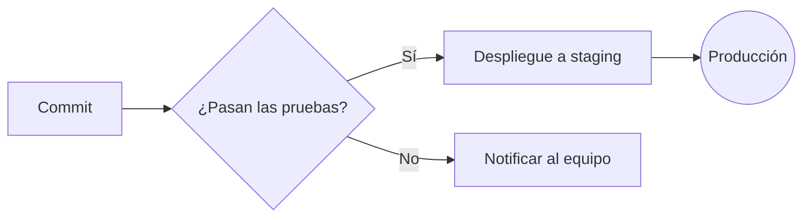
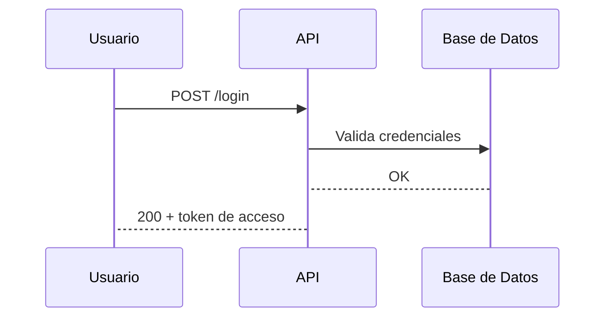
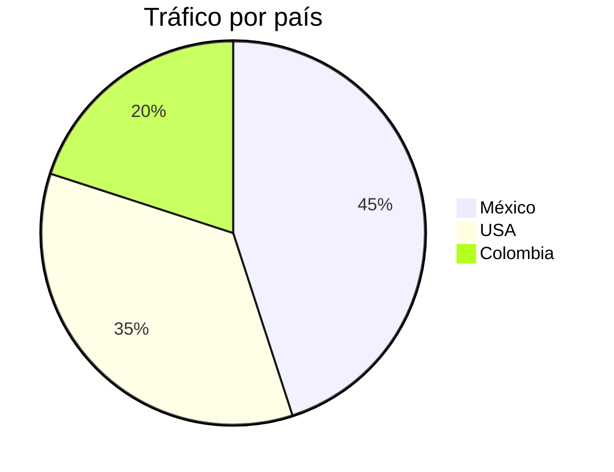

Este es el primer parrafo
Esta linea se pega al párrafo anterior.

Este ya es un segundo párrafo porque tiene un salto de linea más.

PAra fortzar un salto de linea sin cambiar de parrafo\  
puedes poner una diagonal invertida

# Titulo principal (h1)
## Sección (h2)
### Subsección (h3)
#### Nivel 4 (h4)
##### Nivel 5 (h5)
###### Nivel 6 (h6)

*cursivas* o _cursivas. Si puedo poner más de una palabra_
**negrita** o __negritas__
***negrita y cursiva***
___negrita y cursiva___
~~textotachado~~
**Puedes _combinar_ estos ~~estilos~~ como quieras**

- Elemento 1
- Elemento 2
- Elemento 3

+ Elemto 1
+ Elemento2

* Elemento 1
* Elemento 2

## Instrucciones
1. Clonar el repo
2. Instalar las bibliotecas
3. Ejecutar las pruebas

1. Agente de IA
   1. Modelo Gpt 5
   2. Herramientas:
      1. Web Search
      2. A2A
      3. MCP
   3. RAG:
        - Work IQ
        - PDF
        - Foundry IQ

- [x] Diseñar mi proyecto
- [ ] Escribir la propuesta
- [ ] Escribir los archivos de IA

https://learn.microsoft.com/en-us/credentials/certifications/exams/ai-901/

[Más referencias aquí](https://learn.microsoft.com/en-us/credentials/certifications/exams/ai-901/)

[Ir a la sección](#titulo-principal-h1)


| Producto                      | Categoria   | Precio      |
|:------------------------------|:-----------:|------------:|
| Mac Studio M5 Max 512GB 16 TB | Computadora | 737,000 MXN |
| Chicles                       | Dulces      | 2 MXN       |

> Esta es una cita
> El respeto al derechoi ajeno es la paz
> - Albert Einsteinm
>
> Este tiene más espacio
>> Esta es una cita dentro de otra cita
>> Esta también

\# Este no es un encabezado

Ejecuta el comando `python test.py` antes de aplicar cambios


```bash
az login
az login
```

```python
def saludar(nombre):
   return f"Hola, {nombre}"
```
---

$$
x = \frac{\alpha}{b}
$$

## Diagramas





